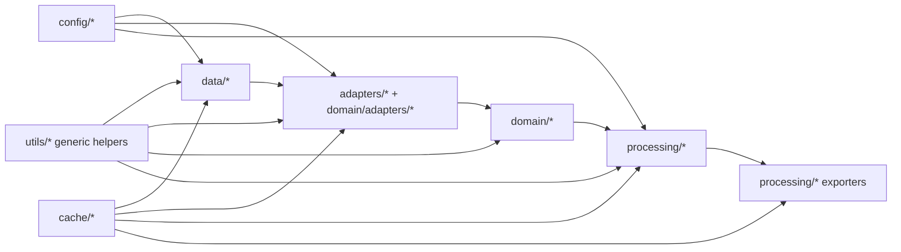

# Phase 1 - Architecture Consolidation

## Objective

Phase 1 aimed to stabilize the project architecture so functional development can continue on top of a clear, layered foundation.

The main target was not a perfect architecture, but a sufficiently consolidated structure with:

- explicit domain models;
- centralized configuration;
- reusable cache infrastructure;
- cleaner module responsibilities;
- predictable dependency direction.

## Scope

Phase 1 scope covered:

- domain consolidation (entities, value objects, MapData aggregate);
- adapter boundaries for external GIS technologies;
- centralized configuration via config package;
- reusable cache infrastructure for multiple artifact types;
- utils reorganization toward generic helpers;
- architecture cleanup and dependency review.

## Final Status

Current repository state is compatible with Phase 1 closure goals.

Confirmed:

- domain package exists with entities and value objects;
- adapters exist to convert external GIS data into domain structures;
- configuration is centralized in config modules and accessed through typed models/settings;
- cache infrastructure is centralized and reused across providers, adapters, processing, and exports;
- no internal circular imports were detected in osm2terrn package;
- relevant cross-layer tests pass.

Open items remain, but they are currently classified as non-blocking technical debt for Phase 2.

## Structure

Simplified current structure:

```text
osm2terrn/
  adapters/
  app/
  cache/
  cli/
  config/
  data/            # providers / acquisition
  domain/
    adapters/      # technology-to-domain translation
    entities/
    value_objects/
  processing/
    network/
    roads/
    terrain/
    otc/
  tools/
  utils/
```

## Architectural Flow



Notes:

- exporters are currently implemented mostly under processing submodules;
- a dedicated exporters package remains a planned evolution, not a Phase 1 requirement.

## Key Decisions in Phase 1

1. Introduce domain-level entities and value objects as canonical internal representations.
2. Add adapter functions that translate GeoDataFrame-like inputs to domain aggregates.
3. Centralize runtime/project configuration under config models and settings accessors.
4. Standardize cache access through cache manager + serializers + metadata.
5. Keep utils focused on generic geometry, hashing, I/O, and logging helpers.
6. Preserve backward compatibility shims for selected legacy imports to reduce migration risk.

## Dependency Review Summary

### CRITICAL

- None identified at closure time.

Rationale:

- no internal circular dependency found by static import graph scan;
- relevant architecture/config/cache/processing/export tests pass.

### IMPORTANT

1. GIS imports still appear inside processing road modules.
   - Impact: technology concerns are not fully isolated to provider/adapter boundaries.
   - Postponement reason: extracting these concerns now would require broader refactoring of road processing internals.
   - Recommended phase: Phase 2.

2. Exporters are distributed under processing modules instead of a dedicated exporters package.
   - Impact: export contract boundaries are less explicit than desired long-term.
   - Postponement reason: does not block current outputs and tests; migration should align with Processing Pipeline definition.
   - Recommended phase: Phase 2.

### TECHNICAL DEBT

1. Module-level configuration snapshots (`_PROGRAM_CONFIG`, `_PROJECT_CONFIG`) remain in several modules.
   - Impact: dynamic reconfiguration and test isolation can be harder in edge cases.
   - Postponement reason: patterns are stable and tested; replacing globally would be cross-cutting.
   - Recommended phase: Phase 2.

2. Legacy compatibility shims remain (for example backward-compatible domain aliases and legacy config fields).
   - Impact: extra maintenance surface and naming noise.
   - Postponement reason: keeps migration safe for existing callers.
   - Recommended phase: Phase 2 or 3.

3. Domain adapters currently live under domain package while importing GIS types.
   - Impact: conceptual purity is slightly reduced, despite explicit adapter intent.
   - Postponement reason: accepted transitional compromise to keep processing domain-first.
   - Recommended phase: Phase 2.

4. Environment-variable handoff in CLI flow is still used for place/origin runtime metadata.
   - Impact: hidden state channel across steps.
   - Postponement reason: behavior is stable and covered by existing workflows.
   - Recommended phase: Phase 2.

## Validation of Phase 1 Goals

### 1) Domain model

Status: Achieved.

- Entities and value objects exist and are used as core project representations.
- MapData aggregate exists and is exercised in tests.

### 2) Adapters

Status: Achieved with known exceptions.

- OSM/GeoDataFrame to domain conversion adapters exist.
- External GIS libraries are still present in some processing modules (tracked as debt, not closure blockers).

### 3) Centralized configuration

Status: Achieved.

- Configuration package is established and reused widely.
- Remaining module-level config snapshots are tracked as debt.

### 4) Cache system

Status: Achieved.

- Reusable cache manager infrastructure exists.
- Cache is already used for OSM, elevation, intermediate domain conversion, terrain/export artifacts.

### 5) Utils reorganization

Status: Achieved.

- utils package is focused on generic support concerns (geometry, hashing, I/O, logger).
- No critical domain/export business logic concentration found in utils.

### 6) Responsibility separation

Status: Achieved with evolution opportunities.

- Main flow direction is preserved.
- Some technology-specific processing internals remain and are explicitly queued for Phase 2 cleanup.

## Tests Executed

Executed command:

```text
python -m pytest tests/test_domain_architecture.py tests/test_pipeline_domain_state.py tests/test_processing_domain_bridge.py tests/test_domain_adapters_cache.py tests/test_cache_controls.py tests/test_cache_infrastructure.py tests/test_elevation_cache.py tests/test_heightmap_cache.py tests/test_export_payload_cache.py tests/test_config_precedence.py tests/test_cli_config_overrides.py tests/test_otc_exporter.py tests/test_road_export.py tests/test_export_filename_normalization.py tests/test_road_network_formatter.py
```

Result:

- 42 passed
- 1 skipped
- 0 failed

Warnings observed are deprecation warnings from third-party colormap stack, not regressions introduced by this closure task.

## Explicit Technical Debt for Phase 2

Items intentionally not solved in Phase 1:

1. Definitive consolidation of entities and value objects based on real pipeline pressure.
2. Additional reduction of GIS imports outside provider/adapter boundaries.
3. Progressive reduction of module-level global config snapshots.
4. Definitive exporter contract design and extraction strategy.
5. MapData evolution according to actual processing pipeline usage.
6. New value objects required by processing once pipeline steps are formalized.

## Phase 2 Starting Point

Next phase objective:

**Phase 2 - Processing Pipeline**

Target flow:

```text
Provider
  -> Adapter
  -> MapData
  -> Processing Pipeline
  -> Processed Domain Data
  -> Exporter
```

First recommended steps:

1. Define an explicit processing pipeline contract (inputs, outputs, invariants).
2. Isolate technology-specific processing operations behind clear interfaces.
3. Define exporter interfaces against processed domain outputs.
4. Add integration tests per pipeline stage boundary.

## Closure Criteria Checklist

- [x] Domain model established
- [x] Configuration centralized
- [x] Reusable cache infrastructure in place
- [x] Utils simplified toward generic helpers
- [x] Adapters defined
- [x] Dependency review completed
- [x] Relevant tests executed
- [x] Architecture documentation updated
- [x] Remaining technical debt explicitly registered
- [x] Clear starting point for Phase 2 documented

## Closure Decision

Phase 1 can be considered formally **CLOSED**.

Reason: all closure criteria are met, no known critical blockers remain, and pending items are explicitly scoped as non-blocking technical debt for Phase 2.