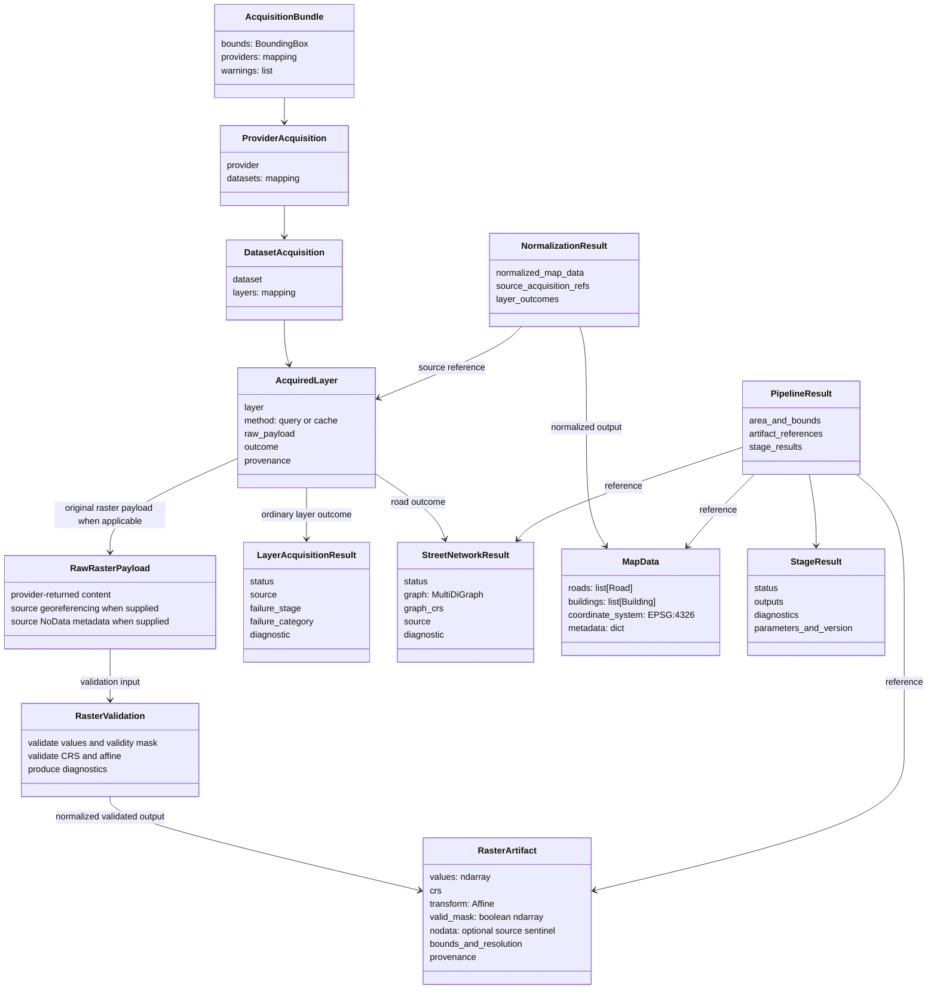
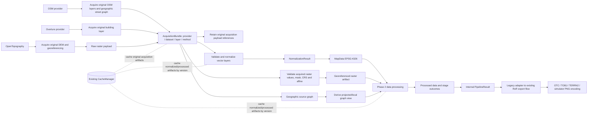

# Phase 2.1.1 — Fundamental Data Contract Specification

## Status and scope

This document specifies the proposed data contracts between acquisition,
normalization, and processing. It is a source-based design specification, not
an implementation record. No functional code, configuration, or exporter is
changed by this specification. Final Rigs of Rods export remains outside the
Phase 2 processing contract.

The current working tree contains local changes. Findings below describe the
source inspected for this specification; they do not attribute authorship or
claim that an unexecuted path works at runtime. Existing tests are listed as
source evidence and are not represented as newly run.

## 1. Verified findings

| Finding | Current evidence | Conclusion for this specification |
|---|---|---|
| There are two classes named `MapData`. | `osm2terrn/app/app_state.py:6-22` is a mutable session holder. `osm2terrn/domain/entities/map_data.py:18-34` is the vector-domain aggregate. | Preserve both responsibilities during migration; do not conflate their contracts. Renaming is explicitly out of scope. |
| The domain aggregate is vector-focused. | `map_data.py:18-34` contains lists of features, bounds, coordinate-system text, elevation-model text, and metadata. `domain/entities/features.py:12-86` defines feature entities. | Keep `MapData` as the normalized vector representation. Do not place full DEM arrays inside it. |
| Street acquisition already has a specialized contract. | `data/street_network.py:22-70` carries status, graph, declared CRS, diagnostic, and source, and validates graph CRS consistency. | Retain `StreetNetworkResult`; target a geographic source graph and derive projected/local views, subject to compatibility with current local-graph consumers. |
| Other OSM layer outcomes already use a status contract. | `data/acquisition.py:8-36` defines `LayerAcquisitionResult` and validates failure details. `data/osm_data_handler.py:259-269, 297-327` builds a heterogeneous bundle with per-layer results. | Reuse these types and make the bundle boundary explicit. Avoid redesigning statuses before checking all callers. |
| Raster data is currently a tuple and a dictionary at different boundaries. | `processing/terrain/elevation_service.py:53-153` reads band, NoData and affine but not CRS/units; its wrapper drops affine and sampler zero-fills invalid samples. `app/app_state.py:12` and `cli/commands.py:70-81` use a dict with array and extrema. | A raster contract and explicit validity semantics are justified; current handoffs cannot distinguish all invalid sample cases. |
| Heightmap processing consumes normalized arrays and returns statistics. | `processing/terrain/heightmap_handler.py:24-67,112-178` normalizes and smooths a NumPy array, writes images, and returns scalar stats/status. | Keep rendered image products and statistics in processing results; keep source DEM metadata with the raster input. |
| The road graph and domain `Road` serve different purposes. | `domain/adapters/osmnx_to_roads.py:37-105` converts a graph to EPSG:4326 features and preserves edge attributes; `processing/network/road_network_export.py` consumes a graph; `processing/roads/road_model.py` represents local metric 3D road points. | The graph is canonical for topology; `MapData.roads` is a geographic feature view; the processing road model is a derived local-coordinate product. Do not collapse them into one class. |
| EPSG:4326 is already enforced in the domain road adapter. | `domain/adapters/osmnx_to_map.py:55-119` rejects road GeoDataFrames outside EPSG:4326 and sets `coordinate_system="EPSG:4326"`. | Adopt the user's canonical geographic-domain CRS decision. Transform only at explicit operation boundaries. |
| Overture has a separate cached acquisition function. | `data/osm_data_handler.py:604-663` returns a GeoDataFrame declared EPSG:4326 and caches it as `buildings_geodataframe`; it does not call `geodataframe_to_buildings` or `build_mapdata_from_pipeline_context`. | Overture-to-domain integration is a real gap. Preserve provider identity and source identifiers when adapting; do not assume it is already integrated. |
| The current orchestrator combines processing and final output. | `processing/orchestrator.py:239-249,335-399,415-429` builds domain state, processes elevation/roads, calls OTC/TERRN2 and returns a dictionary of output paths/statuses. | Define contracts for Phase 2 independently of exporter inputs/outputs; migrate boundaries incrementally without changing exporters in this task. |
| Cache supports typed serialization boundaries and versioned keys/metadata. | `cache/manager.py:18-108`, `cache/metadata.py:14-76`, `cache/serializers.py:12-66`, and `cache/keys.py:49-60` provide serializers, metadata, and key inputs. `CacheManager.get` deserializes but does not compare requested format metadata with the stored `format_version`. | Callers must validate cached artifacts; older formats require explicit adapters or cache misses. Cache entries are storage, not the in-memory orchestration contract. |

### Audit qualifications

The prior audit's conclusions about separate session/domain `MapData`, raster
metadata loss, and broad orchestrator responsibilities are confirmed. Two
qualifications matter for contract design:

1. The current CLI passes `StreetNetworkResult` and layer acquisition results
   separately to `export_terrain_assets` (`cli/commands.py:90-115`); this is
   more structured than treating all acquisition output as an opaque bundle,
   though the original bundle remains a `dict` in session state.
2. `MapData` construction currently adapts roads only. Buildings, including
   Overture buildings, are not passed to the domain adapter in
   `build_mapdata_from_pipeline_context` (`domain/adapters/osmnx_to_map.py:55-119`).

The conclusion that an elevation fetch may be repeated is path-dependent. The
CLI prefetch wrapper discards affine, whereas the road sampler directly loads
the raster (`processing/roads/road_elevation.py:20-32`). The cache can avoid a
second provider request, but it does not guarantee that both consumers share
the same in-memory raster object. Whether this is a material performance issue
depends on cache configuration, bounds/key equality, and runtime path.

## 2. Contract design principles

1. Keep provider libraries at acquisition/adaptation boundaries; domain
   entities remain independent of GeoPandas, Rasterio, and OSMnx.
2. Give each data kind one authoritative representation per stage. Adapters
   may produce derived views but should not silently replace the source of
   truth.
3. Carry CRS and transformation with coordinates/raster values; never infer
   that data was transformed merely because a CRS field was changed.
4. Keep acquisition outcome separate from processing outcome. Empty data,
   not requested, and failed are different states.
5. Preserve source provenance through adaptation and processing.
6. Keep large arrays/graphs in specialized artifacts; an aggregate result
   should reference them and summarize their status, not copy them.
7. Use the existing cache for persisted reuse. Cache serialization/versioning
   is an implementation detail of artifact storage, not a substitute for
   public in-memory contracts.

## 3. Fundamental contracts

The following are conceptual contracts. They do not require new classes in
this specification; existing classes should be reused where identified.

### 3.1 Acquisition Bundle

`AcquisitionBundle` is the conceptual envelope for **provider acquisition
outputs only**. It must not contain normalized `MapData` features. Its
consistent shape is:

| Field | Contract |
|---|---|
| `bounds` | Requested `BoundingBox` in EPSG:4326, with explicit CRS. Keep request bounds distinct from each returned artifact's actual bounds. |
| `providers` | Mapping keyed by provider identity. Each provider entry has an explicit `provider` field and a `datasets` mapping. A provider may expose multiple datasets/products. |
| `datasets` | Mapping keyed by dataset identity. Each dataset entry has an explicit `dataset` field and a `layers` mapping. |
| `layers` | Mapping keyed by layer identity. Each layer entry has an explicit `layer`, `method`, `payload`, `outcome`, and `provenance`. The layer is the acquired information category (for example `building`, `roads`, or `elevation`). |
| `method` | How this payload was obtained: `query`, `cache`, or documented cache recovery. It is not provider, dataset, or layer identity. For a `not_requested` layer with no payload, use no method (`none`/null) consistently with the existing acquisition result; do not invent a query/cache source. |
| `payload` | Original provider/acquisition result in its source representation. Never replace it with normalized domain features. Payload preservation means normalization must not mutate it; the contract keeps an independent source reference. Current OSM geometry acquisition projects results before storing them, so retaining the original provider result is a migration requirement, not current behavior for every layer. |
| `outcome` | Existing `LayerAcquisitionResult` for ordinary layers or `StreetNetworkResult` for roads. Preserve status and diagnostics. Existing `source` values (`query`, `cache`, `cache_recovered`) describe acquisition method; map them explicitly to `method` during transition. |
| `warnings` | Non-fatal diagnostics associated with provider/layer/stage. Failures stay in `outcome`, not warnings alone. |

The dimensions are deliberately separate: `provider` answers who supplied
the result; `dataset` identifies the provider dataset/product; `layer`
identifies the feature/raster layer within it; `method` records query versus
cache retrieval. For example, `provider="overture"`,
`dataset="Overture Maps"`, `layer="building"`, and `method="cache"` describe
four different facts. The current `source` field on acquisition results
represents the method (`query`/`cache`), not provider provenance; preserve it
for compatibility and map it explicitly when adopting this envelope. The
recommended nesting is `AcquisitionBundle -> providers -> datasets -> layers`:
it supports multiple independently identified datasets from the same provider
without overloading the provider or layer key.

The EPSG:4326 `bounds` field describes the geographic request area only; it
does not assign EPSG:4326 to every payload. Each vector, graph, or raster
payload retains and declares its own CRS.

Normalization produces a separate result, conceptually
`NormalizationResult`, that references its source acquisition item(s) and
contains domain data such as `MapData`, per-layer normalization outcomes,
warnings, and transformations applied. Normalization must not modify the
original acquisition payload; retain it through a separate reference and
store normalized output separately. Because current payload types are mutable,
this is a processing contract and does not imply intrinsic object
immutability. A processing result then references normalized inputs and emits
derived processing data.

Current compatibility: `download_data_from_bbox` returns bounds, geometry and
network entries plus `acquisition_results`
(`osm2terrn/data/osm_data_handler.py:259-269,562-582`). Overture and elevation
currently have separate acquisition routes. The minimum migration is to
formalize the above provider/dataset/layer/method shape while preserving the
existing dictionary boundary during transition. Do not change cached payload
formats without explicit adapters/version handling.

### 3.2 Normalized geographic domain data

`osm2terrn.domain.entities.MapData` remains the canonical collection of
normalized vector entities. Its `coordinate_system` is EPSG:4326 for geographic
domain coordinates, as already set by `build_mapdata_from_pipeline_context`
(`domain/adapters/osmnx_to_map.py:102-119`). Each entity's geometry uses that
aggregate CRS; no per-feature projection is implied.

The aggregate may contain roads, buildings, railways, water, vegetation,
terrain regions, and intersections. A feature must retain at least:

- stable-in-scope identifier (provider ID where available; otherwise a
  deterministic adapter identifier, not a process memory address);
- geometry in the aggregate CRS;
- normalized domain fields supported by the entity;
- `metadata` with provider, dataset, layer, acquisition method, source feature
  ID, and unnormalized source attributes needed downstream. These are separate
  values, not aliases for a generic `source` field.

`DomainEntity.metadata` is already the extension point
(`domain/entities/base.py:8-20`). Current road adaptation stores source and
OSM attributes and derives `edge_id` from graph endpoints/key
(`domain/adapters/osmnx_to_roads.py:82-85,131-157`), but the building
adapter labels all records as OSM and does not validate/transform input CRS
(`domain/adapters/osmnx_to_buildings.py`). That adapter must not be reused for
Overture unchanged until its source metadata and CRS contract are corrected.

Geometry fidelity and validation at this boundary:

- reject missing/empty or unsupported geometry rather than fabricate a
  placeholder coordinate;
- require a known input CRS, transform to EPSG:4326 explicitly, then record
  the resulting CRS at the aggregate;
- require line geometry to contain at least two distinct usable coordinates;
- apply the explicit support policy in the table below; unsupported geometry
  must be rejected with a diagnostic unless a lossless conversion is explicitly
  defined for that domain mapping;
- preserve the complete topology of accepted polygonal data: exterior ring,
  each interior ring (hole), and every component of multipart geometries;
- preserve geometry family and component association. Flattening rings or
  concatenating multipart coordinates into one `Polygon(points)` is lossy and
  is not an acceptable normalized contract;
- require finite coordinates and stable IDs;
- do not silently discard source attributes that a later phase may need.

| Geometry family | Current representation/evidence | Contract disposition |
|---|---|---|
| `Point` | `Point2D` preserves a coordinate pair; `Intersection.location` uses it. There is no generic point feature entity. (`domain/value_objects/__init__.py:10-33`; `domain/entities/features.py:74-79`) | Supported when the point has a domain-compatible mapping (including intersections); other point layers require an explicit domain mapping. |
| `MultiPoint` | No multipart point value object or feature grouping exists. | Unsupported unless an explicit conversion preserves all points and their shared source-feature identity; otherwise reject with a diagnostic. |
| `LineString` | `Polyline` stores ordered `Point2D` values. Road adapter requires at least two coordinates (`osmnx_to_roads.py:131-150`). | Supported when non-empty and valid. |
| `MultiLineString` | Road adapter currently splits parts into separate roads and suffixes IDs (`osmnx_to_roads.py:135-150`); no multipart grouping field exists. | Explicit support is pending. Do not treat the current split as a lossless supported mapping; until approved, reject with a diagnostic or use a separately documented lossless mapping. |
| Simple `Polygon` without holes | `Polygon` stores one point sequence (`domain/value_objects/__init__.py:72-83`). Building adapter maps an exterior ring, but its entity permits `Polygon | Polyline` (`domain/entities/features.py:27-33`; `domain/adapters/osmnx_to_buildings.py:31-43`). | Supported subject to validity checks and a domain mapping that retains the polygon family. Current Building adapter does not create the `Polygon` value object consistently. |
| `Polygon` with holes | Value object has no interior-ring collection; adapter only reads `geometry.exterior` (`osmnx_to_buildings.py:31-34`). | Reject until a representation preserves every hole. |
| `MultiPolygon` | Building adapter concatenates component coordinates (`osmnx_to_buildings.py:21-30`), losing component boundaries. | Reject until a representation preserves every component and its association. |
| `GeometryCollection` | Building adapter's generic `.geoms` branch concatenates coordinates without preserving family/associations (`osmnx_to_buildings.py:21-36`). | Reject unless an explicit mapping preserves every member and its family/association. |

These dispositions are also validation rules: adapters must accept only a
domain-compatible `Point`, valid `LineString`, or valid simple `Polygon`
without holes under the conditions above. Reject `MultiPoint` unless its
conversion is explicitly lossless; keep `MultiLineString` pending explicit
support; reject polygons with holes and `MultiPolygon` until their full
topology/components can be represented; reject `GeometryCollection` unless a
lossless mapping is explicitly defined. Emit a diagnostic identifying the
geometry family and reason. Do not silently split, flatten, drop rings, or
substitute a placeholder geometry.

The existing tests do not establish Overture polygon-hole or multipart
fidelity. The current `Polygon(points)` and building adapter are insufficient
for those cases. This specification does not add geometry classes; approval of
the support/rejection boundary is required before integrating affected
Overture records.

### 3.3 Raster contract

Raster data is independent of `MapData`. A DEM artifact carries:

| Required item | Meaning / validation |
|---|---|
| `values` | Two-dimensional NumPy array for one band; array shape must equal declared `(height, width)`. |
| `crs` | Parseable CRS describing array coordinates; mandatory for geographic sampling/reprojection. |
| `transform` | Rasterio affine transform from pixel coordinates to CRS coordinates; mandatory when sampling or relating pixels to bounds. |
| `width`, `height` | Must match the array shape. |
| `valid_mask` | Explicit two-dimensional boolean mask with the same shape as `values`. A cell is valid only if its mask is true, its value is finite, and it is not a source NoData value identified during acquisition. This mask is the source of truth for statistics and sampling. |
| `nodata` | Preserve the source NoData sentinel as metadata when defined, even when a validity mask is present. During acquisition, mark the cell invalid if it matches this sentinel. A valid zero elevation remains valid and must not be confused with NoData. |
| `resolution` | Pixel size in CRS units (or derive from affine); units depend on CRS and must not be mislabeled as metres for geographic CRS. |
| `bounds` | Raster extent in raster CRS, derived/checked against transform and dimensions. It is distinct from request bounds. |
| `vertical_units` and vertical datum | Required metadata when guaranteed by the provider; otherwise `unknown`, never inferred from a `m` log string alone. |
| `provenance` | Provider, dataset/DEM type, source/request bounds, query/cache source if known, and acquisition timestamp or cache creation metadata. |
| `statistics` | Optional min/max and other statistics computed only from cells where `valid_mask` is true and the value is finite. If no valid cells exist, statistics are absent and the raster outcome is empty/failed according to the agreed policy; never emit fabricated extrema. |

The loader currently returns array, affine, max and min, while provider CRS,
dimensions, source NoData metadata, vertical units and raster bounds are not
returned in the tuple (`processing/terrain/elevation_service.py:53-131`). The
fetch wrapper dropping affine is the minimum defect the contract must
eliminate. The current extrema use `nanmin`/`nanmax`; these ignore NaN but do
not by themselves exclude infinities or express a validity mask
(`elevation_service.py:64-71`). The target contract defines validity as:

```text
valid_mask[i, j] = True  only when the source mask permits the cell,
                         the value is finite, and it is not identified NoData
valid_mask[i, j] = False for NoData, NaN, infinity, or another documented
                          invalidity condition
```

Compute statistics only over `values[valid_mask]`. Do not substitute zero for
invalid values at this contract boundary. The code does not provide evidence
for a universal fill/interpolation policy, so invalidity stays explicit until
a consumer-specific policy is selected. Avoid resampling in
the data contract: reprojection/resampling is a processing operation with
explicit target CRS, resolution and resampling method.

Heightmap **data processing** consumes this raster contract (or a validated
legacy adapter during migration) and produces a separate processing result:
normalized/smoothed height values or a processed raster artifact, valid mask,
statistics, status, and effective parameters. It may also produce a
visualization/preview product where useful. The Phase 2 boundary ends before
encoding simulator-specific heightmap/groundmap PNGs, writing OTC/TERRN2/TOBJ
files, naming simulator resources, or assembling a Rigs of Rods terrain
package. The current `generate_heightmap_n_texture` combines array processing
with PNG writing (`processing/terrain/heightmap_handler.py:112-178`); preserve
that legacy call path through an adapter until the future export boundary is
approved, but do not define its PNG files as the Phase 2 processing result.

### 3.4 Street graph and `Road` responsibilities

| Representation | Authority and use | CRS/coordinates |
|---|---|---|
| Geographic source graph carried by `StreetNetworkResult` | Target authoritative acquired road topology, nodes, edges, provider attributes and source CRS. It is the source for normalized domain roads and projected/local processing views. | Target CRS is EPSG:4326. The current bbox acquisition transforms the provider graph to local CRS and stores that transformed copy; retaining the original source graph in the future contract is a migration requirement. |
| Projected/local graph view | Derived graph for metric topology operations, road geometry, distance/width calculations, and terrain placement. | CRS declared in graph metadata and `StreetNetworkResult`/processing handoff; never relabel coordinates without transforming them. Regenerate from or retain a traceable link to the geographic source. |
| `domain.entities.Road` in `MapData` | Normalized geographic feature view for domain operations and cross-provider integration. It preserves per-edge feature attributes but is not a substitute for graph topology. | EPSG:4326 per current adapter and agreed domain policy. |
| `processing.roads.road_model.Road` | Derived processed 3D road geometry and parameters for the current terrain/export path. | Local metric coordinates, with elevation and width-related processing data. |

Do not transfer `Road` instances between these roles by name alone. The
processing bridge currently converts local X/Z coordinates to `Point2D` and
assigns an ID from Python `id(road)` (`processing/domain_bridge.py:10-24`);
that is not a stable provenance/identity contract and should not be used as
the source identifier for normalized acquired roads.

Keep three identity namespaces distinct:

| Identity | Identifies | Current evidence and contract |
|---|---|---|
| Source feature ID | The provider feature, such as an OSM way (`osmid` when present). | Preserve the original value and provider-qualified provenance on every derived edge/Road. A way may create multiple graph edges, and edge attributes may carry one or more source IDs; do not assume a one-to-one relationship. |
| Graph edge ID | One topological graph edge. | `graph_to_roads_geodataframe` constructs `edge_id` from `(u, v, key)` (`domain/adapters/osmnx_to_roads.py:72-85`). This identifies an edge, not its source feature. |
| Road entity ID | One normalized `domain.entities.Road`. | `geodataframe_to_roads` currently uses `edge_id`, adding a part suffix when splitting a `MultiLineString` (`osmnx_to_roads.py:131-153`). Keep this behavior during compatibility migration but treat the value as a Road ID namespace; do not imply it equals a source feature ID. |

When one source feature is represented by multiple graph edges or normalized
Road entities, preserve a source-to-edge-to-Road association (including part
identity when applicable). Do not silently reuse an ID across these namespaces
or lose the parent source identity. The exact persistent Road ID and any
fallback generation policy remain implementation choices; preserve provider
identity when available and keep the current adapter behavior compatible until
an explicit migration is approved.

The recommended authority is the geographic source graph, with projected/local
graphs treated as derived views and `MapData.roads` as a separate geographic
feature view. Current evidence and compatibility constraints are:

- `download_data_from_bbox` calls `transform_graph_to_ror` and stores that
  returned local graph in `StreetNetworkResult` (`data/osm_data_handler.py:
  481-504`). The transform copies rather than mutates its input; a handoff
  test verifies the provider graph stays unchanged, but the bundle does not
  retain it (`adapters/coordinate_transform.py:78-127`,
  `tests/test_street_network_integration.py:245-271`).
- `graph_to_roads_geodataframe` accepts the graph's declared CRS and converts
  to EPSG:4326 (`domain/adapters/osmnx_to_roads.py:54-98`).
- `build_roads_from_graph` obtains edge geometry with the declared source CRS
  and projects linework to a local CRS (`data/osm_loader.py:87-111`,
  `processing/network/road_network_export.py:71-105`). Its DEM sampler
  transforms local road bounds to geographic before raster acquisition;
  node sampling transforms graph coordinates to EPSG:4326
  (`processing/roads/road_elevation.py:15-66,86-101`). These functions are
  CRS-aware in source, but their full runtime compatibility was not executed
  in this audit.
- The CLI passes the stored `StreetNetworkResult` directly to the orchestrator
  (`cli/commands.py:90-115`). The bbox bundle cache stores the transformed
  result. The separate `osm_loader.load_graph` path caches a provider graph
  with its declared CRS (`data/osm_loader.py:41-85`).
- Existing integration tests explicitly assert the bbox result is local
  (`tests/test_street_network_integration.py:245-271`), so the target CRS
  change requires test/consumer migration and cache format/version handling.

Transition recommendation: retain the geographic source graph as the
acquisition payload and derive a local view at the consumer boundary where
compatibility requires it. Treat such views as transient by default; cache a
derived view only if measured/reproducible consumer needs justify it. Switch
the `StreetNetworkResult` canonical graph only after compatibility tests
cover domain conversion, road-building, elevation sampling, CLI/orchestrator
handoff and cache recovery. Do not relabel coordinates or keep duplicate
persisted graphs longer than the project-approved transition requires.

### 3.5 CRS and transformations

1. Provider query bounds and normalized domain feature geometry use EPSG:4326.
2. Every acquired GeoDataFrame or graph must declare a valid CRS before
   transformation. Missing CRS is an error at an adapter boundary, not a
   reason to stamp EPSG:4326 onto unknown coordinates.
3. Use `always_xy=True` semantics for transformations between longitude/latitude
   and projected coordinates. Existing geometry helpers and adapters use
   explicit `pyproj` transforms (`utils/geometry/crs.py:37-49`,
   `adapters/coordinate_transform.py:48-113`).
4. Create local projected CRS only for metric operations, such as road widths,
   distances and local terrain coordinates. Preserve the original geographic
   source geometry/graph or make the transformed view explicit.
5. For a raster, transform sample coordinates into the raster CRS before
   applying its affine; alternatively reproject the raster explicitly. Never
   apply a geographic affine to local metres or vice versa.
6. Bboxes must carry CRS. `BoundingBox.reproject` transforms corners and
   returns a projected/geographic flag (`domain/value_objects/__init__.py:192-217`);
   callers must avoid treating `is_projected` as a CRS substitute.
7. Validate CRS equality using parsed CRS objects, as
   `StreetNetworkResult.validate` already does, rather than literal string
   equality.

EPSG:4326 as domain canonical CRS is compatible with the current road adapter.
The current acquired street graph is often already transformed to a local
azimuthal-equidistant CRS (`adapters/coordinate_transform.py:44-46` and
`data/osm_data_handler.py:480-499`); this is an operation-specific graph
representation, not a contradiction of the domain CRS policy.

### 3.6 Overture and provenance

Overture building acquisition currently returns a GeoDataFrame with a declared
EPSG:4326 CRS and a cache entry tagged `provider="overture"` and
`artifact_type="buildings_geodataframe"` (`data/osm_data_handler.py:604-657`).
The output is not currently adapted into `MapData` by the pipeline. The
integration contract is:

1. Keep provider acquisition and caching provider-specific.
2. Validate actual geometry and CRS; do not rely only on assigning a CRS in
   the GeoDataFrame constructor.
3. Adapt Overture buildings to the existing domain `Building` entity where
   its geometry can be represented without material loss.
4. Preserve the distinct provenance dimensions in entity metadata:
   `provider="overture"`, dataset name/version where available,
   `layer="building"`, acquisition method (`query`/`cache`), provider feature
   ID, and source attributes. Do not use one generic `source` field to mean
   provider, dataset, layer and method simultaneously.
5. Use provider-prefixed IDs when a source ID exists (for example
   `overture:<source-id>`). If it does not, generate a deterministic fallback
   from stable source fields and canonical geometry/attributes; never use row
   order or Python object identity as a persistent identity.
6. Record acquisition status separately from normalization status. A
   successful fetch with invalid geometry is a transformation failure, not an
   empty successful layer.
7. Integrate Overture additively alongside OSM in the normalized building
   collection for the initial implementation. Preserve provenance so
   consumers can filter by source. Do not deduplicate or infer equivalence
   between providers initially.

Current compatibility gap: `geodataframe_to_buildings` stamps
`metadata.source="osmnx"`, uses row index as ID, accepts a limited geometry
shape, and is not called from `build_mapdata_from_pipeline_context`. It needs
an adapter path that can express provider provenance before Overture is
integrated; no new domain entity is justified for this alone.

### 3.7 Processing-stage results and `PipelineResult`

Each processing step should report:

- input artifact identity/references;
- outcome state;
- output artifact references or in-memory value;
- diagnostics/warnings;
- effective parameters and algorithm/format version.

**A lightweight, internal `PipelineResult` is recommended as a coordination envelope**
because the CLI currently sends elevation, street graph, acquisition statuses
and bounds as separate arguments, while the orchestrator mutates domain
metadata and returns a dictionary (`cli/commands.py:90-115`,
`processing/orchestrator.py:239-249,296-333,415-429`). It should contain:

- area identity and canonical bounds;
- references to normalized `MapData`, raster input, and specialized street
  result;
- per-layer acquisition outcomes;
- per-stage processing outcomes and diagnostics;
- references to derived artifacts and effective config/provenance identifiers.

It should not contain the whole application session, configuration loader,
provider clients, cache manager, exporter logic, duplicated arrays, or a second
copy of geometry collections. It should not own final Rigs of Rods output
paths as part of the Phase 2 contract.

Compatibility path: do not change `export_terrain_assets`' current signature
as part of this specification. Introduce any eventual result envelope at the
acquisition/processing boundary and adapt it to existing calls until the
pipeline is migrated. It is an internal Phase 2 handoff, not a new public
extension API in this specification.

### 3.8 Status, warning, and error semantics

Retain distinctions already present in acquisition contracts:

| State | Meaning |
|---|---|
| `not_requested` | Configuration intentionally omitted the layer. No failure. |
| `empty` | Acquisition succeeded and returned no usable features. No failure. |
| `available` | Acquisition succeeded with data. |
| `failed` | Requested operation failed; include failure stage/category and diagnostic where contract supports them. |
| `missing` | Expected handoff was absent; distinguish this from provider failure. Already used by street result handling. |

For processing, `available` describes whether an input or output artifact is
present and usable; it is not a stage outcome. A successful stage is
`completed`. Processing stages distinguish `not_started`, `skipped`,
`completed`, `empty`, `partial`, and `failed` where applicable. These
processing states do not replace or alter acquisition statuses.

| Processing state | Meaning |
|---|---|
| `not_started` | Stage has not run. |
| `skipped` | Stage was intentionally omitted by policy/configuration or because its inputs were not required. Record the reason. |
| `completed` | Stage ran successfully and produced its expected result. |
| `empty` | Stage ran successfully but had no usable content to emit. |
| `partial` | Stage produced a usable result with a limitation, degradation, or fallback. Record affected output, `fallback_used` where applicable, and reason. |
| `failed` | Stage could not produce its required result. Diagnostics identify the failure stage/category where available. |

Do not encode stage status only in arbitrary `MapData.metadata` keys. Warnings
are non-fatal, actionable diagnostics; errors are represented by stage
outcomes. Avoid placing API secrets or full sensitive request URLs in
diagnostics; current elevation tests cover key redaction behavior
(`tests/test_elevation_cache.py`).

During migration, preserve current fallback behavior—such as flat heightmap on
elevation failure—while reporting acquisition `failed` and processing
`partial` if that fallback is permitted and yields a usable result. Include
`fallback_used` and a reason. If fallback is disallowed by the caller, report
processing `failed`. A fallback never changes the acquisition result to
`available`.

## 4. Relationship diagrams

### Data contracts



`ProviderAcquisition`, `DatasetAcquisition`, `AcquiredLayer`,
`NormalizationResult`, `RawRasterPayload`, `RasterValidation`,
`RasterArtifact`, `AcquisitionBundle`, `StageResult`,
and `PipelineResult` in
the diagram are conceptual names, not a request to create those classes during
specification work.

### Stage flow and cache boundary



Acquisition payloads and normalized/processed artifacts are distinct nodes;
normalization never replaces the original acquisition result. The RoR boundary
is shown only for compatibility: Phase 2 contracts end at processed data and
stage outcomes, before simulator-specific PNG encoding and file generation.
The cache is an optional read/write boundary. In-memory payload contracts stay
the same on cache hit and provider query; the acquisition `method` records
`cache` or `query` separately from provider, dataset and layer identity.

## 5. Cache and in-memory relationship

Use the existing `CacheManager` to store a serialized stage artifact keyed by
all inputs that affect its value, with `provider`, `artifact_type`,
`algorithm_version`, and `format_version`. `CacheMetadata` is storage
metadata, not the sole provenance record attached to a data object.

Rules:

- Cache lookup returns the same logical contract as a fresh computation.
- Validate deserialized type, required fields, CRS, and format before use; the
  OSM path already validates street and layer result types on cache hits
  (`data/osm_data_handler.py:312-327`).
- A changed raster contract or serialization shape requires a format version
  change and a deliberate legacy-entry policy.
- Include all semantically relevant parameters in cache keys: bounds and CRS,
  provider/dataset, requested layers, resolution/DEM selection, and processing
  parameters as applicable. Do not include secrets such as API keys.
- Keep cache metadata such as creation time and byte size outside domain
  entities unless a consumer needs it as provenance.
- Never make downstream processing depend on a cache hit; cache disabled,
  missing, expired, or invalid entries must take the regular provider/compute
  path or produce a reported failure.
- Persist large arrays and graphs by reference/serialization through the
  configured cache; do not duplicate them into `PipelineResult` summaries.

The current cache uses Python pickle for many GIS and NumPy artifacts. This is
compatible with current local cache use but couples cached entries to Python
class/module compatibility. A durable, cross-version artifact format is an
open decision, not a requirement to introduce a dependency now.

The cache key includes algorithm/format version inputs
(`cache/keys.py:49-60`), but `CacheManager.get` deserializes a hit without
comparing its `CacheMetadata.format_version` to an expected version
(`cache/manager.py:54-64`). Some callers add structural checks (for example,
the OSM bundle path validates the cached result types at
`data/osm_data_handler.py:312-327`); this is not a general manager guarantee.
Recommended legacy handling:

- **Adapt safely:** accept a legacy vector graph or GeoDataFrame only when its
  payload and declared CRS are present and valid, then pass it through an
  explicit adapter that records legacy method/provenance. Do not mutate the
  cached object.
- **Convert explicitly:** a known graph with a valid CRS can be reprojected
  into a derived view; preserve the cache entry as source and check whether
  required graph attributes/geometry remain available. This is a computed
  conversion, not a relabeling.
- **Treat as miss:** a raster entry without a trustworthy CRS, affine, validity
  information, or data needed to distinguish NoData cannot satisfy the new
  raster contract. Reacquire/recompute when possible; otherwise report failure.
- **Do not set a time window here:** the repository does not document a cache
  support lifecycle. The compatibility duration and removal release should be
  chosen by the maintainer. Until then, each adapter must be version-scoped
  and able to decline unsupported formats safely.

## 6. Responsibility by subsystem

| Subsystem | Contract responsibility | Explicitly outside its responsibility |
|---|---|---|
| Provider acquisition (`data/`) | Query provider, preserve raw source identifiers/attributes, return layer/street outcomes and source diagnostics. | Terrain processing, domain policy decisions, final export. |
| Adapters (`domain/adapters/`) | Validate source CRS/geometry, transform to canonical domain CRS, map source fields and provenance to domain entities. | Network queries, cache policy beyond current adapters, final export. |
| Domain (`domain/`) | GIS-independent vector concepts, feature fields, CRS declaration and entity metadata. | NumPy arrays, provider clients, file persistence. |
| Raster acquisition/processing (`processing/terrain/`) | Load georeferenced raster and derive processed elevation data/statistics while preserving source metadata until no longer needed. | Simulator-specific grayscale/RGB encoding, PNG naming, OTC/TOBJ/TERRN2 writing, or terrain package assembly. |
| Street processing (`processing/network/`, `processing/roads/`) | Consume canonical graph for topology, use explicit projected/local views for metric operations, return processed road result/status. | Reacquire streets when a valid graph result is already provided. |
| Pipeline coordinator | Pass typed artifacts, collect stage outcomes/diagnostics, determine which stages are requested. | Provider implementation, cache backend details, file-format serialization. |
| Cache (`cache/`) | Persist/retrieve versioned artifacts through serializer/backend and expose cache metadata. | Define domain semantics or stage success. |
| Existing RoR export path | During migration, adapt legacy heightmap results to current consumers and retain current outputs. | Not part of the Phase 2 processed-data contract; no exporter changes specified. |

## 7. Incremental migration plan

### Reuse unchanged

- Domain `MapData`, entities, `BoundingBox`, and current value objects where
  their validation is sufficient.
- `StreetNetworkResult` and `LayerAcquisitionResult` as acquisition outcome
  contracts.
- Existing OSMnx-to-road conversion and explicit graph-to-GeoDataFrame CRS
  conversion, while preserving current consumers.
- `CacheManager`, `CacheMetadata`, serializers, and per-artifact namespaces.

### Adapt with compatibility shims

1. Define typed/documented shape for the acquisition bundle while preserving
   existing dictionary keys used by CLI/cache/tests.
2. Keep the provider-returned raster payload within its `AcquiredLayer`; add a
   validated raster result boundary around it and the existing loader tuple.
   Keep `fetch_elevation_from_api` and current dict consumers temporarily via
   explicit adapters; ensure affine/CRS/mask/NoData are not discarded on the
   new route.
3. Add Overture building conversion into the existing `Building` and `MapData`
   path with provider-qualified provenance. Keep its existing acquisition
   function and cache namespace.
4. Separate acquisition status from normalization status for Overture and
   other adapters, without collapsing empty and failed outcomes.
5. Introduce a lightweight pipeline result only at the coordinator boundary
   after defining stage result semantics. Adapt it to current orchestrator
   calls; do not alter exporters in this step.

Unsupported geometry must fail normalization with a diagnostic under the
policy in §3.2; compatibility adapters must not preserve the current lossy
MultiLineString splitting, polygon-hole omission, or multipart flattening as
successful normalized output. Keep legacy callers available through explicit
adapters while they are migrated, and surface unsupported inputs as partial or
failed processing outcomes according to whether other valid features remain.

### Refactor after contracts stabilize

- Replace session-global transport with explicit pipeline inputs only when
  compatibility callers are identified.
- Remove duplicate conversions/reacquisition only after graph/domain/raster
  consumers are covered by handoff tests.
- Move stage status out of untyped metadata gradually; keep existing metadata
  keys while downstream callers still read them.
- Update cache format versions and invalidation policy in the same change as
  serialized artifact format changes.

### Keep outside this change

- Renaming classes or modules.
- Modifying configuration schemas or defaults.
- Replacing exporter interfaces or output formats.
- Adding dependencies or implementing provider/pipeline code as part of this
  specification.

## 8. Contract tests required before implementation is considered complete

These are proposed test cases, not newly executed tests.

1. **Acquisition bundle:** each configured layer has exactly one valid status;
   not-requested, empty, available, and failed remain distinguishable; cache
   hit and provider query yield equivalent values and status semantics.
2. **Street contract:** graph CRS declaration matches graph metadata; available
   requires edges; empty graph behavior remains valid; transformations do not
   mutate the source graph. Existing coverage includes
   `tests/test_street_network_handoff.py` and
   `tests/test_street_network_integration.py`.
3. **Domain CRS:** OSM and Overture feature adapters return EPSG:4326 geometry,
   preserve stable source-qualified IDs and provider attributes, reject
   missing/invalid CRS, and do not mutate source GeoDataFrames.
4. **Geometry fidelity:** assert the §3.2 matrix: domain-compatible `Point`,
   `LineString`, and valid simple `Polygon` without holes are supported;
   `MultiPoint` requires an explicit lossless conversion; `MultiLineString`
   remains pending explicit support; polygons with holes and `MultiPolygon`
   are rejected until fully representable; `GeometryCollection` requires an
   explicit lossless mapping. Verify rejection diagnostics, no flattening or
   placeholder geometry, and Overture-specific synthetic geometries.
5. **Road identity:** a source feature may map to multiple graph edges and
   normalized `Road` entities; fields and meanings remain distinct by role,
   each derived entity retains its source feature association, and tests do
   not assume source-feature/edge/Road ID equality or one-to-one cardinality.
   Cover the current `edge_id` to `Road.id` compatibility mapping explicitly
   without interpreting it as the source feature ID.
6. **Raster invariant:** array rank and dimensions match metadata; affine and
   CRS round-trip through cache; bounds/resolution agree with affine; NoData
   remains distinct from valid zero; all-NoData input has defined outcome.
7. **Sampling:** coordinates transformed into raster CRS sample the expected
   cell; points outside extent and invalid cells report the agreed missing
   value/status rather than conflating them with zero elevation.
8. **Processing result:** normalization/smoothing reports finite statistics,
   effective parameters, output status and fallback provenance; source raster
   metadata is not falsely assigned to a resized image.
9. **Pipeline result:** references one acquisition/processing run, does not
   duplicate graph/array payloads, and preserves per-stage diagnostics.
10. **Cache compatibility:** old tuple/dict entries are read only through
   explicit, version-aware adapters that validate the fields they can support.
   An old payload without CRS/mask must not be silently upgraded with invented
   metadata; when safe adaptation is impossible, treat the entry as a miss.
11. **Compatibility:** existing CLI and exporter-facing tests keep passing
    while adapters are introduced. Relevant source suites include
    `tests/test_pipeline_domain_state.py`, `tests/test_domain_architecture.py`,
    `tests/test_domain_adapters_cache.py`, `tests/test_elevation_cache.py`,
    and `tests/test_heightmap_cache.py`.

## 9. Recommended architectural decisions

The evidence below supports the following target recommendations. They are
ready for developer approval; this document does not mark them formally
approved or implement them.

| Decision | Recommendation and code-based rationale |
|---|---|
| Acquisition structure | Adopt `providers -> datasets -> layers`, with distinct `provider`, `dataset`, `layer`, `method`, `payload`, `outcome`, and `provenance` fields (§3.1). Current OSM is a heterogeneous dict, while Overture/elevation use separate routes (`data/osm_data_handler.py:259-269,604-659`). Nesting allows multiple products per provider without conflating their identities. Keep a typed target contract with a compatibility adapter for current dictionaries. |
| Acquisition versus normalization | Preserve original acquisition payloads through normalization without mutating them; keep independent references and return normalized `MapData`/outcomes separately. The current OSM path transforms OSM layer GeoDataFrames before storing them (`data/osm_data_handler.py:381-440`), so source retention must be introduced in a compatibility-aware migration. Mutability of GeoDataFrames, graphs and arrays means this is a handling rule, not an immutability guarantee. |
| Fallback IDs | Prefer provider-supplied feature IDs with provider prefix. Where absent, recommend a full SHA-256 digest over a deterministic canonical serialization of provider, dataset, layer, canonicalized geometry, and an explicitly selected set of stable attributes. Sort attribute names; canonicalize geometry component/ring order and coordinates in EPSG:4326 before hashing; do not use row order or `id()`. The repository already uses SHA-256 for GeoDataFrame fingerprints (`domain/adapters/osmnx_to_roads.py:22-50`), but that fingerprint includes row/index order and raw WKB, so it is not suitable unchanged for persistent entity IDs. The building adapter currently uses row index (`domain/adapters/osmnx_to_buildings.py:38-44`) and the processing bridge uses Python `id()` (`processing/domain_bridge.py:10-24`); neither is suitable as a persistent identity. IDs derived from content change when geometry/selected attributes change; they are fallback content identities, not durable identities across edits. |
| Geometry support | Apply the single §3.2 matrix: support domain-compatible `Point`, `LineString`, and valid simple `Polygon` without holes; `MultiPoint` only with an explicit lossless conversion; keep `MultiLineString` pending explicit support; reject polygons with holes and `MultiPolygon` until lossless representations exist; reject `GeometryCollection` absent an explicit lossless mapping. Current splitting/flattening adapters do not establish lossless support (`domain/value_objects/__init__.py:10-83`, `domain/adapters/osmnx_to_roads.py:135-150`, `domain/adapters/osmnx_to_buildings.py:21-46`). |
| Road identity | Preserve source feature ID, graph edge ID, and normalized `Road` entity ID as distinct identities with separate semantics and provenance fields. The graph adapter derives `edge_id` from `(u, v, key)` and the domain adapter currently copies it into `Road.id` (with a part suffix on split); source `osmid` remains an attribute where available (`domain/adapters/osmnx_to_roads.py:72-85,131-157`). This is a transitional value mapping, not a claim that the identities are interchangeable. A source way may yield multiple edges/Roads, so retain the source association without assuming ID equality or one-to-one cardinality. Keep existing adapter behavior during migration; the future persistent Road ID/fallback policy is an implementation choice. |
| Vertical units/datum | Carry `unknown` unless reliable source metadata establishes units and datum. Metric operations must validate trusted metadata or receive an explicit documented user/config assumption. The DEM reader captures array, affine and nodata but does not read/return `dataset.crs`, units or vertical datum (`elevation_service.py:64-71`); a log suffix `m` is not source metadata. |
| Raster validity and legacy consumers | Make `valid_mask` authoritative, preserve source NoData metadata, and never convert invalid samples to zero automatically. Current `sample_elevation_at_coords` fills out-of-raster/NaN samples with zero (`elevation_service.py:133-153`); road sampling returns zero arrays on errors (`roads/road_elevation.py:86-126`); heightmap normalization maps NaN to zero (`heightmap_handler.py:24-35`). Adapt legacy consumers explicitly and carry validity/reason until a caller policy decides how to proceed. |
| Street graph authority | Target an EPSG:4326 provider graph as the canonical acquired graph; projected/local graphs are derived views. This is technically supported by CRS-aware conversion/processing functions (`osmnx_to_roads.py:54-98`, `osm_loader.py:87-111`, `road_network_export.py:71-105`) but not the current bbox result, which is local (`osm_data_handler.py:481-504`) and asserted as such by an integration test (`test_street_network_integration.py:245-271`). Migrate through explicit source/local graph references and retain current consumer behavior until cache/tests are updated. |
| Cache compatibility | Use explicit, version-aware adapters only for payloads whose type, CRS and required metadata can be verified. A legacy graph with declared CRS can be validated and transformed to a derived CRS; a legacy raster without trustworthy CRS or validity/NoData information cannot satisfy the target contract and must be treated as a cache miss. Keys include versions, but `CacheManager.get` does not independently validate metadata format (`cache/keys.py:49-60`, `cache/manager.py:54-64`). No support duration is set because the repository has no lifecycle policy. |
| `PipelineResult` and stage status | Use an internal, lightweight `PipelineResult` referencing artifacts and separate stage outcomes; do not copy large payloads. The CLI passes bounds, elevation, streets and layer results separately, while orchestration returns a dict and mutates metadata (`cli/commands.py:90-115`, `processing/orchestrator.py:239-249,296-333,415-429`). Keep acquisition states unchanged; use processing `partial` for usable degraded/fallback results. |
| Elevation fallback | Keep acquisition `failed` if source acquisition fails. If the caller allows the current flat fallback and it yields a usable output, report processing `partial`, `fallback_used=true`, and a reason; otherwise processing is `failed`. The heightmap handler currently creates a flat result after fetch failure and marks elevation status failed (`heightmap_handler.py:38-67,196-199`); CLI preload separately catches failure and stores an empty dict (`cli/commands.py:70-81`). Fallback allowance must be a caller policy, not a rewritten acquisition state. |
| Phase 2 output boundary | Phase 2 heightmap processing yields processed elevation data and stage results; simulator-specific image encoding/file writing stays downstream. The current heightmap function combines normalization/smoothing and PNG output, and the orchestrator writes OTC/TOBJ/TERRN2 (`heightmap_handler.py:112-199`, `orchestrator.py:362-399`). Preserve those call paths with adapters during future migration; do not change exporters here. |

## 10. Decisions still requiring developer confirmation

The recommendations above resolve the architectural direction where source
evidence supports it. The following implementation-level choices remain open
because the code does not define their product policy or required precision:

1. **Fallback ID canonicalization:** approve which stable attributes participate
   in the digest; coordinate quantization/precision tolerance; canonical ring
   orientation/start point and multipart ordering; duplicate features with
   identical canonical content; and collision handling. Until approved, use
   provider IDs where available and reject or mark missing identity rather
   than inventing an unstable fallback.
2. **Geometry mapping details:** the support/rejection boundary in §3.2 is
   specified. Confirm only the future lossless domain mapping needed to enable
   currently rejected/pending families, including whether and how
   `MultiLineString` grouping/component order is represented. No implicit
   splitting or flattening is authorized by this document.
3. **Road ID generation:** confirm the persistent normalized `Road` ID and
   fallback algorithm/identity precision during implementation. Preserve
   provider source identity and source-to-edge-to-Road relationships; do not
   treat graph edge IDs as source feature IDs.
4. **Unknown vertical metadata:** confirm whether metric consumers may proceed
   under an explicitly supplied user/config assumption when provider metadata
   is unavailable, and what provenance string/field records that assumption.
   No current configuration field expresses vertical units/datum.
5. **Invalid raster samples for legacy consumers:** confirm per-caller response
   when sample outcome is outside-raster, NoData, non-finite, or another
   invalid condition: fail stage, skip affected road sample/feature, or use a
   separately authorized fallback. The new contract must not map these cases
   automatically to zero. NoData/source mask policy itself is defined in §3.3.
6. **Graph cutover mechanics:** confirm whether a transition bundle temporarily
   carries both geographic source and local derived graph, which consumers
   should receive each view, and when the local graph cache shape can be retired.
   The repository has no release/cache lifecycle policy to set that date.
7. **Legacy cache support duration:** confirm the release or lifecycle event
   after which explicit adapters may be removed. Until then, adapt only
   structurally verifiable entries and treat incomplete raster metadata as a
   cache miss; do not invent a fixed time window.
8. **Fallback enablement policy:** confirm which callers may request flat
   heightmap fallback and the policy default for non-CLI callers. Current code
   has the fallback in heightmap processing and zero substitution in road
   sampling but no general caller-selectable fallback policy.

## Appendix A. Illustrative payload shapes

The following pseudocode illustrates relationships only. It is not a proposed
class implementation or an instruction to add these names now.

For roads, preserve source feature identity in provenance independently of the
graph edge key and normalized `Road.id`. The current adapter may carry the
graph edge value into `Road.id` as a compatibility mapping, but that does not
turn it into the original OSM way ID; one way may be associated with multiple
edges and Roads.

```python
acquisition_bundle = {
    "bounds": BoundingBox(..., crs="EPSG:4326"),
    "providers": {
        "osm": {
            "provider": "osm",
            "datasets": {
                "openstreetmap": {
                    "dataset": "OpenStreetMap",
                    "layers": {
                        "roads": {
                            "layer": "roads",
                            "method": "query",  # or cache/cache_recovered
                            "payload": original_geographic_street_graph,
                            "outcome": StreetNetworkResult(
                                graph=original_geographic_street_graph, ...
                            ),  # same graph reference; not a copied graph
                            "provenance": {
                                "provider_feature_ids": "...",
                                "provider": "osm",
                                "dataset": "OpenStreetMap",
                                "layer": "roads",
                            },
                        },
                    },
                },
            },
        },
        "overture": {
            "provider": "overture",
            "datasets": {
                "overture_maps": {
                    "dataset": "Overture Maps",
                    "layers": {
                        "building": {
                            "layer": "building",
                            "method": "cache",
                            "payload": original_overture_geodataframe,
                            "outcome": LayerAcquisitionResult(
                                status="available", source="cache"
                            ),
                            "provenance": {
                                "provider": "overture",
                                "dataset": "Overture Maps",
                                "layer": "building",
                                "source_feature_id": "feature-id",
                            },
                        },
                    },
                },
            },
        },
        "opentopography": {
            "provider": "opentopography",
            "datasets": {
                "AW3D30": {
                    "dataset": "AW3D30",
                    "layers": {
                        "elevation": {
                            "layer": "elevation",
                            "method": "query",
                            "payload": original_georeferenced_dem,
                            "outcome": LayerAcquisitionResult(
                                status="available", source="query"
                            ),
                            "provenance": {
                                "provider": "opentopography",
                                "dataset": "AW3D30",
                                "layer": "elevation",
                                "source_request_bounds": "...",
                                "vertical_units": "unknown",
                                "vertical_datum": "unknown",
                            },
                        },
                    },
                },
            },
        },
    },
    "warnings": [],
}

normalization_result = {
    "source_refs": [("overture", "overture_maps", "building")],
    "map_data": MapData(
        buildings=[Building(
            id="overture:feature-id",
            geometry=...,  # lossless geometry in EPSG:4326
            metadata={
                "provider": "overture",
                "dataset": "Overture Maps",
                "layer": "building",
                "method": "cache",
                "source_feature_id": "feature-id",
            },
        )],
        coordinate_system="EPSG:4326",
    ),
    "layer_outcomes": {"overture/building": "completed"},
}

raster_contract = {
    "values": numpy_2d_array,
    "crs": "EPSG:4326",
    "transform": affine_transform,
    "shape": (height, width),
    "valid_mask": boolean_2d_array,
    "nodata": nodata_value,  # preserve source sentinel when defined
    "bounds": raster_bounds,
    "statistics": valid_finite_cell_statistics,
    "vertical_units": "unknown",  # until source evidence confirms units
    "provenance": {
        "provider": "opentopography",
        "dataset": "AW3D30",
        "layer": "elevation",
        "method": "query",
    },
}

pipeline_summary = {
    "normalization_result": normalization_result,
    "raster": raster_contract,  # specialized artifact/reference
    "street_network": acquisition_bundle["providers"]["osm"]
        ["datasets"]["openstreetmap"]["layers"]["roads"]["payload"],
    "stage_results": {"elevation_processing": stage_result},
}
```

The example intentionally uses the same `providers -> datasets -> layers`
nesting as §3.1. A layer payload is the original acquisition result; the
separate `normalization_result` contains adapted domain data and is the only
place where `MapData` appears. Its entity metadata carries the same provider,
dataset, layer, method, and source feature ID dimensions specified in §§3.1-3.2.
Production contracts should avoid copying a large graph in both `payload` and
`outcome`; the `StreetNetworkResult.graph` here is a reference to the same
source graph shown in `payload`, not a second graph instance.
