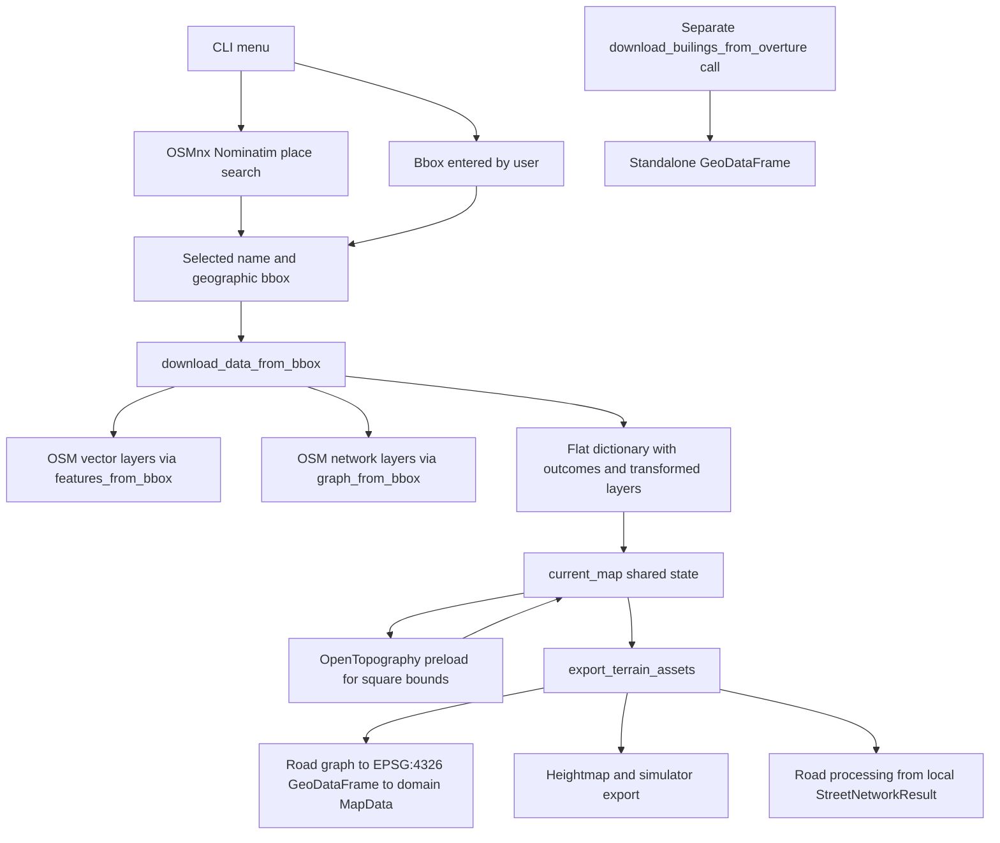
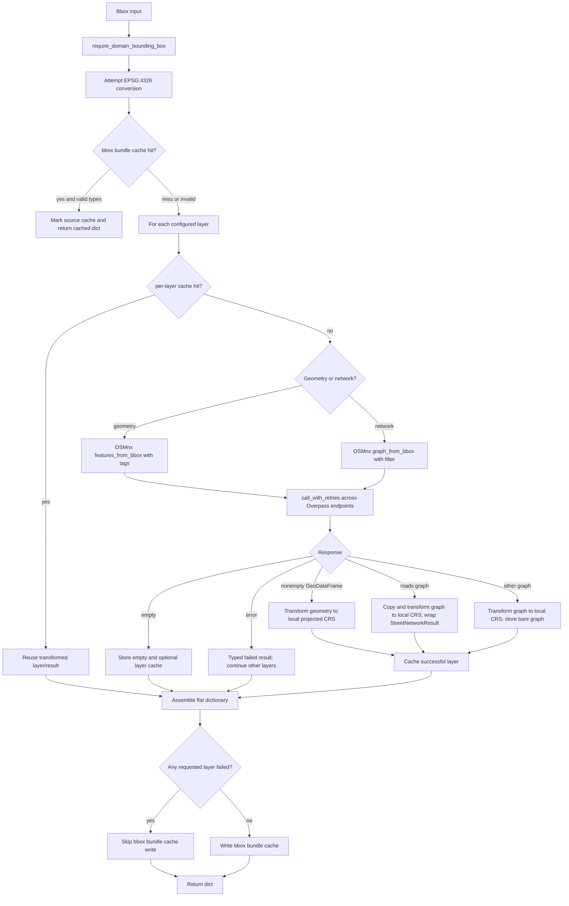
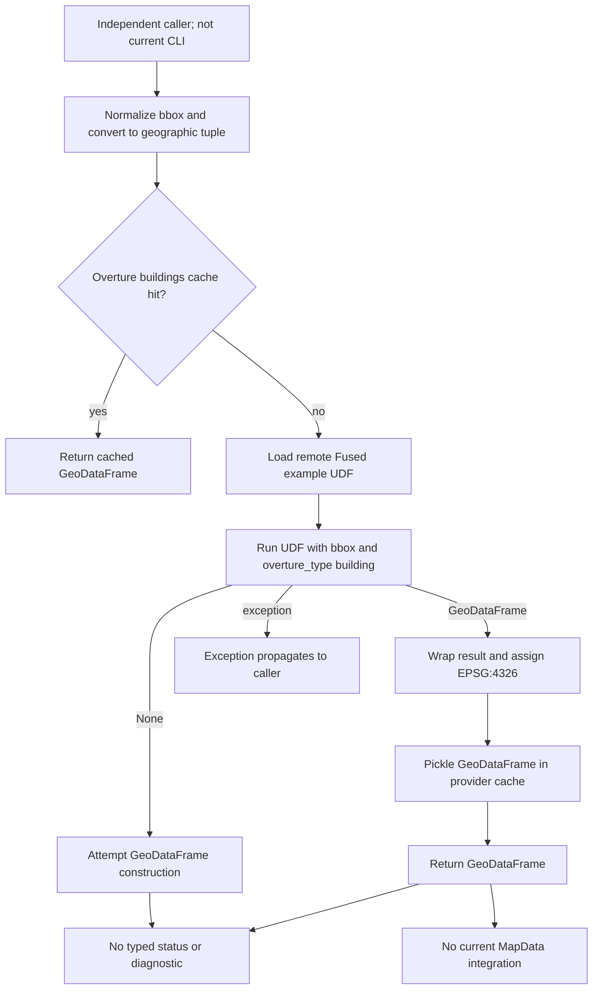
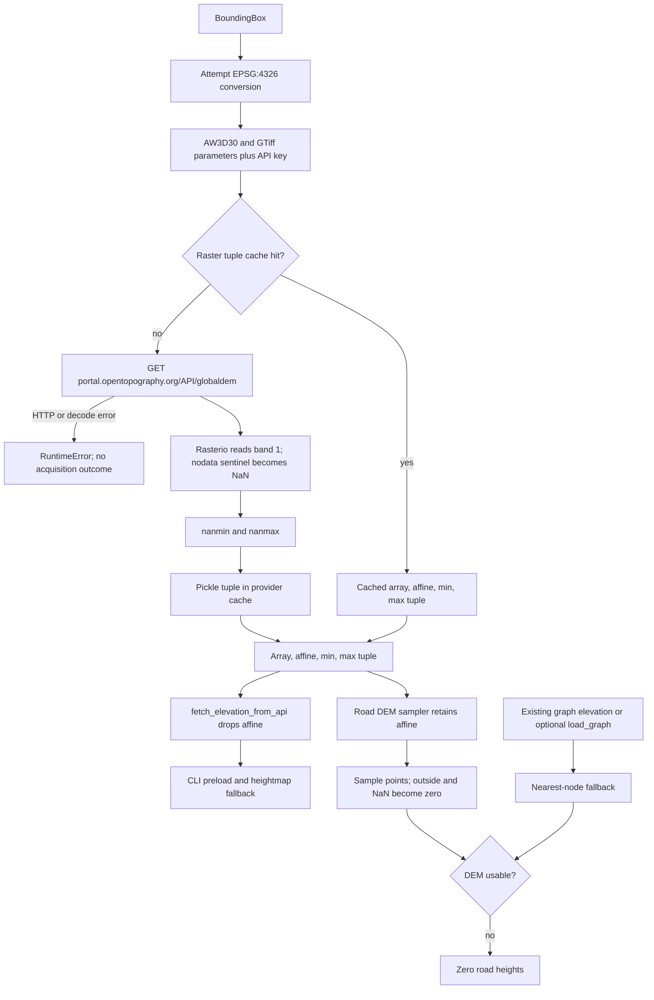
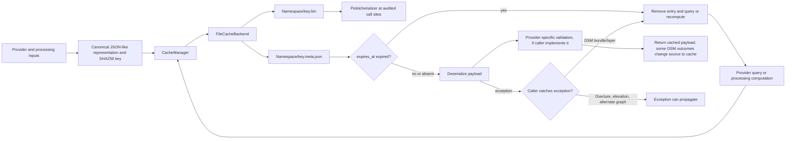
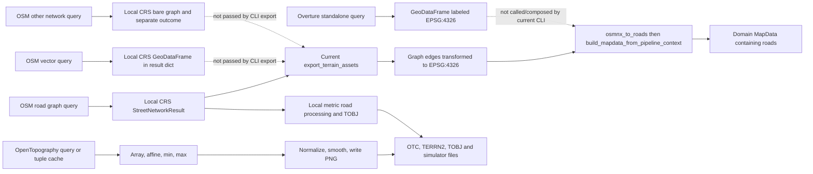

# Phase 2.2 — Data Acquisition Flows Audit

## 1. Introduction and scope

This audit reconstructs the acquisition paths present in the inspected
workspace for OpenStreetMap (OSM), Overture Maps, and OpenTopography. It traces
their callers, request construction, transformations, in-memory results,
errors, cache behavior, and downstream consumers. It compares those observed
paths with the target contracts in
[`phase-2.1.1-data-contracts.md`](phase-2.1.1-data-contracts.md); it does not
change that specification.

The audit is read-only. No provider behavior, cache format, source file, test,
or configuration was changed. The only new file authorized for this task is
this report. The working tree already contained extensive modifications and
untracked files at the start; those were preserved. In particular, the
untracked acquisition, cache, and test modules were inspected as current
workspace code, not assumed disposable.

**Evidence limit:** findings are based on static inspection of the current
checkout and its tests. No tests, live provider queries, or full CLI runs were
executed. Code references point to the inspected workspace and may include
pre-existing local edits.

## 2. Method

The audit followed these steps:

1. Captured `git status --short` before inspection and noted all pre-existing
   modified and untracked paths.
2. Traced CLI/menu entry points, provider functions, coordinate adapters,
   cache implementation, domain adapters, and the orchestrator.
3. Inspected tests to determine which behaviors have test cases. Test
   inspection is not evidence that those tests passed in this audit.
4. Compared observed behavior with the Phase 2.1.1 data contract, without
   changing its recommendations.
5. Classified contract alignment and technical risks from code evidence.
6. Read the referenced public Fused UDF and OpenTopography developer/API
   information to distinguish the local wrapper parameters from remote
   service defaults. This was documentation/code inspection only; no
   application request was made during the audit.

The repository uses the `osm2terrn/` package layout in the inspected tree.
There is no separate root `src/data` implementation in this checkout.

## 3. Module inventory and responsibilities

| Module | Observed responsibility |
|---|---|
| `osm2terrn/app/main.py` | Builds CLI arguments, loads program/project configuration, then imports and starts the menu (`main`, around lines 156–175). |
| `osm2terrn/data/download_menu.py` | Prompts for place search, custom bbox, or cancellation. Place search uses OSMnx's private Nominatim request path (`DownloadMenu.search_nominatim`, lines 89–103). |
| `osm2terrn/data/download_menu_components.py` | Converts the Nominatim bbox string order to `(west, south, east, north)` and selects a display place name (`NominatimResult`, lines 16–38). |
| `osm2terrn/data/osm_data_handler.py` | Main bbox OSM acquisition; separate Overture building function; acquisition outcomes and provider cache calls. It also applies OSMnx process-global settings at import time (lines 38–64). |
| `osm2terrn/data/overpass.py` | Bounded retry wrapper for OSMnx Overpass requests; temporarily patches OSMnx private module state and global settings (lines 22–228). |
| `osm2terrn/data/acquisition.py` | `LayerAcquisitionResult` for generic layer status/source/failure information (lines 8–32). |
| `osm2terrn/data/street_network.py` | `StreetNetworkResult` for road graph, status, declared CRS, source, and validation (lines 8–66). |
| `osm2terrn/data/osm_loader.py` | Alternative place/bbox OSMnx graph loading path, with an independent graph cache (lines 17–85); graph edge-to-line helper (lines 87–111). |
| `osm2terrn/adapters/coordinate_transform.py` | Copies and transforms GeoDataFrames and NetworkX graphs to local projected CRS (`transform_gdf_to_ror`, lines 50–64; `transform_graph`, lines 77–130). |
| `osm2terrn/processing/terrain/elevation_service.py` | OpenTopography request, GeoTIFF decoding, raster tuple cache, and point sampling (lines 24–153). It resides under processing despite also owning acquisition. |
| `osm2terrn/processing/terrain/heightmap_handler.py` | Elevation fetch/fallback, normalization, smoothing, image writing, and a processed-array cache (lines 24–199). |
| `osm2terrn/processing/roads/road_elevation.py` | Requests a DEM for road extents, samples points, and optionally derives a node elevation fallback (lines 15–126). |
| `osm2terrn/domain/adapters/osmnx_to_roads.py` | Converts street graph edges to EPSG:4326 GeoDataFrame and to domain `Road` entities (lines 54–170). |
| `osm2terrn/domain/adapters/osmnx_to_map.py` | Builds/caches `MapData`; the pipeline-context adapter currently maps roads only (lines 21–131). |
| `osm2terrn/cli/commands.py` and `osm2terrn/app/app_state.py` | `dlcity` coordinates OSM acquisition and elevation preload; module-global `current_map` retains session values. `export` passes selected state to the orchestrator (`commands.py:21–151`; `app_state.py:6–22`). |
| `osm2terrn/processing/orchestrator.py` | Adapts road acquisition to MapData, gathers status metadata, invokes heightmap and road/export paths (`export_terrain_assets`, lines 239–429). |
| `osm2terrn/cache/*` and `osm2terrn/config/cache.py` | Generic key, serializer, metadata, manager, filesystem backend, and configured singleton (`CacheManager`, `FileCacheBackend`, `get_cache_manager`). |

## 4. OSM acquisition audit

### 4.1 Entry points and request inputs

The interactive entry starts in `cli.commands.dlcity()` (`commands.py:21–82`):
it calls `download_menu()`, then `download_data_from_bbox(bbox)`. The menu can
search a place through OSMnx Nominatim or accept a custom geographic bbox
(`download_menu.py:26–54,80–103`). Nominatim is used to find a displayed
place and bbox; OSM feature/graph data are subsequently requested separately
through Overpass-backed OSMnx calls. The CLI passes the bbox, not the place
name, to `download_data_from_bbox`.

`download_data_from_bbox()` converts its input with
`require_domain_bounding_box` and attempts to reproject it to EPSG:4326
(`osm_data_handler.py:259–277`). Its query tuple is `(west, south, east,
north)` (`_bbox_to_osmnx_tuple`, lines 69–73). If the first reprojection fails,
the function logs a warning and temporarily retains the supplied object; the
later tuple helper may attempt reprojection again. The returned `bounds` is
explicitly constructed as EPSG:4326 (around lines 339–350).

OSM behavior is partly configured at module import: geometry tags, network
filters, custom useful way tags, OSMnx Overpass endpoint, logging, area limit,
request timeout, and rate limiting are read into module globals or copied to
`ox.settings` (`osm_data_handler.py:38–64`). The defaults include `buildings`,
`parks`, and `lakes` geometry queries and `roads` and `rails` network entries
(`config/defaults.py:69–90`). The building geometry query includes
`amenity=school` and `building=True`; it is not an Overture request.

### 4.2 Vector geometries and network graph are different acquisitions

Each configured geometry layer is requested separately with
`ox.features_from_bbox((west, south, east, north), tags=tag)` under
`_query_osm_layer()` (`osm_data_handler.py:248–249, 373–424`). This yields a
GeoDataFrame-like feature collection. A missing/empty result becomes `None`
with an `empty` outcome. A non-empty result is transformed by
`transform_gdf_to_ror(gdf, origin_lon, origin_lat)` before it is stored in the
result dictionary (around lines 425–454). That adapter transforms from the
GeoDataFrame's declared CRS to a local projected CRS (`coordinate_transform.py:
50–64`). The original geographic GeoDataFrame is not retained in the returned
dictionary or the layer cache. Its attributes and feature identifiers may
remain as columns, but coordinates and CRS have changed.

Each network layer is also requested separately, through
`ox.graph_from_bbox(..., network_type="drive", simplify=False,
retain_all=True, custom_filter=cf)` (`osm_data_handler.py:455–570`). Both the
`roads` and `rails` keys use `network_type="drive"`; a configured custom
filter distinguishes the rails layer. This differs from `features_from_bbox`:
the result is a topological NetworkX graph with nodes, keyed edges, edge
attributes, and graph CRS rather than an areal/vector layer GeoDataFrame.

For `roads`, the provider graph is passed to `transform_graph_to_ror()` and a
`StreetNetworkResult` stores the transformed graph and its CRS (around lines
488–522). The coordinate adapter copies the graph and transforms node
coordinates and edge geometry, then replaces graph CRS metadata with the
local CRS (`coordinate_transform.py:77–130`). The original provider graph is
not retained. `StreetNetworkResult` validates status/graph/CRS consistency
(`data/street_network.py:23–66`). Its data contract allows an available graph
only with edges, an empty graph with zero edges and at least one node, or
`graph=None` for a fully empty network.

Other network entries, such as `rails`, are transformed to local coordinates
and stored as bare graph objects. Their outcomes are recorded separately in
`acquisition_results`; roads use the specialized `StreetNetworkResult`
instead. Configured geometry and network layers are processed serially.

### 4.3 OSM outputs, states, failures, and recovery

The returned object is a flat dictionary, not an `AcquisitionBundle`. It
contains `bounds`, origin fields, each configured geometry/network key,
`roads` as a `StreetNetworkResult` (or `not_requested` result), and an
`acquisition_results` mapping for geometry and non-road network layers
(`osm_data_handler.py:259–590`). Geometry and network outcomes use
`LayerAcquisitionResult` statuses `not_requested`, `empty`, `available`, and
`failed`; the source is `query`, `cache`, or `none` (`data/acquisition.py:
8–32`). Roads have their separate status and can also be `missing` at the
result-model level, although the bbox handler emits `not_requested`,
`empty`, `available`, or `failed`.

`_layer_failure()` distinguishes temporary/permanent/unknown categories and
acquisition/transformation stages, and records a sanitized exception type and
HTTP status where available (`osm_data_handler.py:75–120`). Empty geometry is
recognized both as an empty returned GeoDataFrame and as the OSMnx
`InsufficientResponseError` text “no matching features” (lines 123–128,
393–424). Empty graphs are recognized when no nodes are returned; a nodes-only
road graph is represented as `empty` while retaining the transformed graph
(around lines 489–502). Failures in optional layers are retained in their
outcome while other layers continue. If any requested layer fails, the full
bbox bundle is not written, but individually successful layer cache entries
may already have been written (around lines 558–588).

`data.overpass.call_with_retries()` rotates configured endpoints, respects
retryable HTTP statuses and transport errors, uses `Retry-After` when
available, and applies jittered backoff within an elapsed-time deadline
(`overpass.py:103–227`). It wraps each individual OSM query. The wrapper
temporarily replaces OSMnx's private Overpass `requests` and pause functions
and global endpoint/logging settings while holding a module lock
(`overpass.py:129–179`). This is bounded retry/recovery for temporary
Overpass failures; it is not a fallback provider or a recovery of source graph
data after transformation.

Place lookup is a separate Nominatim request through the private
`ox._nominatim._nominatim_request()` call in
`DownloadMenu.search_nominatim()` (`download_menu.py:89–103`). It does not use
the bounded Overpass wrapper or produce a typed acquisition outcome. An empty
search result is shown to the user and retried interactively; request
exceptions are not converted to the OSM layer error model in this path.

### 4.4 Alternative OSM graph path

`data.osm_loader.load_graph(place=None, bbox=None, network_type="drive",
simplify=True, bidirectional=False)` independently calls
`ox.graph_from_place` or `ox.graph_from_bbox`, optionally converts to an
undirected graph, and caches the graph (`osm_loader.py:17–85`). Unlike the
bbox handler it does not use `call_with_retries`, `StreetNetworkResult`,
`transform_graph_to_ror`, or the bbox bundle. It returns the provider graph
with its OSMnx CRS. `road_network_export.build_roads_from_place()` calls this
path directly (`road_network_export.py:42–68`). Road node-elevation fallback
can also load a place graph if no graph was supplied (`road_elevation.py:
37–84`). The current CLI export normally supplies the acquired graph, so that
fallback avoids that graph reload, but this remains a callable alternate
route.

## 5. Overture Maps audit

### 5.1 Entry point, query, and output

The sole provider function found is
`download_builings_from_overture(bbox)` (misspelling retained in its public
name) in `osm2terrn/data/osm_data_handler.py:604–663`. It normalizes the bbox
through the shared `BoundingBox` helpers, converts it to geographic bounds,
loads the Fused UDF at
`https://github.com/fusedio/udfs/tree/main/public/Overture_Maps_Example`, and
calls `fused.run()` with parameter `bbox=(west,south,east,north)` and
`overture_type="building"` (lines 618–649). The public UDF currently defines
its spatial argument as `bounds`, not `bbox`, and its default bounds are a
London-area rectangle. This key/signature mismatch means it is not verifiable
from local code whether Fused maps the parameter alias, rejects it, or runs
against the UDF default; the actual queried area requires a provider-call test.
No OSM result, graph, or OSM
identifier is passed; this is an independent provider route that shares
utility/cache infrastructure only.

The result is wrapped as a GeoDataFrame with `crs="epsg:4326"` and returned
directly (lines 648–663). The wrapper does not inspect or preserve an upstream
CRS declaration before assigning EPSG:4326, select a schema, validate geometry,
normalize source IDs, or construct `MapData`. Returned attributes are whatever
the Fused UDF provides. There is no explicit dataset release/version,
source-feature ID mapping, query outcome object, empty-result state, warning,
or provider-specific exception translation. The inspected remote UDF can
return `None` when it obtains no data; the local wrapper immediately attempts
to construct a GeoDataFrame from the return value and does not translate that
case to an explicit `empty` outcome. Exceptions from `fused.load`, `fused.run`,
conversion, or cache operations propagate to the caller.

The remote repository's current `main` UDF is broader than this wrapper: its
README describes global buildings, POIs, administrative boundaries, and
transportation, while the local function requests only
`overture_type="building"`. The UDF source currently defaults `release`
internally to `2026-04-15-0`, maps `building` to the `buildings` theme, and
reads table tiles for the bounds; the local caller neither pins that release
nor passes one explicitly. The remote `main` URL is mutable, so the exact
queried release/default can change without a local code change. See the
[public UDF README](https://github.com/fusedio/udfs/blob/main/public/Overture_Maps_Example/README.MD)
and [public UDF source](https://github.com/fusedio/udfs/blob/main/public/Overture_Maps_Example/Overture_Maps_Example.py).

`fused` is imported at the top of `osm_data_handler.py`, so importing the
shared handler has a module-level dependency on Fused even for OSM-only calls.
No CLI command invokes the Overture function. The orchestrator marks building
export as `not_implemented` when building export is enabled and its current
MapData constructor is only supplied road GeoData (`orchestrator.py:296–355`).
The provider therefore has neither acquisition-flow integration nor current
domain/export integration.

### 5.2 Cache behavior

Overture uses namespace `providers/overture/buildings`, algorithm version `1`,
format version `1`, artifact type `buildings_geodataframe`, and a Pickle
serializer (`osm_data_handler.py:34–35,620–663`). The key includes the input
bbox tuple/CRS/projection flag and `overture_type="building"`; it does not
identify the remote UDF revision or a returned dataset release (lines 622–633).
The cache hit is returned without an explicit type/CRS/content validation or
recovery wrapper. Cache metadata records `feature_count`, but no acquisition
method/outcome is returned.

## 6. OpenTopography elevation audit

### 6.1 Request and raster decoding

`load_elevation_raster(bounds)` is the acquisition-bearing path in
`processing/terrain/elevation_service.py:24–131`. It attempts to normalize
bounds to EPSG:4326, reads the API key from the configured environment
variable, and requests the `globaldem` endpoint with `demtype="AW3D30"`,
`outputFormat="GTiff"`, and west/south/east/north parameters
(`_normalize_bbox_for_api` and `_build_elevation_api_params`, lines 24–51).
No resolution or vertical datum parameter is sent. The `requests.get` call
uses `stream=True` but no explicit timeout (lines 53–61). OpenTopography
documents that its Global Datasets API requires an API key; the local code
includes the configured key in the request and excludes it from the cache key,
but does not validate that the environment value is present.

OpenTopography identifies AW3D30 as a global 30 m dataset in its developer
catalog; the code selects that dataset but does not request or validate an
output resolution field. The endpoint and parameter names match the provider's
published Global Datasets API example. See [OpenTopography for Developers](https://www.opentopography.org/developers)
and its [Global DEM API example](https://opentopography.org/faq-page). The
dataset resolution description does not establish vertical units/datum for
each returned raster, and the local reader does not retain such metadata.

The response body is opened in-memory using `BytesIO` and Rasterio. Band 1 is
read; exact matches to `dataset.nodata` are converted to NaN; min/max are
computed with `nanmin`/`nanmax` and a log message labels them metres
(`elevation_service.py:53–79`). The returned tuple is
`(elevation_array, dataset.transform, max_elevation, min_elevation)`.
Dimensions can be inferred from the array shape but are not a separate return
field. CRS, dataset bounds, resolution, source NoData sentinel, raster mask,
vertical units, and vertical datum are discarded. The transform is retained
by `load_elevation_raster`; the convenience `fetch_elevation_from_api()`
discards it and returns only `(array, max, min)` (`lines 83–87`).

HTTP errors are translated to a `RuntimeError` with an HTTP status; other
errors become a generic `RuntimeError` naming the exception type
(`_download_elevation_raster`, lines 72–80). There is no explicit API-key
prevalidation, response-size check, dataset CRS check, finite-value check,
all-NoData handling, or validity-mask production. Empty/all-NoData or
non-finite data can therefore yield warnings/NaN statistics rather than a
contracted empty/failed acquisition result. The service has no retry policy;
recovery comes from a cache hit or from the separate flat-heightmap/node-value
fallbacks in consumers. `sample_elevation_at_coords()`
uses the affine to index lon/lat points, but replaces out-of-raster and NaN
samples with zero (`lines 133–153`).

### 6.2 Elevation acquisition routes and consumers

There are multiple routes that can acquire elevation:

1. **CLI preload:** `dlcity()` unconditionally calls the alias
   `heightmapper`, which is `fetch_elevation_from_api`, for the squared
   `data["bounds"]` and stores the three-field dictionary in global
   `current_map.elevation_data` (`cli/commands.py:21–82`). The configured
   `pipeline.preload_elevation` value is parsed by `app/main.py:56–58,142–150`
   but `dlcity()` does not consult it.
2. **Heightmap fallback/acquisition:** `_prepare_elevation_data()` uses a
   passed dictionary when it has `elevation`, `maxh`, and `minh`; otherwise it
   calls `fetch_elevation_from_api()`. On exception it creates a flat array
   and returns status `failed` (`heightmap_handler.py:44–67`). The normal CLI
   export passes the preload dictionary, so successful preload avoids this
   second path. If preload failed, CLI stores `{}`, so export attempts another
   fetch before falling back.
3. **Road DEM sampling:** `build_dem_sampler()` derives bounds from the
   processed road geometry extent, transforms them to EPSG:4326, and calls
   `load_elevation_raster()` to obtain array plus affine
   (`road_elevation.py:15–34`). It can request a different extent from the
   whole-map heightmap. Failure is swallowed into `None` with a warning.
4. **Optional graph-node fallback:** road elevation can use existing graph
   node `elevation`/`elev` attributes, or load a separate place graph if no
   graph was supplied (`road_elevation.py:37–84`). If graph and DEM sampling
   fail, sampled road heights fall back to zeros (`lines 86–126`).

The normal CLI path preloads elevation over the world-sized square bounds; the
road DEM sampler later requests the road geometry extent independently. They
share the raster cache only when their normalized request inputs yield the
same key, which is not guaranteed. The CLI does not pass the preload affine
or raster tuple to road processing; it passes the graph and separate height
dictionary. These are distinct in-memory results even if cache happens to
serve a matching query.

## 7. Cache system audit

### 7.1 Shared cache mechanics

`get_cache_manager()` builds a process-level singleton over `FileCacheBackend`
and recreates it when enabled/root settings change (`config/cache.py:15–56`).
`CacheManager.build_key()` combines canonicalized inputs with the global
pipeline version, artifact type, provider, algorithm version, and format
version (`cache/keys.py:14–70`). The canonicalizer handles dataclasses,
mapping key ordering, sequences, sets, paths, and JSON primitives before
SHA-256 hashing.

`CacheManager.get()` reads backend bytes and deserializes them, returning
`(value, CacheMetadata)`; it does not compare stored metadata versions or
validate the decoded value (`cache/manager.py:50–64`). Most callers use only
`cached[0]` and discard metadata. The filesystem backend stores one `.bin`
payload and one `.meta.json` file per key and removes entries only when
`expires_at` is set and expired (`cache/file_cache.py:13–79`). Current provider
callers do not set expiry. `max_size_mb` is loaded and validated but the
inspected manager/backend do not enforce it or implement eviction
(`config/cache.py:35–39`; `cache/manager.py`; `cache/file_cache.py`).

The default serializer used for acquired GIS data is Pickle. The code also
provides bytes and JSON serializers, but those are not used for the audited
provider artifacts (`cache/serializers.py:12–64`). A pickle entry can fail on
deserialization due to corruption or incompatible Python object/module
versions. Recovery behavior belongs to individual callers, not the generic
manager. `put()` serializes before checking whether persistence is enabled, so
disabled cache still incurs serialization cost and serialization errors can
still propagate (`cache/manager.py:66–84`).

### 7.2 Provider and adapter cache entries

| Artifact / namespace | Key inputs and versions | Payload | Read validation / observable effect |
|---|---|---|---|
| OSM bbox bundle: `providers/osm/bbox-bundle` | `use_bbox` values, original bbox CRS/projection flag, configured geometry/network mappings, custom tags; algorithm `5`, format `3` (`osm_data_handler.py:280–300,570–587`). | Entire returned dictionary, including locally transformed layers, `StreetNetworkResult`, and outcomes. | Deserialization and selected bundle/result type checks; a hit changes each outcome source to `cache` and road source to `cache`. Invalid bundle triggers fresh acquisition and may mark roads `cache_recovered`. |
| OSM per-layer: `providers/osm/bbox-layers` | Bbox/CRS/projection, layer/type/query, custom tags and bbox algorithm; layer algorithm `1`, format `1` (`osm_data_handler.py:130–153`). | Dict with status, data, and typed outcome. Geometry data are already local CRS; road data/result are transformed graph (`lines 156–246`). | Catches deserialization and structural/type/status failures; treats invalid entry as miss. Successful `available`/`empty` layers are cached, including individually successful layers when a sibling fails. |
| OSM alternate graph: `providers/osm/graph` | Place or bbox, network type, simplify, bidirectional; algorithm `1`, format `1` (`osm_loader.py:42–54`). | Pickled NetworkX graph in provider CRS. | No explicit decode/type/CRS validation or recovery wrapper in `load_graph`; cache exception propagates. Separate from bbox result/cache. |
| Overture buildings: `providers/overture/buildings` | Bbox tuple/CRS/projection and layer type; algorithm `1`, format `1` (`osm_data_handler.py:622–633`). | Pickled GeoDataFrame. | No caller-side type/CRS validation and no cache exception recovery; hit bypasses Fused query. |
| OpenTopography raster tuple: `providers/elevation/raster` | DEM type, bbox coordinates, output format; algorithm `1`, format `1` (`elevation_service.py:89–131`). | Array, affine transform, min, max; no full raster geospatial metadata. | No caller-side shape/CRS validation or cache exception recovery; hit bypasses API and preserves only tuple fields. |
| Domain road/map adapters | GeoDataFrame fingerprints plus bounds/place/metadata; adapter algorithm `2`, format `2` (`osmnx_to_roads.py:22–50,101–169`; `osmnx_to_map.py:21–131`). | Pickled `Road` list or `MapData`. | Separate derived caches; adapter cache hits bypass conversion and provider payloads are not included in returned results. |
| Smoothed heightmap: `processing/terrain/heightmap-smoothed` | Bounds/CRS/projection flag, output size, smoothing sigma; algorithm `1`, format `1` (`heightmap_handler.py:19–21,137–178`). | Pickled NumPy array after normalization/smoothing. | Used only when `elevation_data is None`. The interactive CLI passes a dict (including `{}` after preload failure), so its normal path bypasses this smoothing cache. |

OSM therefore has layered caching: a whole bbox bundle and individual layer
entries. A successful full bundle short-circuits all layer queries; a partial
failure prevents the bundle write but successful per-layer entries can still
short-circuit those requests next time. The alternate graph loader has a third
OSM cache namespace. Cache hits also rewrite provenance-like `source` values
for OSM typed results. Overture and elevation instead return plain payloads
without an acquisition method/outcome, so their cache origin is only visible
in logs.

Cache write failures are not handled uniformly: OSM per-layer writes are
caught and downgraded to warnings, but the bbox bundle write and the
Overture/elevation/alternate-graph writes can propagate after provider work
has completed (`osm_data_handler.py:216–246,558–588,650–663`;
`elevation_service.py:116–131`; `osm_loader.py:67–82`).

The audited tests cover ordinary hits, invalid OSM bundle recovery, partial
OSM success reuse, and version behavior. They do not demonstrate that every
provider's corrupt serialized payload is caught. No cache migration or
format change is proposed by this audit.

## 8. CLI and pipeline integration

### 8.1 Current call sequence and shared state

`app.main.main()` configures program/project settings before importing the
interactive CLI menu (`app/main.py:156–175`). The download action reaches
`dlcity()`, which:

1. Prompts through OSMnx Nominatim or custom bbox.
2. Calls `download_data_from_bbox(bbox)` for OSM.
3. Computes origin coordinates, then computes a square world extent and
   replaces `data["bounds"]` with those bounds (`cli/commands.py:34–66`).
4. Stores the result dictionary, place, origin, and world size in the module
   singleton `current_map` (`app_state.py:6–22`; `commands.py:68–71`).
5. Calls the elevation convenience API for the updated square bounds and
   stores only array/min/max in `current_map.elevation_data` (`commands.py:
   74–82`).

The provider layers were acquired for the original selected bbox; elevation
preload uses the later square bbox. `current_map` is shared mutable session
state, not a typed per-run acquisition object. A canceled download returns
before clearing existing session data (`commands.py:27–30`), so a prior map
may remain exportable. On invalid bounds the data/elevation/world-size fields
are cleared, while place/origin are not all reset (`lines 34–41`).

`export()` passes only selected fields—bounds, elevation dictionary, origin,
`roads`, `acquisition_results`, world size—to
`export_terrain_assets()` (`commands.py:93–115`). It does not pass the
acquired geometry GeoDataFrames, the `rails` network, or Overture output.
The orchestrator validates the road result, converts its graph to a roads
GeoDataFrame in EPSG:4326, and creates `MapData` from that road frame
(`orchestrator.py:239–355`; `osmnx_to_roads.py:54–99`; `osmnx_to_map.py:
55–131`). It records acquisition and conversion status separately in
`MapData.metadata`, then calls heightmap and road/export paths. Buildings are
marked `not_implemented` when enabled. Thus the first current MapData
normalization happens during export and includes roads only, not all acquired
provider layers.

For road file generation, the same local `StreetNetworkResult.graph` is passed
to `build_roads_from_graph()`; that consumer declares/reads its CRS and derives
the working local geometry (`orchestrator.py:155–235`;
`road_network_export.py:71–106`). The graph-to-domain path explicitly
reprojects that graph to EPSG:4326. These are separate consumer views derived
from the already-local graph; the original geographic OSM graph is not
available at this handoff.

### 8.2 Is there a common acquisition point?

There is a common CLI coordinator only for the OSM bbox result and optional
elevation preload. There is no cross-provider acquisition coordinator,
provider registry, or nested `providers → datasets → layers` object.
Overture is called independently and is not composed into CLI state. Elevation
is called from the CLI and from terrain/road processing modules. The common
infrastructure is limited to bbox conversion helpers, cache manager,
configuration access, and logging.

There are also two differently scoped `MapData` concepts: session
`app.app_state.MapData` is a mutable holder for dictionaries/metadata, while
`domain.entities.MapData` is the vector aggregate. The same name does not
represent the same contract.

## 9. Current-flow diagrams

The following diagrams represent inspected code paths, including parallel and
alternative routes. They are not target-architecture diagrams.

### 9.1 General acquisition flow



### 9.2 OSM bbox detail



### 9.3 Overture detail



### 9.4 OpenTopography detail and alternative DEM consumers



### 9.5 Cache interaction



### 9.6 Acquisition, normalization, and consumers



## 10. Comparison with Phase 2.1.1 contracts

Classification describes the implementation observed in this checkout, not
whether the target contract is desirable.

| Target contract / criterion | Classification | Evidence and gap |
|---|---|---|
| `AcquisitionBundle` | **Partially compatible** | OSM has a useful per-run dictionary with bounds, layers, typed outcomes, and cache sources; there is no common result for OSM, Overture, and raster. Provider routes return incompatible shapes (`osm_data_handler.py:259–590,604–663`; `elevation_service.py:83–131`). |
| `providers → datasets → layers` | **Absent** | OSM uses flat keys and one `acquisition_results` map; Overture and elevation are standalone functions. Provider/dataset/layer are not explicit nested identity dimensions. |
| Preserve original acquisition payload | **Incompatible for OSM; partially compatible for Overture; incompatible for raster** | OSM GeoDataFrames and graph are transformed before being placed in result/cache (`osm_data_handler.py:425–454,488–522`). Overture returns its wrapped GeoDataFrame but has no separate raw/normalized object. Raster bytes are decoded and discarded; cache stores a reduced tuple (`elevation_service.py:53–79,89–131`). |
| Explicit `provider`, `dataset`, `layer`, `method` | **Partially compatible** | Provider is implicit in function/cache metadata; OSM layer names are explicit, Overture type is a parameter, and source marks query/cache for OSM. Dataset identity is absent. Overture/raster methods and outcomes are not returned. |
| Typed `outcome`, warning, diagnostic | **Partially compatible** | OSM generic layers use `LayerAcquisitionResult`; roads use `StreetNetworkResult`. Overture has no outcome. Elevation raises runtime errors and heightmap later labels an `elevation_status`; acquisition and processing status are conflated at the convenience boundary. |
| `provenance` and source identifiers | **Partially compatible** | OSM retains provider attributes through transformations in many cases but does not retain original CRS/payload reference or a uniform provenance object. Overture returns opaque UDF attributes without validating source IDs/dataset version. Raster drops most source georeferencing and metadata. |
| `StreetNetworkResult` and graph CRS | **Partially compatible / incompatible with target authority** | A typed validated result exists and records graph CRS/status/source. Current bbox acquisition stores a local projected graph, not the canonical EPSG:4326 provider graph proposed by Phase 2.1.1; the geographic source graph is discarded. The alternate loader returns an unwrapped provider-CRS graph. |
| Raster payload / `RasterArtifact` metadata | **Incompatible** | Only array, affine, min, and max are returned by the loader; convenience API further drops affine. CRS, dimensions field, bounds, resolution, explicit mask, source NoData metadata, units, and vertical datum are not retained (`elevation_service.py:53–131`). |
| Cache and target contracts | **Partially compatible** | A reusable versioned cache manager and provider namespaces exist. Current artifact shapes are Pickle tuples/dicts/graphs/GDFs; format metadata is not generically enforced, original payloads are often not cached, and cache method/provenance differs by provider (`cache/manager.py:50–64`; provider table in §7). |
| Independent providers | **Compatible in isolation; integration absent** | Overture is called without OSM input, and OpenTopography receives bounds only. There is no shared coordinator or normalized cross-provider result. |
| Actual Overture query area/release | **No verificable** | The local caller passes `bbox` while the inspected public UDF signature accepts `bounds`; it does not pin/pass the release. No live call was made, and the remote `main` branch is mutable. The intended bbox/release are identifiable, but the actual query behavior cannot be confirmed from the wrapper alone (`osm_data_handler.py:643–649`; remote source linked in §5.1). |
| EPSG:4326 domain boundary | **Partially compatible** | The graph-to-road adapter explicitly converts a declared graph CRS to EPSG:4326 before `MapData`; OSM acquisition first stores a local graph. OSM geometry layers are stored local and not currently passed through the domain boundary (`osmnx_to_roads.py:54–99`; `osm_data_handler.py:425–454`). |

## 11. Problems and risks

Severity uses **critical**, **high**, **medium**, and **low**. “Confirmed” means
the behavior is directly visible in code; “potential” means the failure
depends on runtime conditions or future usage. No critical issue was
established by static inspection.

| Severity / evidence | Problem and consequence | Contract relation |
|---|---|---|
| **High — confirmed:** `osm_data_handler.py:425–454,488–522`; `coordinate_transform.py:50–64,77–130` | OSM feature layers and the street graph are changed to local CRS before the acquisition result/cache is produced; the original graph/GDF is not retained. This prevents the source payload from serving as a stable normalization input and forces downstream CRS reconstruction. | Payload preservation; canonical geographic graph; separate acquisition and normalization. |
| **High — confirmed:** `elevation_service.py:53–79,89–131` | Raster CRS, bounds, source NoData, mask, resolution, dimensions metadata, vertical units, and datum are discarded. Invalid samples and out-of-bounds points can become zero. Terrain/road consumers cannot distinguish valid zero elevation from missing data or verify sample CRS. | RasterArtifact and explicit validity/provenance contract. |
| **High — confirmed:** `elevation_service.py:24–38`; `osm_data_handler.py:269–277,69–73` | The elevation adapter explicitly continues with the original bbox after reprojection failure and can send projected numeric coordinates as geographic bounds. The OSM handler also catches its first reprojection failure, but `_bbox_to_osmnx_tuple()` retries conversion and can then fail before querying. | Explicit CRS validation and transformations; no relabeling. |
| **High — confirmed:** `elevation_service.py:53–61` | OpenTopography HTTP GET has no explicit timeout. A stalled request can block CLI preload/export and delay all later work. | Acquisition errors/timeouts and reliable stage outcomes. |
| **Medium — potential:** `elevation_service.py:53–71` | The complete response body is materialized in `response.content` and Rasterio reads the full band into memory. Large extents can create high transient memory use; `stream=True` does not keep the response out of memory in this path. | Bounded acquisition payloads and scalable raster handling. |
| **Medium — confirmed routes; repeated requests conditional:** `cli/commands.py:21–82`; `heightmap_handler.py:44–67`; `road_elevation.py:15–34` | DEM can be acquired in CLI preload, retried after preload failure during heightmap export, and separately for road extent. Requests may have different bounds and no shared in-memory raster result; only identical keys reuse provider cache. This can add latency and repeated memory/network work. | Shared artifact references, cache transparency, acquisition/processing separation. |
| **Medium — confirmed:** `osm_data_handler.py:604–663`; `domain/adapters/osmnx_to_map.py:55–131`; `orchestrator.py:296–355` | Overture results are not called by the CLI, not normalized to `MapData`, and not exported. OSM geometry layers and rails are also not passed to current export; only road graph is normalized. Existing successful acquisition can therefore be unused downstream. | Provider integration; normalized `MapData`; pipeline result handoff. |
| **Medium — confirmed:** `osm_data_handler.py:604–649` | Overture assigns EPSG:4326 when wrapping the UDF result without inspecting a source CRS. If returned coordinates are not already WGS84, they would be mislabeled rather than transformed. | Known input CRS and explicit transformation. |
| **High — potential, static signature mismatch confirmed:** `osm_data_handler.py:643–649`; current remote UDF source linked in §5.1 | Local caller passes `bbox`, while the referenced public UDF signature takes `bounds` (and defaults to a London-area bbox). Depending on Fused parameter handling, the query may fail or use default bounds rather than the selected area. No live provider request was made, so runtime behavior is unverified. | Correct request bounds, provider contract, and verifiable provenance. |
| **Medium — confirmed:** `osm_data_handler.py:604–663`; `elevation_service.py:89–131`; `osm_loader.py:17–85` | Cache deserialization/type failures are caught and recovered in OSM bbox/layer helpers but can propagate for Overture, elevation, and the alternate graph loader. A corrupted or incompatible local cache may fail the user-visible acquisition instead of being treated as a miss. | Version-aware cache handling and equivalent acquisition outcomes. |
| **Medium — confirmed:** `cache/manager.py:50–64`; `cache/file_cache.py:13–79`; `config/cache.py:35–39` | Generic cache retrieval does not verify metadata format/version; no expiry is configured by audited callers and configured `max_size_mb` has no eviction implementation. Cache can grow without its declared size bound, and compatible-looking stale Pickles may be deserialized. | Cache compatibility and resource management. |
| **Medium — confirmed:** `overpass.py:129–179` | Retry isolation patches private OSMnx module globals/settings. Its lock coordinates only callers using this wrapper; unrelated OSMnx work in another thread may observe temporary endpoint/request/logging values. | Provider independence and concurrency-safe acquisition boundaries. |
| **Medium — confirmed:** `osm_data_handler.py:38–64`; `elevation_service.py:19`; `cli/commands.py:18` | Provider/project settings are captured at module import, and OSMnx settings are mutated globally. Reconfiguration after import may not be reflected consistently across acquisition modules. | Explicit provider configuration and reproducible run provenance. |
| **Medium — confirmed:** `osm_data_handler.py:373–588`; `download_builings_from_overture`, lines 604–663 | OSM acquisition returns a flat dict, Overture a bare GeoDataFrame, and elevation a tuple/dict; method and provenance are inconsistent. Adding a provider requires bespoke CLI/state/cache handling rather than plugging into a shared boundary. | AcquisitionBundle and stable provider/dataset/layer dimensions. |
| **Medium — potential:** OSM defaults include buildings, parks, lakes, and rails; Overture separately requests buildings (`config/defaults.py:69–90`; `osm_data_handler.py:604–649`) | If Overture is later integrated additively, overlapping building coverage can produce duplicates. No cross-provider deduplication or precedence policy is present. This is a future integration risk, not a current duplicate export, because Overture is not composed today. | Provenance and additive Overture integration decision. |
| **Low — confirmed:** `cli/commands.py:27–30,34–41` | Cancel returns before clearing a prior `current_map`; an old session can remain available for export after a canceled download. Invalid bounds clear only part of the holder. | Run-scoped result state and clear outcome semantics. |
| **Low — confirmed:** `app/main.py:56–58,142–150`; `cli/commands.py:21–82` | `preload_elevation` CLI/config controls are accepted but the download command does not read the project pipeline setting. The apparent option may not control actual preload behavior. | Explicit stage selection and `skipped`/`not_started` status. |
| **Medium — confirmed:** `heightmap_handler.py:112–199`; `orchestrator.py:239–429` | Acquisition, normalization/smoothing, image writing, and simulator-specific output remain coupled in the existing processing/export path. This makes it difficult to consume a validated raster artifact independently. | Separate acquisition, processing, and export boundary. |

## 12. Preliminary consolidation strategy

Consolidation should preserve the existing provider implementations and
consumer-facing shapes while introducing observable seams in small steps.
Keep providers independent: they should return source data and provenance;
domain adapters and processing consumers should own normalization and
transformation policy. The cache is audited here but its migration or format
is deliberately not proposed in this phase.

Recommended sequence:

1. Characterize existing flows and contract expectations with focused tests.
2. Add an internal typed acquisition envelope around current results while
   retaining the flat OSM dictionary and existing direct function returns as
   compatibility views. Keep original OSM objects separately before local
   transforms; do not route providers through domain entities.
3. Bring Overture and raster into the same run-level handoff as independent
   provider results, with explicit method/outcome/provenance and untouched
   source payload references. Preserve current provider entry points.
4. Make normalizers own transformations: OSM vector/graph inputs stay
   source-referenced; adapters produce EPSG:4326 domain vectors and declared
   projected/local views for metric work. Raster validation produces the
   target geospatial contract before sampling/heightmap processing.
5. Replace direct CLI/global-state wiring gradually with a coordinator result
   consumed by existing CLI/export adapters. Keep exporter signatures and
   current output behavior until each handoff has characterization coverage.

No cache format, key, namespace, or serializer migration is included in these
steps. Existing cache hit/miss paths should be exercised by the tests at each
handoff; a separate cache design decision can follow this audit.

## 13. Incremental implementation stages

These are proposals only. No implementation has started.

### Stage A — Characterization baseline

- **Objective:** Establish regression expectations for current query/cache,
  empty/failure, CRS, and handoff behavior before changing boundaries.
- **Modules:** Existing `data/osm_data_handler.py`, `data/overpass.py`,
  `data/osm_loader.py`, `elevation_service.py`, CLI/orchestrator, and current
  cache helpers.
- **Expected changes:** Add narrowly scoped tests/fixtures only; no provider
  behavior or cache format changes.
- **Dependencies:** None.
- **Risks:** Tests may encode current loss of CRS/payload or zero fallback;
  keep such tests explicitly transitional rather than treating them as target
  contracts.
- **Tests:** Existing OSM cache/status tests, Overpass retry tests, graph CRS
  handoff tests, elevation cache and fallback tests; add provider-call-count
  assertions for the three DEM routes.
- **Acceptance:** Query/cache results, empty states, retry bounds, and current
  CLI behavior have explicit characterization coverage; all new tests pass in
  CI. (Not executed for this audit.)

### Stage B — Acquisition handoff compatibility envelope

- **Objective:** Give one run a typed place to reference provider/dataset/layer
  outputs and acquisition outcomes without changing provider internals.
- **Modules:** `data/acquisition.py`, `data/street_network.py`,
  `data/osm_data_handler.py`, CLI state/coordinator boundary.
- **Expected changes:** Adapt flat OSM dictionary and typed road result into
  envelope references; retain legacy dictionary keys. Do not make provider
  modules construct `MapData`.
- **Dependencies:** Stage A.
- **Risks:** Duplicating large graph/GDF/raster payloads instead of retaining
  references; source and cache methods may be incorrectly conflated.
- **Tests:** Contract checks for provider/dataset/layer/method/outcome,
  identity of referenced payloads, independent layer status, and legacy
  dictionary equivalence.
- **Acceptance:** Existing callers continue to receive their current values;
  the new internal handoff distinguishes OSM, Overture, elevation, source
  payload, and normalized output references.

### Stage C — Preserve OSM source payloads and isolate normalization

- **Objective:** Stop treating local projected query output as the only
  acquisition payload while preserving current local-graph consumers.
- **Modules:** `osm_data_handler.py`, `coordinate_transform.py`,
  `osmnx_to_roads.py`, `osmnx_to_map.py`.
- **Expected changes:** Keep/refer to acquired geographic GeoDataFrames and
  provider graph before deriving local views. Move `transform_gdf_to_ror` and
  graph projection behind explicit normalization/processing handoffs. Continue
  to supply current consumers a local graph through an adapter.
- **Dependencies:** Stage B; geometry/CRS tests from Stage A.
- **Risks:** Memory use for duplicate representations; code may mutate a
  supposedly retained source object; cache continues to hold current legacy
  shape during the stage.
- **Tests:** Source objects remain unchanged; graph CRS metadata matches
  coordinates; round-trip to EPSG:4326; local consumer output remains
  equivalent; source feature attributes survive conversion.
- **Acceptance:** Geographic source data are referenceable for normalization,
  local consumer behavior remains covered, and status still reflects provider
  acquisition separately from conversion failures.

### Stage D — Independent Overture and raster result adapters

- **Objective:** Carry Overture and OpenTopography through the same
  acquisition/normalization handoff without making either depend on OSM.
- **Modules:** `osm_data_handler.py`, `elevation_service.py`,
  `heightmap_handler.py`, `road_elevation.py`, domain/raster handoff points.
- **Expected changes:** Preserve existing callable APIs behind adapters; expose
  provider/dataset/layer, source method, outcomes, and source provenance.
  Validate CRS before assigning/transforming; retain raster georeferencing and
  validity metadata before consumers use it. Do not integrate final buildings
  export or change simulator outputs in this stage.
- **Dependencies:** Stage B; Stage C for Overture domain mapping; raster
  contract from Phase 2.1.1.
- **Risks:** Remote UDF output schema/version is not currently pinned;
  OpenTopography may not provide trustworthy vertical metadata; legacy callers
  rely on the three-field elevation dictionary.
- **Tests:** Overture empty/error/CRS/source ID contract; raster affine/CRS/
  mask/NoData preservation and valid-cell stats; adapter behavior for legacy
  calls; one-provider failure does not fail unrelated providers.
- **Acceptance:** Provider results remain independently callable and usable;
  normalized outputs are distinct from original payloads; legacy CLI/export
  callers still receive their expected inputs.

### Stage E — Coordinator and consumer transition

- **Objective:** Make the CLI/pipeline consume run-level results rather than
  depending on mutable global dictionaries while keeping exporters stable.
- **Modules:** `cli/commands.py`, `app/app_state.py`,
  `processing/orchestrator.py`, provider compatibility adapters.
- **Expected changes:** Coordinate acquisition selection/outcomes, process
  requested stages, and adapt result references to current export signatures.
  Make preload policy observable and prevent accidental duplicate DEM work
  where the same artifact is already available.
- **Dependencies:** Stages B–D.
- **Risks:** Existing callers depend on `current_map`, previous menu behavior,
  cache-backed values, and fallback output; migration must preserve their
  status and output semantics.
- **Tests:** CLI query-to-export handoff; cancel/reset behavior; elevation
  preload enabled/disabled; provider partial failure; no duplicate fetch when
  a compatible in-memory raster is already available; output regression tests.
- **Acceptance:** The coordinator has one per-run result, providers remain
  independent, adapters preserve legacy interfaces, and exporters require no
  contract-breaking change.

Cache formats and cache migration are explicitly out of this preliminary
sequence pending a separate decision, consistent with the task scope.

## 14. Existing tests and relevant coverage

The following tests were inspected by name/source only; none were executed for
this audit.

| Test module | Relevant coverage visible in test names/source |
|---|---|
| `tests/test_osm_data_handler_cache.py` | OSM bundle hit, Overture cache hit, legitimate empty layers, no-matching-features, failed layer retry, road HTTP diagnostics, bundle algorithm version, partial layer reuse. |
| `tests/test_overpass_retry.py` | Retryable status/transport failures, permanent error, Retry-After, alternate endpoint, timeout budget, log redaction, jitter. |
| `tests/test_osm_loader_cache.py` | Place graph cache hit for identical inputs. |
| `tests/test_street_network_handoff.py` | Graph CRS transformations, source graph preservation in adapter paths, outcomes, node sampler reuse, export handoff. |
| `tests/test_street_network_integration.py` | Local graph result from bbox acquisition, EPSG:4326 adapter, empty/failure distinctions, cache round-trip, CLI-to-export flow, partial outcomes. |
| `tests/test_elevation_cache.py` | Raster tuple cache, zero fill outside extent, API key redaction on HTTP failure. |
| `tests/test_heightmap_cache.py` | Smoothed heightmap cache and failed elevation fallback status. |
| `tests/test_domain_adapters_cache.py` | Road-list and `MapData` adapter cache hits. |
| `tests/test_pipeline_domain_state.py` | Domain metadata and export pipeline states. |
| `tests/test_street_cache_process.py` | Street cache persistence across processes and bundle algorithm-version separation. |

Coverage gaps suggested by inspection: no provider-independent bundle test,
no Overture source-CRS verification or explicit outcome test, no DEM CRS/mask/
NoData/vertical metadata contract test, no corrupt Overture/elevation/alternate
graph cache recovery test, and no assertion that CLI configuration actually
controls elevation preload.

## 15. Conclusions and recommendations

The current implementation has useful pieces—typed OSM layer/road outcomes,
bounded Overpass retries, explicit graph CRS checks in adapters, and a shared
versioned cache API—but acquisition remains provider-specific and results are
not normalized through one handoff.

The most consequential differences from Phase 2.1.1 are that OSM source
payloads are transformed and discarded during acquisition, the road result
contains a local graph instead of the proposed retained geographic source,
OpenTopography returns a reduced tuple without the required geospatial
metadata, and Overture is a standalone function absent from the current CLI
and MapData integration. Elevation is also acquired from multiple consumer
paths, while shared mutable CLI state and module-level configuration make the
run boundary implicit.

Proceed incrementally: first add characterization coverage, then introduce a
compatibility handoff, preserve source OSM artifacts while deriving consumer
views, adapt Overture and raster results independently, and finally move CLI
coordination toward one per-run result. Keep provider cache behavior unchanged
through those early steps; cache migration is not proposed in this audit.
Implementation should start only after the developer approves this diagnosis
and chooses the open details recorded by Phase 2.1.1.

## Appendix A. Key call paths

```text
CLI download
  app.main.main
    -> mainmenu
      -> cli.commands.dlcity
        -> data.osm_data_handler.download_menu
          -> data.download_menu.DownloadMenu.show_main_menu
            -> OSMnx Nominatim OR custom bbox
        -> data.osm_data_handler.download_data_from_bbox
          -> OSMnx features_from_bbox / graph_from_bbox
            -> data.overpass.call_with_retries
          -> transform_gdf_to_ror / transform_graph_to_ror
          -> LayerAcquisitionResult / StreetNetworkResult
          -> OSM bbox-layer cache and bbox-bundle cache
        -> elevation_service.fetch_elevation_from_api
          -> load_elevation_raster
            -> elevation tuple cache OR OpenTopography GeoTIFF request

CLI export
  cli.commands.export
    -> processing.orchestrator.export_terrain_assets
      -> graph_to_roads_geodataframe (graph CRS -> EPSG:4326)
      -> build_mapdata_from_pipeline_context
        -> geodataframe_to_roads
      -> heightmap_handler.generate_heightmap_n_texture
      -> road_network_export.build_roads_from_graph
        -> road_elevation.build_dem_sampler
          -> elevation_service.load_elevation_raster
        -> current simulator-format exporters

Independent alternatives
  data.osm_data_handler.download_builings_from_overture
    -> Fused UDF -> GeoDataFrame -> Overture cache
  data.osm_loader.load_graph
    -> OSMnx graph_from_place / graph_from_bbox -> graph cache
```
