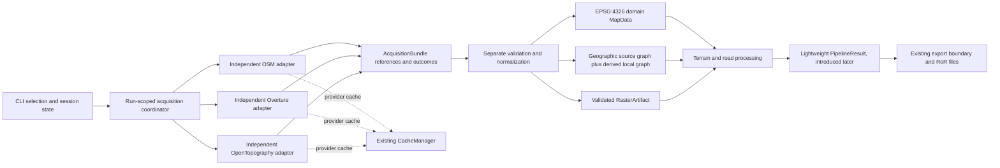
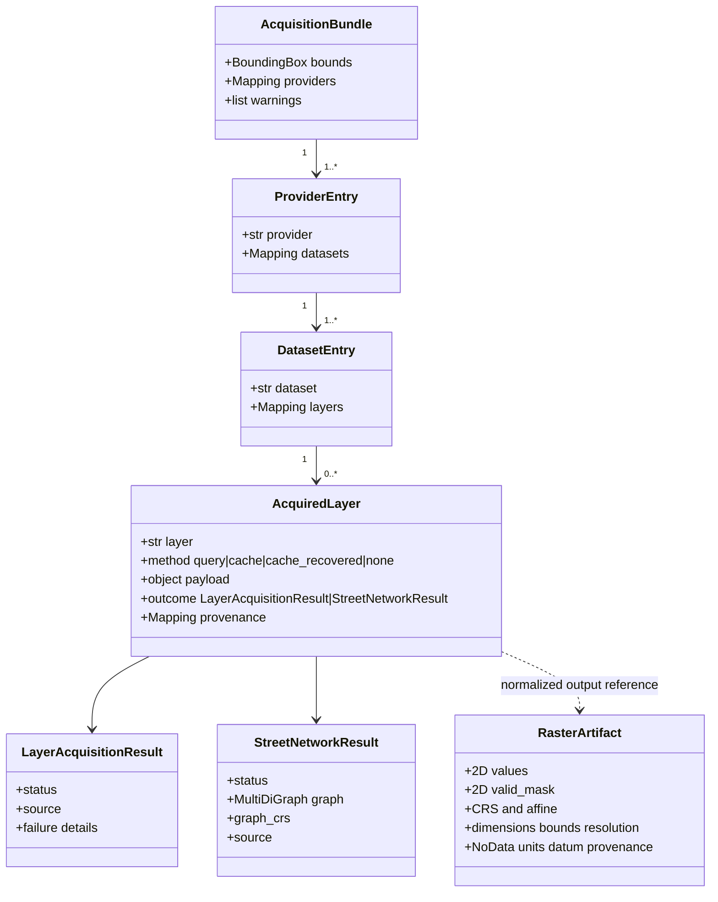
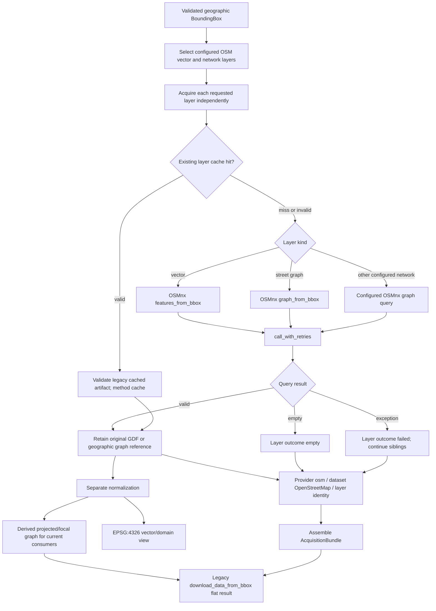
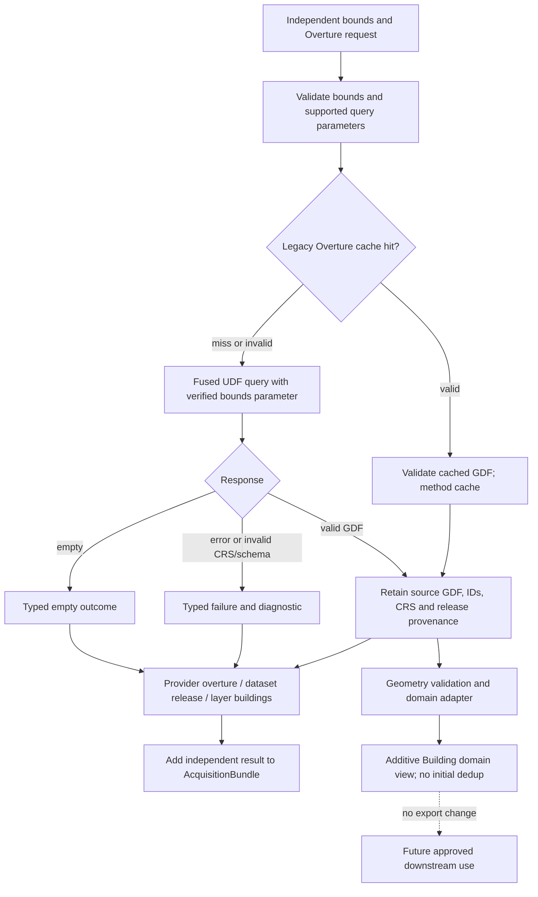
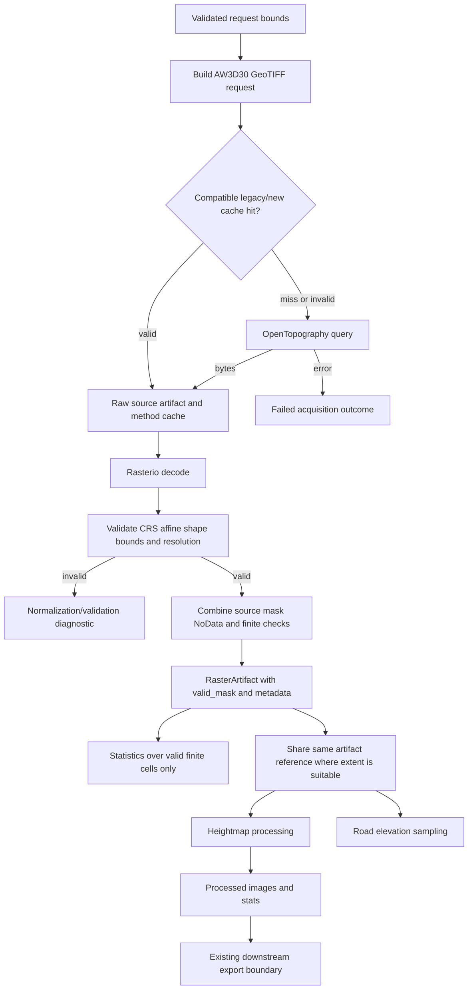
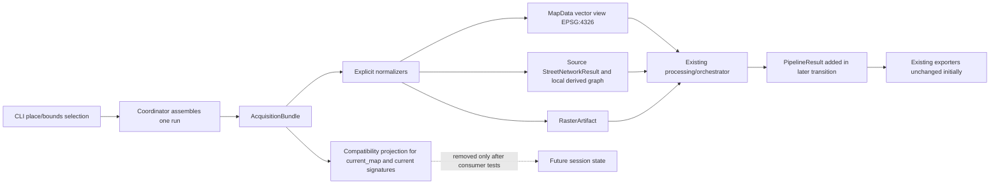
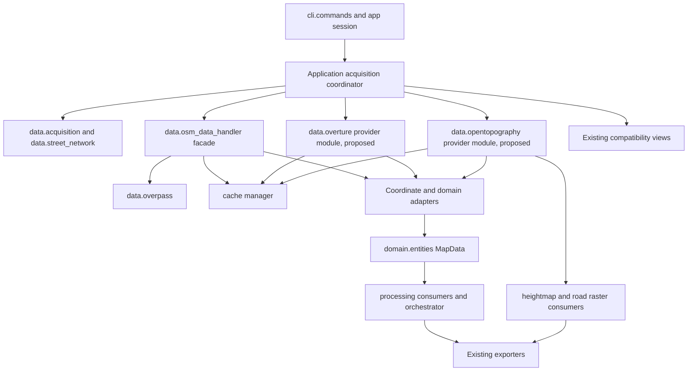

# Phase 2.2.2 — Acquisition Consolidation Design

## 1. Purpose and scope

This document specifies a proposed, incremental design for consolidating acquisition from OpenStreetMap (OSM), Overture Maps, and OpenTopography. It is a design artifact only. No proposed interface or migration step is implemented here, and this document does not approve the architecture.

The design preserves provider independence, original payloads, specialized vector/graph/raster contracts, and existing callers during transition. It does not change exporters, cache keys or formats, configuration defaults, provider behavior, or Rigs of Rods output. The current checkout already contains substantial local changes; the design treats those files as user work and does not modify them.

## 2. Architectural references and evidence

The controlling contract is [Phase 2.1.1 — Fundamental Data Contract Specification](phase-2.1.1-data-contracts.md). The current-state evidence is [Phase 2.2 — Acquisition Audit](phase-2.2-acquisition-audit.md). Those documents define target data semantics and observed behavior respectively; this proposal does not revise either.

Code references below describe the current checkout, not implemented target behavior. The principal evidence is:

| Current module | Verified responsibility and relevant symbols |
|---|---|
| `osm2terrn/data/acquisition.py:1–36` | `LayerAcquisitionResult`, status/source literals, and failure-field validation. |
| `osm2terrn/data/street_network.py:1–70` | `StreetNetworkResult`, graph/status/source/CRS validation. |
| `osm2terrn/data/osm_data_handler.py:259–590` | OSM bbox acquisition, vector and graph queries, transformation, per-layer and bundle cache. |
| `osm2terrn/data/osm_data_handler.py:604–663` | Standalone Fused Overture building query/cache. |
| `osm2terrn/data/overpass.py:22–227` | Bounded retry/endpoint handling and OSMnx integration. |
| `osm2terrn/data/osm_loader.py:17–85` | Alternative place/bbox graph acquisition and separate cache. |
| `osm2terrn/adapters/coordinate_transform.py:50–141` | GeoDataFrame and graph transformation to the current local coordinate representation. |
| `osm2terrn/processing/terrain/elevation_service.py:24–153` | OpenTopography request, GeoTIFF decode, tuple cache, convenience API, and sampling. |
| `osm2terrn/processing/terrain/heightmap_handler.py:44–67,112–199` | Elevation fallback, normalization/smoothing, and image output. |
| `osm2terrn/processing/roads/road_elevation.py:15–126` | Independent road-extent DEM request and graph/zero fallbacks. |
| `osm2terrn/cache/manager.py:16–108`; `osm2terrn/cache/keys.py:14–70`; `osm2terrn/cache/file_cache.py:13–79` | Shared persistence, key construction, backend, and serialization boundary. |
| `osm2terrn/cli/commands.py:21–115`; `osm2terrn/app/app_state.py:1–25` | CLI acquisition/export and mutable process-level `current_map`. |
| `osm2terrn/processing/orchestrator.py:239–429` | Current integration of roads, heightmap, and RoR outputs. |
| `osm2terrn/domain/adapters/osmnx_to_roads.py:54–169`; `osm2terrn/domain/adapters/osmnx_to_map.py:55–131` | Graph/GDF-to-domain adaptation and EPSG:4326 domain checks. |
| `osm2terrn/domain/entities/map_data.py:19–33`; `osm2terrn/domain/entities/features.py:12–67` | Vector-domain aggregate and feature entities. |

The detailed actual flows, current cache namespaces, current test inventory, and known risks are documented in the Phase 2.2 audit. No provider was queried and no test was run for this design.

## 3. Design principles

1. A provider adapter obtains source data and reports acquisition facts. It does not construct domain entities or run terrain/road processing.
2. Acquisition keeps a reference to the original source payload. Normalization creates explicit derived views and never silently mutates the source reference.
3. The common envelope coordinates heterogeneous contracts; it does not flatten a street graph or raster into a generic vector payload.
4. `StreetNetworkResult` remains authoritative for street topology/status and declares the CRS of the graph it contains. Geographic source graph is the preferred canonical representation; projected/local graphs are named derived views. Adoption is gated by tests for current local-graph consumers.
5. Raster data remains a separate geospatial artifact with affine transform, CRS, dimensions, bounds/resolution, NoData metadata where present, and an explicit validity mask.
6. CRS changes are coordinate transformations at named boundaries, never metadata relabeling. Missing source CRS is a validation failure or an explicitly unknown value, not grounds to assume EPSG:4326.
7. Cache is persistence for the same acquisition result contract. Cache origin changes the method/provenance, not the payload schema presented to consumers.
8. Overture is an independent provider and is integrated additively. Initial integration does not deduplicate against OSM.
9. Compatibility adapters preserve present public call paths until their consumers move. No exporter interface change is required by the early stages.
10. A per-run result is lightweight: it refers to artifacts and stage outcomes; it does not duplicate arrays/graphs/GDFs or hold the full session/configuration object.

## 4. Proposed acquisition contract

### 4.1 Shape and representation choices

Retain `LayerAcquisitionResult` and `StreetNetworkResult` as the specialized outcome objects. Add one lightweight `AcquisitionBundle` dataclass alongside the acquisition contracts in `osm2terrn/data/acquisition.py`; use nested typed mappings for provider and dataset groupings and a small typed layer record only if required to make payload/method/provenance explicit. Do not create one class per provider, dataset, layer, warning, or outcome. Prefer standard-library `dataclass`, `TypedDict`/type aliases, and `Mapping`/`dict`—no new dependency.

This is the smallest shape that makes the already-required hierarchy and run scope explicit while reusing the two existing outcome contracts. A plain flat dictionary is insufficient because the current flat OSM keys cannot distinguish provider, dataset, and layer identity (`osm_data_handler.py:297–327,570–587`), while a provider plugin/registry abstraction is not justified by three concrete flows. A transitional constructor/adapter should assemble the envelope from current returns rather than forcing provider implementations to change at once.

Conceptual example (illustrative types, not implemented code):

```python
AcquisitionBundle(
    bounds=BoundingBox(..., crs="EPSG:4326"),
    providers={
        "osm": {
            "provider": "osm",
            "datasets": {
                "openstreetmap": {
                    "dataset": "openstreetmap",
                    "layers": {
                        "buildings": {
                            "layer": "buildings",
                            "method": "query",
                            "payload": original_osm_buildings_gdf,
                            "outcome": LayerAcquisitionResult(status="available"),
                            "provenance": {"query_tags": {"building": True}},
                        },
                        "roads": {
                            "layer": "roads",
                            "method": "query",
                            "payload": geographic_street_graph,
                            "outcome": StreetNetworkResult(
                                status="available", graph=geographic_street_graph,
                                graph_crs="EPSG:4326", source="query"
                            ),
                            "provenance": {"network_type": "drive"},
                        },
                    },
                },
            },
        },
        "overture": {"provider": "overture", "datasets": {...}},
        "opentopography": {"provider": "opentopography", "datasets": {...}},
    },
    warnings=[...],
)
```

The nested mapping keys must equal their explicit identity fields (`provider`, `dataset`, `layer`) to support stable lookup and validation. The `payload` is a shared reference to the exact acquired object; adding it to the bundle must not deep-copy large data. For roads, `payload` and `StreetNetworkResult.graph` refer to the same graph object. If a future implementation finds that repeated identity fields add no value, typed nested mappings can omit those fields only after the Phase 2.1.1 contract is explicitly revised; this proposal follows that contract.

| Concept | Proposed responsibility | Representation choice |
|---|---|---|
| `AcquisitionBundle` | Bounds, provider results, top-level warnings and run-level lookup/validation boundary. | One dataclass; lightweight references only. |
| `provider` | Source identity, e.g. `osm`, `overture`, `opentopography`. | Stable string key plus explicit identity field in a typed mapping. |
| `dataset` | Provider dataset/release family, not a logical layer or API method. | Stable string key plus identity field; release details in provenance. |
| `layer` | Requested semantic product, e.g. `roads`, `buildings`, `elevation`. | Stable string key plus identity field. |
| `method` | How this payload was obtained: `query`, `cache`, `cache_recovered`, or `none`. | Closed string literal/type alias; distinct from provider/dataset/layer and outcome. |
| `payload` | Original provider representation (GDF, graph, bytes/raster source, etc.). | `object | None` at the heterogeneous boundary, narrowed by layer/provider-specific validation. Keep reference, do not copy. |
| `outcome` | Acquisition status and diagnostic. | Existing `LayerAcquisitionResult` or `StreetNetworkResult`; do not replace with a universal result hierarchy. |
| `provenance` | Request parameters safe to retain, provider IDs/version/release, input/output CRS evidence, and timestamps when available. | Typed mapping with JSON-like scalar/list/mapping values; omit secrets. |
| `warnings` | Non-fatal diagnostics at bundle/run scope that are not already the failure diagnostic of one layer. | List of strings initially, matching the existing CLI/orchestrator warning boundary; structured codes can be considered later if a concrete consumer needs them. |

Do not place normalized `MapData`, a local graph, a smoothed heightmap, or simulator files inside the acquisition payload. Track normalized and processed references in later stage results, not by overwriting the original payload.

### 4.2 Outcomes, methods, and partial success

Keep existing meanings from Phase 2.1.1 and current validation in `acquisition.py:8–36` and `street_network.py:12–70`:

| State | Meaning at acquisition boundary |
|---|---|
| `not_requested` | The plan did not request this layer; no payload; method/source `none`. |
| `empty` | The request completed successfully and provider data were absent/empty; this is not a failure. Keep a provider's meaningful empty payload only if its existing contract requires one; otherwise `None`. |
| `available` | Provider/cache supplied a non-empty payload that passed acquisition-level structural checks. Does not claim it has been normalized or processed. |
| `failed` | The requested acquisition could not produce an acceptable payload. Keep diagnostic and failure category/stage; sibling layers and providers may still succeed. |
| `missing` | Retain only for the specialized street handoff meaning already documented in Phase 2.1.1; do not use it as a synonym for `empty` or an unrequested generic layer. |

`method` answers “where did these bytes/objects come from?” while `outcome` answers “what was the result?” `cache_recovered` means an invalid cache entry was rejected and acquisition recovered through a fresh query; it is not a provider or a status. Existing `StreetNetworkResult.source` already admits it, but `LayerAcquisitionResult.source` currently does not. During transition, preserve that type and record recovered origin in the envelope's `method`/provenance; only consider widening the specialized literal after all existing callers and serialized cache readers are characterized. `source` remains a compatibility field and must not contradict the envelope method.

Acquisition, normalization, processing, and export statuses remain separate. A successfully acquired payload whose CRS/geometry/raster metadata fails normalization remains acquisition-`available`; record the failure in a distinct normalization-stage result/status and diagnostic. Existing `LayerAcquisitionResult.failure_stage` includes acquisition/transformation, but reusing it for all future normalization failures would conflate provider success with adapter failure. During the transition, map the legacy combined failure to the closest compatible fields without rewriting existing meanings.

The bundle is partial whenever one requested layer fails and another succeeds. Do not fail independent providers because a sibling failed. Warnings identify the failed provider/dataset/layer and stage; the layer outcome remains the structured source of truth.

### 4.3 Payload reference and mutation rules

The OSM vector acquisition currently transforms GeoDataFrames before returning them (`osm_data_handler.py:425–454`); graphs are also transformed before handoff (`:488–522`). The target keeps the acquired geographic GDF/graph as source references and creates explicit projected/local views for consumers. Overture's provider result is likewise retained before domain adaptation. OpenTopography source bytes are kept as the acquired payload (or as a cache-backed source artifact) while Rasterio decoding produces a separate validated raster artifact.

The envelope stores references, not defensive deep copies. Normalizers must use non-mutating transformations: GeoPandas `to_crs` result, graph copy/coordinate transform, and a separately validated raster representation. They must not change source CRS metadata in place, mutate source graph coordinates, replace source attributes, or replace source GDF geometry. NetworkX shallow copy semantics require care: nested mutable edge attributes must not be modified. Contract tests should fingerprint source GDF geometry/CRS/attributes and graph node/edge coordinates/CRS before and after normalization. A derived local graph may share immutable/scalar attributes, but any mutable nested field that will be changed must be copied at that boundary.

No duplicate raster arrays solely to attach metadata. A raster artifact should own/refer to its values, validity mask, and metadata; if a mask is derived from the data, it is a distinct boolean array and that cost is explicit. Do not retain redundant decoded copies when consumers can share the same artifact reference. Whether the original downloaded byte buffer must remain resident after decode or can be persisted in cache and released is an implementation/memory decision; provenance and source reproducibility must remain sufficient and the selected policy must be tested.

## 5. Provider architectures

### 5.1 OSM

Current `download_data_from_bbox()` combines bbox normalization, cache lookup, `features_from_bbox`/`graph_from_bbox` calls, retry wrapper use, local CRS conversion, typed outcomes, and legacy dictionary assembly (`osm_data_handler.py:259–590`). The desired internal flow separates those responsibilities while retaining the public function as a compatibility facade until callers migrate.

1. **Request preparation:** validate a geographic `BoundingBox` and derive OSMnx's `(west, south, east, north)` argument. A failed CRS conversion fails the request; do not continue with projected numeric coordinates.
2. **Provider query:** keep `features_from_bbox` for vector layers and `graph_from_bbox` for network layers; preserve configured tags, filters, `simplify=False`, `retain_all=True`, network type, and `call_with_retries` behavior. They are distinct provider operations and may have separate outcomes.
3. **Source retention and result:** validate the returned shape/CRS, then attach the untouched GDF or source graph and its result to the OSM/OpenStreetMap dataset layers. Empty/no-match and transport/provider failures are classified per layer; continue independent layers as today.
4. **Normalization:** derive EPSG:4326 domain vectors and metric/local graph views through explicit adapters. Keep the source graph as the topology authority; the local graph is a derived processing view.
5. **Compatibility view:** `download_data_from_bbox()` continues returning the current flat keys and local road result while old consumers require them. The adapter references existing values and must not issue a second query.

The acquisition API must not collapse vector query payload and graph result into a common geometry table. OSMnx's graph query preserves nodes, edge keys, topology, direction, and network attributes; `StreetNetworkResult` is the authoritative road topology contract. `MapData.roads` is a geographic feature view built from graph edges by `graph_to_roads_geodataframe()` and `geodataframe_to_roads()` (`osmnx_to_roads.py:54–169`). It is not a second source of topology and a `Road` entity is not necessarily identical to one OSM way or one graph edge: an OSM way can yield multiple edges and a road view can be split/derived. Preserve source IDs/tags when present, but keep source feature, graph edge `(u,v,key)`, and domain `Road.id` identities distinct unless an explicit stable mapping is defined.

The `osm_loader.load_graph()` route (`osm_loader.py:17–85`) remains an independent legacy path during migration. It supports place/bbox, alternate simplification/direction behavior, and its own cache. Do not silently route it through bbox acquisition or remove it. First identify each caller; then either adapt its returned graph into the same specialized street result or keep a compatibility wrapper with equivalent CRS/outcome metadata. No provider adapter constructs `MapData`.

The current `overpass.call_with_retries()` retry policy and endpoint rotation remain behind the OSM query seam. The OSMnx private-global patch/lock is an implementation detail to characterize and isolate; consolidation should not expand its scope or introduce another direct OSMnx call path around it (`data/overpass.py:22–227`).

### 5.2 Overture Maps

Overture remains an independent provider; it receives bounds/request settings, not OSM output. The current `download_builings_from_overture()` (spelling retained as an existing API) calls Fused and returns a bare GDF, then caches that object (`osm_data_handler.py:604–663`). It is not used by the CLI or domain mapping today.

The design wraps this path in an acquisition result without making it depend on OSM: provider `overture`; dataset identity `overture-buildings` or another stable dataset label; layer `buildings`; method from query/cache/recovery; payload is the returned source GDF; outcome distinguishes empty/available/failed; provenance records the actual release/UDF reference, query bounds, source feature ID fields, and verified CRS. Preserve the current callable as a transitional façade.

The local wrapper passes `bbox`, while the remotely inspected UDF accepts `bounds`; no live provider call was performed, and remote `main` can change (audit §5.1 and §11). Therefore the accepted parameter and queried region are **unverified**. Before enabling the provider in the coordinator, add a controlled, opt-in integration test using a known small bounding box with a fixture/control area that can prove: (a) the UDF accepts the selected parameter, (b) the returned extent lies within expected bounds, (c) an intentionally invalid parameter does not silently use a default area, and (d) the resulting dataset/UDF release is observable and can be pinned or recorded. Keep this test out of ordinary unit CI if it requires network credentials. During this task no provider was contacted.

Do not assign `EPSG:4326` to a returned frame unless its CRS is absent and an independently verified provider contract establishes that coordinates are WGS84. Prefer a returned CRS; validate and transform explicitly. Preserve provider feature IDs and raw attributes. Domain normalization then maps supported geometries into `Building` entities while preserving provider/dataset/source ID provenance. Keep geometry fidelity rules from Phase 2.1.1 (holes and multipart geometries must not be flattened lossily). Initial Overture composition is additive, without deduplication or precedence against OSM buildings. Building export to RoR remains outside acquisition and this design.

Current Fused import at module scope couples an OSM-only import to the Fused dependency (`osm_data_handler.py` imports). Moving the provider adapter to a focused `osm2terrn/data/overture.py` is proposed only after a compatibility wrapper/test exists; first stage behavior can be adapted in place to avoid a risky file move.

### 5.3 OpenTopography and raster contract

Current `load_elevation_raster()` requests AW3D30/GeoTIFF, decodes band 1, maps the source NoData sentinel to NaN, computes extrema, caches a four-field tuple, and discards CRS, bounds, mask, and most source metadata (`elevation_service.py:24–131`). `fetch_elevation_from_api()` drops the affine (`:83–87`). The CLI, heightmap fallback, and road sampler can each start their own request (`cli/commands.py:74–82`; `heightmap_handler.py:44–67`; `road_elevation.py:15–34`).

Separate the flow into request, provider response, decode/validation, raster artifact, and consumer processing:

1. Validate bounds and transform to EPSG:4326 before building west/south/east/north parameters. Missing API key, invalid bounds, HTTP error, invalid GeoTIFF, or invalid geospatial metadata produces a failed acquisition result with a diagnostic; never send untransformed bounds after transform failure.
2. Acquire response bytes by query or compatible cache read. Do not put the API key in keys, logs, provenance, or diagnostics. Record requested DEM and request extent.
3. Decode the source using Rasterio and validate band dimensionality, nonzero dimensions, CRS, affine transform, bounds, resolution, and consistency between dataset metadata and array shape. The raster CRS must be retained as returned; if absent, do not relabel it as EPSG:4326.
4. Produce a `RasterArtifact` conceptual contract with 2D values; `valid_mask` (boolean, same rows/columns, `True` exactly for valid samples after combining source mask, NoData, and finite-value checks); CRS; affine transform; dimensions; bounds; x/y resolution; source NoData sentinel where present; vertical units/datum (`unknown` absent evidence); and provenance. Preserve NoData as metadata even if the in-memory values use NaN or another normalized representation.
5. Calculate min/max/other summaries only from cells where `valid_mask` is true and values are finite. An all-invalid raster is not an available elevation surface; report empty or failed according to whether the provider successfully returned an empty dataset versus a malformed/unusable response. Do not let `nanmin`/`nanmax` on an all-invalid array create a successful result.
6. Hand the same artifact reference to heightmap and road processing when its extent/CRS/resolution covers the consumer need. If a different road extent is required, express it as a separate requested raster artifact and acquisition layer. Consumers own explicit invalid-sample policy; this design does not impose interpolation or a universal zero fill.

Keep heightmap operations (resampling, smoothing, display-range normalization, image generation) in terrain processing. Keep road sampling/point construction in road processing. A `RasterArtifact` and processed heightmap are not RoR files. Writing PNG/groundmap may remain in the current processing/export flow during compatibility transition, but simulator-specific terrain manifests, `.otc`, `.terrn2`, `.tobj`, and format layout remain downstream export responsibilities. No acquisition contract represents those files.

The old APIs remain adapters: `load_elevation_raster()` can project a `RasterArtifact` back to `(array, affine, max, min)`; `fetch_elevation_from_api()` can keep returning `(array, max, min)`; the CLI can continue receiving its current dictionary. These adapters do not trigger a second request and should document their information loss. `sample_elevation_at_coords()` must not silently determine future universal invalid-value semantics; old zero behavior remains only in its compatibility path until consumers are migrated.

Vertical unit/datum fields must remain `unknown` unless returned metadata or authoritative provider documentation establishes values for the particular raster. AW3D30's nominal horizontal resolution does not prove vertical unit/datum for each response. Do not infer metres merely from the existing log text.

## 6. Coordination and pipeline boundary

Add no provider registry or framework. Introduce a small orchestration function at the application/CLI boundary that calls the selected independent acquisition functions, then assembles one `AcquisitionBundle`. The provider adapters do not call each other, know `MapData`, or coordinate terrain processing. This coordinator is justified by the current split: OSM is invoked in `dlcity`, Overture is standalone, and elevation is invoked both by CLI and processing consumers (`cli/commands.py:21–82`; `elevation_service.py`; audit §8).

Do not require every provider to run. The coordinator accepts/derives requested layers from current configuration and selection, invokes only requested providers, and preserves per-layer outcomes. Configuration currently includes module-captured values (`osm_data_handler.py:38–64`, `elevation_service.py:19`, `cli/commands.py:18`) and OSMnx global settings. As later implementation work, pass a run-scoped, explicit snapshot of only relevant provider parameters to each adapter (bounds/tags/network filters, DEM selection, endpoint/retry/timeouts, and cache manager/access). Preserve current configured values and defaults in the first adapter; do not establish new defaults in this design. API keys are obtained at the request boundary from the configured environment variable, never retained in result/cache provenance, and redacted from diagnostics. Avoid mutable shared provider config and imports that snapshot settings before application setup.

`PipelineResult` is useful as a lightweight internal stage ledger after the acquisition bundle has a consumer. It is not required to implement acquisition itself and must not duplicate all bundle fields. Recommended future responsibility: reference the `AcquisitionBundle`, normalization/processing outputs, stage statuses, diagnostics, and warnings for one run; it excludes full configuration, global session state, repeated raster arrays/graphs/GDFs, and export file contents. Introduce it in the CLI transition stage, not in initial provider adaptations. Until then, `current_map` remains a compatibility/session holder and is not redefined as an acquisition result.

The separation is:

```text
session selection/state -> acquisition bundle -> normalized domain/graph/raster views
                       -> processing results -> export results/files
```

`MapData` in `domain/entities/map_data.py` remains vector-domain data in EPSG:4326; it must not hold the full raster array. The separate `app.app_state.MapData` remains session state during transition. The domain adapter currently converts graph to EPSG:4326 before creating domain roads (`osmnx_to_roads.py:54–169`, `osmnx_to_map.py:55–131`).

## 7. Cache interaction (no migration in this design)

Keep `CacheManager`, serializers, namespaces, keys, and artifact formats unchanged in the first consolidation stages. The cache boundary is called by the provider adapter (or the existing provider function behind a facade), not by domain normalization or exporters. The caller validates decoded types/shape/CRS before treating a hit as usable because `CacheManager.get()` deserializes but does not verify requested format metadata (`cache/manager.py:50–64`).

On valid hit, return the same logical contract as on query and set `method="cache"`; preserve provider provenance available in cached metadata/payload. On invalid/corrupt/incompatible cache entry, the provider adapter decides whether recovery is safe, reports `cache_recovered` if it then queries successfully, and does not present the rejected payload. If query also fails, report failed outcome and preserve both cache-rejection and provider diagnostics without exposing credentials. Do not fabricate unknown release, CRS, NoData, IDs, units, or timestamps for legacy cache artifacts.

Legacy cache tuple/dict/GDF/graph shapes remain supported only through explicit, named compatibility adapters that validate what can be validated and mark unavailable metadata unknown. They do not masquerade as a new-format object. During this work, preserve existing keys and writes. New serialization formats, key dimensions, namespaces, expiry/eviction, and retention policy require a separate cache change proposal and versioning plan. The generic manager's current missing version comparison and uneven caller recovery remain known risks, not a reason to silently alter the cache here (audit §7).

Cache method must be observable consistently across providers. `LayerAcquisitionResult.source` currently supports only `none/query/cache`, whereas `StreetNetworkResult.source` includes `cache_recovered` (`acquisition.py:8–12`; `street_network.py:12–19`). Initially the bundle-level `method` carries the richer value and the adapter translates to existing source literals when filling legacy fields. Ensure query and cache paths have equivalent outcome/payload validation.

## 8. CLI and consumer transition

Current `dlcity()` calls OSM, updates the mutable global session holder, expands bounds, and preloads elevation. `export()` passes a selected subset of fields to `export_terrain_assets()` (`cli/commands.py:21–115`). The orchestrator creates road-only domain `MapData`, processes heightmap/roads, and writes simulator output (`orchestrator.py:239–429`). Overture and acquired vector layers are not handed to it today.

Transition without a flag-day rewrite:

1. Assemble `AcquisitionBundle` from existing provider return objects at the CLI boundary; maintain current session keys and function return types through a compatibility projection.
2. Add normalized views as separate references; keep local graph available to `build_roads_from_graph()` and EPSG:4326 edge GDF available to domain adapters.
3. Make the shared elevation artifact available once to heightmap/road consumers where bounds are suitable. Maintain legacy array/dict adapters until all callers accept the raster contract.
4. Add `PipelineResult` only when the orchestration layer consumes explicit acquisition/normalization results. It records partial outcomes but does not replace `MapData` or final export return values prematurely.
5. Deprecate global `current_map` only after CLI behavior (cancel/reset, preload on/off, partial acquisition, export) is explicitly tested and an equivalent session transition exists.

No buildings export is introduced by this acquisition design. A future normalized building collection can be added to domain `MapData` via the existing adapter; the `not_implemented` current export state remains untouched until its own approved scope.

## 9. Module organization proposal

Use existing boundaries first; create at most the focused provider modules needed to remove real responsibility coupling. In particular, do not create a provider base class/registry. Module actions below are proposals, not edits.

| Current module | Current responsibility | Target responsibility | Action |
|---|---|---|---|
| `osm2terrn/data/acquisition.py` | Generic layer outcome dataclass. | Keep outcome contract and add the minimal bundle/layer typed envelope and validation helpers. | Adapt |
| `osm2terrn/data/street_network.py` | Validated street graph outcome. | Remain the authoritative topology/status contract; represent geographic source graph, with local/projected results derived by adapters. | Adapt after compatibility tests |
| `osm2terrn/data/osm_data_handler.py` | OSM bbox provider, cache, transformations, legacy dict; also Overture/Fused. | Transitional OSM facade; isolate raw query/result from normalization/cache projections. Retain existing function as compatibility API. | Divide incrementally |
| `osm2terrn/data/overpass.py` | OSMnx retry/endpoint wrapper. | Keep OSM-specific query recovery behind OSM adapter. | Maintain |
| `osm2terrn/data/osm_loader.py` | Independent place/bbox graph API and cache. | Maintain separate legacy route, then adapt its result for shared street handoff after consumers are inventoried. | Adapt, do not remove |
| `osm2terrn/data/overture.py` (proposed) | No current module. | Fused/Overture request, typed outcome and provenance; no domain mapping. Keep import out of OSM-only path. | Create after signature test |
| `osm2terrn/data/opentopography.py` (proposed) | Provider HTTP and decode currently live in processing. | Provider request/response and raw source result; no smoothing, sampling, image or export logic. | Create in raster stage, preserving old facade |
| `osm2terrn/adapters/coordinate_transform.py` | Current local CRS transformation. | Pure transformations producing named derived views; preserve source graph/GDF. | Adapt |
| `osm2terrn/domain/adapters/osmnx_to_roads.py`, `osmnx_to_map.py` | GIS-to-domain conversion and adapter caches. | Normalize geographic graph/vector data to domain entities, preserving provenance and geometry fidelity. | Maintain, then adapt |
| `osm2terrn/processing/terrain/elevation_service.py` | Provider request/decode/cache and sampling. | Transitional façade, then consumer-level sampling/utilities over validated RasterArtifact; no direct provider calls. | Divide responsibilities incrementally |
| `osm2terrn/processing/terrain/heightmap_handler.py` | Fallback, raster processing, smoothing, image products. | Consume a validated artifact or legacy adapter; own heightmap processing, not provider request. RoR writing remains downstream. | Adapt |
| `osm2terrn/processing/roads/road_elevation.py` | DEM acquisition and road sampling/fallback. | Consume supplied raster artifact/sampler; explicit road sample policy, with legacy acquisition fallback only during transition. | Adapt |
| `osm2terrn/cache/*`, `config/cache.py` | Shared persistence, serializer/key/backend. | Unchanged initially; validated adapter boundary around old artifacts. | Maintain |
| `osm2terrn/cli/commands.py`, `app/app_state.py` | Menu, direct acquisition, global session state, export handoff. | Thin run coordinator and compatibility projection; eventually session references a PipelineResult. | Adapt in final stage |
| `osm2terrn/processing/orchestrator.py` | Domain adapter coordination, processing and output export. | Consume explicit normalized/processed handoffs; preserve exporter interfaces and output behavior during this scope. | Adapt later; no exporter changes |
| `osm2terrn/domain/entities/map_data.py`, `features.py` | Vector-domain entities. | Remain provider-independent domain model; no arrays, NetworkX, Rasterio, Fused, or API config. | Maintain |

### Dependency rules

- Provider modules may depend on provider SDK/HTTP client, geospatial decoding libraries, acquisition outcome types, config values passed at call time, cache interface, and logging.
- Provider modules must not import `domain.entities`, CLI, processing, or exporters.
- `data/acquisition.py` and `data/street_network.py` must not import providers, CLI, domain `MapData`, or export code.
- CRS/raster/graph normalizers may depend on geospatial libraries and acquisition payload contracts, but not make provider requests.
- Domain entities remain independent of GeoPandas, OSMnx, NetworkX, Rasterio, and provider clients; adapters isolate those libraries.
- Processing consumes normalized/raster/graph references and produces processing artifacts; it does not silently acquire provider data after migration.
- CLI/application coordination may depend on provider entry points and adapters; providers never import the coordinator.
- Exporters remain downstream and unchanged in the initial stages.

## 10. Target diagrams

These diagrams show the proposed architecture, not the present implementation. Boxes marked as proposed remain unimplemented.

### 10.1 General acquisition architecture



### 10.2 Acquisition contract relations



`ProviderEntry`, `DatasetEntry`, and `AcquiredLayer` are proposed typed mapping shapes unless a runtime invariant warrants the small layer dataclass. `RasterArtifact` is a target conceptual contract from Phase 2.1.1, not a class added here.

### 10.3 OSM acquisition flow



### 10.4 Overture flow



UDF parameter/release behavior is an explicit pre-integration test gate; diagram labels do not imply it is verified.

### 10.5 Raster flow



### 10.6 Provider, cache, and result interaction

```mermaid
sequenceDiagram
    participant C as Coordinator
    participant P as Provider adapter
    participant K as Existing CacheManager
    participant S as Provider service
    participant B as AcquisitionBundle
    C->>P: acquire(request, explicit settings)
    P->>K: get(existing namespace/key/serializer)
    alt valid cached artifact
        K-->>P: payload + metadata
        P->>P: validate type and available metadata
        P-->>B: payload reference, outcome, method=cache
    else miss, invalid or deserialization error
        P->>S: query using provider-specific flow
        alt provider succeeds
            S-->>P: original payload and response metadata
            P->>K: put using current format during early migration
            P-->>B: payload reference, outcome, method=query or cache_recovered
        else provider fails
            S-->>P: error/empty response
            P-->>B: layer outcome and diagnostic; preserve partial siblings
        end
    end
    B-->>C: independent provider results for the run
```

### 10.7 CLI, normalization, and processing integration



### 10.8 Proposed module architecture



## 11. Incremental migration plan

Stages are ordered to create behavioral evidence before moving boundaries. Each stage is independently reviewable. Tests named here are proposed future tests, not executed in this task.

### Stage A — Characterization baseline

- **Objective:** Freeze current externally visible query/cache, status, CRS, and CLI handoff behavior before changing it.
- **Modules:** Existing OSM/Overpass/loader, elevation service, cache, CLI/orchestrator, and domain adapters.
- **Changes:** Focused tests/fixtures and call-count observations only; mark tests for known information loss as transitional.
- **Dependencies:** None.
- **Risks:** Encoding current zero-fill, CRS loss, or duplicate requests as desired behavior.
- **Tests:** Current OSM cache/status and retries; graph CRS/export handoff; elevation tuple/fallback; CLI cancel/reset and partial-result behavior; test with mocked provider functions for the three DEM call paths.
- **Acceptance:** Baseline is deterministic without live providers; test names/results distinguish current behavior from target semantics.
- **Next-stage gate:** Existing caller inventory is complete and compatibility expectations are agreed.

### Stage B — Contracts and compatibility adapters

- **Objective:** Introduce the common envelope without changing provider internals or public return values.
- **Modules:** `data/acquisition.py`, `data/street_network.py`, OSM facade, CLI boundary.
- **Changes:** Add `AcquisitionBundle` and nested typed mapping shape; assemble references to existing OSM dictionary/outcomes; adapt legacy keys without copies or re-queries. Do not add full `PipelineResult` yet.
- **Dependencies:** Stage A.
- **Risks:** Mislabeling source/method; duplicating graph/GDF/raster references; confusing dataset and layer names.
- **Tests:** Identity equality of payload references, key/identity validation, all status combinations, partial layer results, method query/cache/recovery and legacy dictionary parity.
- **Acceptance:** Both envelope and old callers observe equivalent payloads/statuses; provider identity dimensions are explicit.
- **Next-stage gate:** Bundle can contain partial provider output and preserve existing direct-call tests.

### Stage C — Preserve OSM source payloads and derive views

- **Objective:** Retain queried geographic GDF/graph and isolate current local transformations.
- **Modules:** `osm_data_handler.py`, `coordinate_transform.py`, `osmnx_to_roads.py`, `osmnx_to_map.py`, `osm_loader.py` adapter seam.
- **Changes:** Store source references and outcomes; generate derived projected/local graph for existing road processing and geographic edge/domain GDF for `MapData`. Maintain `download_data_from_bbox()` and independent `load_graph()` compatibility paths.
- **Dependencies:** Stage B; CRS characterization.
- **Risks:** Memory growth, nested graph attribute mutation, mismatch between source graph and cached legacy local graph, consumers assuming source is local.
- **Tests:** Source geometry/attributes/graph coordinates remain unchanged; graph declared CRS matches coordinates; round-trip/projected view; existing road output equivalent; edge/source/domain IDs not conflated.
- **Acceptance:** Original payload is available for normalization while current local-graph consumer output and calls remain compatible.
- **Next-stage gate:** All known graph consumers accept their explicitly named view.

### Stage D — Overture and raster adapters

- **Objective:** Bring independent Overture and OpenTopography acquisitions into the envelope and normalize them without provider coupling.
- **Modules:** `data/overture.py` (proposed after seam test), `data/opentopography.py` (proposed), current Overture wrapper, elevation service, heightmap and road elevation consumers, domain adapters.
- **Changes:** Typed outcomes/provenance, raw source references, source CRS validation, explicit RasterArtifact mask/metadata, old function/tuple/dictionary facades. No cache key or format migration. No RoR building output.
- **Dependencies:** Stage B; Stage C for Overture-to-domain geometry adapter; Phase 2.1.1 raster/geometry decisions.
- **Risks:** Fused UDF signature/release unverified; source CRS/IDs may be absent; legacy tuple has insufficient metadata; raster memory overhead; units/datum unknown.
- **Tests:** Mocked empty/error/cache/query cases; Overture source ID/CRS and bounded integration test opt-in after UDF query parameter confirmed; raster dimensions/affine/CRS/mask/NoData preservation and all-invalid behavior; finite-valid-cell statistics; old API adapter parity; one provider failure does not fail another.
- **Acceptance:** Consumers can use validated result contracts; legacy callers still receive their current values; provider origins remain independently observable.
- **Next-stage gate:** Shared raster object can reach both relevant consumers and tests show no extra request where one suitable result is already present.

### Stage E — Coordinator and CLI transition

- **Objective:** Replace direct provider calls/global data dictionaries gradually with a run-scoped result.
- **Modules:** `cli/commands.py`, `app/app_state.py`, coordinator boundary, `processing/orchestrator.py`, compatibility adapters.
- **Changes:** One acquisition plan/run assembly; status-aware optional stages; adapt to current exporter signatures. Introduce lightweight `PipelineResult` only when at least two explicit downstream stage results need a common run ledger. Deprecate global state only after parity.
- **Dependencies:** Stages B–D.
- **Risks:** CLI menu/cancel behavior, preload setting, partial failures, output paths, prior state persistence, and old integrations.
- **Tests:** CLI query-to-export handoff; cancel/reset; preload enabled/disabled; partial provider failure; single in-memory raster reuse; output regression tests with provider stubs.
- **Acceptance:** One run has explicit inputs/outcomes; existing output behavior remains; exporters require no signature change in this stage.
- **Next-stage gate:** Developer approves CLI behavior changes and all characterized legacy callers have an adapter or are removed by an explicit decision.

### Cache work is a separate follow-up

Do not change serializers, namespaces, keys, format versions, validation policy in the generic manager, size/eviction, or retention within A–E. After contract adoption, prepare a separate cache compatibility/migration proposal. Cache tests in A–E exercise existing behavior only.

## 12. Contract test matrix

| Contract area | Required assertions |
|---|---|
| Bundle structure | Provider → dataset → layer nesting; repeated identity keys match fields; no cross-provider dependency; bounds CRS explicit; warnings coexist with successful siblings. |
| Outcomes/methods | Each status's permitted payload/source; query/cache/cache-recovered distinguished from status; failure has diagnostic and stage; empty is not failed; partial success retained. |
| Original payload | Bundle references identical source object; GDF/graph source fingerprints unchanged after normalization; adapters never silently relabel CRS. |
| Street graph | `StreetNetworkResult` remains graph authority; CRS declaration equals `graph['crs']`; geographic source retained; local/projected graph is explicitly derived; graph edges and domain Road entities have distinct identities. |
| CRS | Invalid/missing CRS cannot silently become EPSG:4326; transform failure stops provider request; domain GDF is EPSG:4326; projected/local coordinate consumers get a CRS-consistent view. |
| Overture | Independent result; selected bounds honored (controlled opt-in integration); verified UDF parameter/release; source CRS and IDs retained; empty/error typed; no initial dedup. |
| Raster | Two-dimensional values; mask same shape and true only for valid finite samples; source NoData retained where present; affine/CRS/dimensions/bounds/resolution consistent; units/datum unknown absent evidence; stats use valid cells only; all-invalid rejected/empty with explicit status. |
| Compatibility | Legacy OSM dictionary, graph return, Overture function and elevation tuple/dict match payload/status behavior; adapters do not re-query; old cache payloads only accepted through explicit validating adapters. |
| Cache | Valid hit has same contract with method cache; invalid payload rejected; recovery is visible; no secret in key/log/provenance; current keys/formats unchanged during initial stages. |
| Coordination | Independent provider failures remain partial; only requested providers execute; applicable single raster reference reused; session and pipeline results are not conflated. |

The audit inspected existing tests by source/name; they cover several OSM cache, Overpass retry, graph handoff, elevation cache/fallback, domain adapter, and pipeline status paths (audit §14). They do not establish full AcquisitionBundle, Overture CRS/outcome, raster mask/geospatial metadata, or all-provider corrupt-cache behavior. This document does not claim those tests were run.

## 13. Decisions affecting acquisition

### Must be resolved before the corresponding contract is implemented

| Decision | Why it matters | Recommended handling |
|---|---|---|
| Overture UDF parameter and selected-bounds behavior | Current wrapper passes `bbox`; inspected remote signature uses `bounds`, but runtime was not verified. Wrong bounds can silently return unrelated data. | Require a controlled test proving actual queried extent before enabling Overture integration. No provider call in this design task. |
| Overture dataset/UDF version identity | Remote `main` is mutable and current wrapper does not pin/record release. This affects provenance and cache reproducibility. | Decide a supported pin/recording mechanism after test confirms remote API support; absent that, report exact revision as unknown, not guessed. |
| Acquisition versus normalization status boundary | Existing generic result has a transformation failure stage; desired model separates acquired source success from failed derived view. | Keep acquisition success intact and add a narrowly scoped normalization result/status at implementation, without changing Phase 2.1.1 meanings. |
| Geographic graph authority migration | Current bbox consumers receive local graph; the alternate loader returns provider CRS. Swapping authority before adapting consumers risks coordinate errors. | Preserve both through adapter during transition; require consumer inventory and CRS/parity tests before source-graph cutover. |
| `cache_recovered` representation for generic layers | `StreetNetworkResult` supports it but `LayerAcquisitionResult` does not. | Initially record richer method in the envelope and map to legacy source; decide whether to widen generic literal only after caller/cache tests. |

### Can be resolved during a named stage

| Decision | Stage | Consequence |
|---|---|---|
| Whether a reusable normalized raster artifact keeps raw response bytes resident or releases them after cache/persistence | D | Memory versus exact source reproducibility; does not alter raster metadata contract. |
| Exact CRS/resolution match rule for sharing a full-area raster with road sampling | D | Determines whether consumer can reuse the artifact or requests a distinct extent; do not imply any interpolation policy. |
| Minimal provider-specific provenance keys available from OSMnx/Fused/OpenTopography | B–D | Determines provenance completeness; unknown fields remain absent/unknown, not synthesized. |
| When the lightweight `PipelineResult` becomes worthwhile | E | Add only when it removes concrete duplicated stage state; it is not a prerequisite to bundle acquisition. |

### Can be deferred without changing the initial acquisition envelope

| Decision | Deferred implication |
|---|---|
| Domain feature ID canonicalization and exact fallback algorithm | Source IDs and provider-prefixed provenance must still be retained; canonicalization can be decided with the domain integration step. |
| Geometry mappings for unsupported polygon holes/multipart families | Preserve source geometry and reject unsupported lossy normalization; the envelope remains valid. |
| Vertical unit/datum inference | Keep both unknown until response-level authoritative evidence exists. |
| Raster invalid-sample interpolation/fill policy | Each consumer specifies its own policy; mask/NoData contract remains stable. |
| Deduplication/precedence between OSM and Overture | Initial integration remains additive; future dedup needs product rules and stable feature identity. |
| Cache format migration, key expansion, old-format retention duration, eviction/size enforcement | Separate decision and migration proposal; preserve present cache behavior for A–E. |
| Broader Overture building export to RoR | Outside acquisition and current exporter scope. |

## 14. Risks and conclusions

| Risk | Severity/evidence | Mitigation in the proposed sequence |
|---|---|---|
| Existing acquisition destroys geographic source views by projecting in place/early; source graph is not at current CLI handoff. | High, confirmed by audit and `osm_data_handler.py:425–522`. | Preserve references in Stage C, test source immutability and derived CRS before changing consumers. |
| Raster currently loses CRS/mask/NoData and zero-fills invalid/outside samples. | High, confirmed by `elevation_service.py:53–153`. | Stage D validates georeferencing, uses explicit mask, preserves legacy fill only inside old adapter. |
| Overture bounds parameter/signature and release are uncertain. | High, static mismatch confirmed; runtime unverified. | Integration gate before provider use; no silent default-area behavior. |
| DEM is acquired from multiple call paths and may be requested twice. | Medium, confirmed paths in CLI, heightmap fallback, road sampler. | Characterize call counts; pass one suitable artifact reference; separate requests for genuinely different extents. |
| Current mutable session/global configuration makes run inputs implicit. | Medium, confirmed `app_state.py`, module-captured config, and OSMnx global settings. | Delay coordinator/state migration until explicit per-run contracts have parity tests. |
| Cache deserialization/recovery differs by provider and old payloads lack target metadata. | Medium, confirmed by cache audit. | Preserve current formats; caller validation and named legacy adapters; separate future migration proposal. |
| Duplicated graph/GDF/raster representations increase memory or accidental mutation risk. | Medium, plausible during source-plus-derived transition. | Reference originals; create only required derived views; profile/test large-area scenarios before expanding retention. |
| Local projected CRS and EPSG:4326 can be confused at consumer boundaries. | High, confirmed inconsistent current graph handoffs. | Carry CRS with every spatial object and test coordinate/metadata agreement at each named transform. |

The recommended sequence is A → B → C → D → E: characterize first, establish reference-only contracts, preserve OSM source payloads, adapt Overture/raster independently, then coordinate CLI/pipeline. This minimizes simultaneous changes and keeps exporters stable. It is a proposal only. Approval of the design and implementation sequence remains with the developer; this document does not declare Phase 2.2 complete or start implementation.

## 15. Approval checklist

Before implementation, obtain explicit decisions on:

1. The proposed minimal `AcquisitionBundle` dataclass plus typed nested mappings/layer record, and whether identity fields are repeated inside mapping entries.
2. The source graph as canonical topology authority with local graphs as derived views, including a consumer-by-consumer compatibility gate.
3. The status/method transition for generic `cache_recovered` and separation of acquisition versus normalization failures.
4. The Overture UDF parameter, actual bounds behavior, and supported dataset/revision pinning after a controlled integration test.
5. The raster raw-byte retention policy and the exact compatibility period for legacy tuple/dictionary/cache artifacts.
6. The criteria for sharing one raster with heightmap and road consumers when extents differ.
7. The point at which `PipelineResult` should be introduced and whether it is limited to status/reference tracking.
8. The module split timing for Overture/OpenTopography and the compatibility lifetime of `osm_data_handler`, `elevation_service`, and `osm_loader` entry points.
9. Whether the staged test gates and no-cache-migration boundary are accepted.

No implementation or provider query is authorized by this design document.
