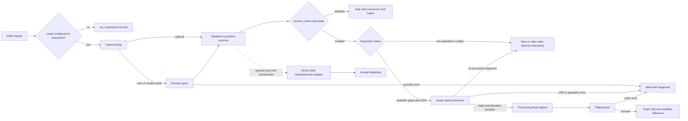

# Stage 3.2 — Download, State, and Export Handoff

## Scope and certainty

This section records the Stage 3.2 static source analysis of the working tree
on 2026-10-20. It does not establish which provider branches ran, whether a
cache hit occurred, or which files exist from an actual export. The
implementation and synthetic-test follow-up is recorded in the final section.

Use `code fact` for explicit declarations and statements, `static inference`
for their connected control/data-flow consequences, and `open decision` where
the implementation does not specify intent. The working tree had pre-existing
source modifications; references describe the files as inspected, not an
assertion about when those changes were made.

Two classes share the name `MapData` and must not be conflated:

- `osm2terrn.app.app_state.MapData` is the mutable CLI session container. It
  holds `data`, `elevation_data`, `place`, `origin_lon`, and `origin_lat`
  ([app_state.py](../../../osm2terrn/app/app_state.py#L6)).
- `osm2terrn.domain.entities.MapData` is the domain aggregate containing
  typed feature lists, bounds, coordinate system, and metadata
  ([map_data.py](../../../osm2terrn/domain/entities/map_data.py#L18)).

## Data handoff table

| Stage | Function / file | Input → output | Side effects / next consumer | Evidence and certainty | Open points |
|---|---|---|---|---|---|
| Configuration | `ProjectLoader` / `osm2terrn/config/loader.py`; config defaults and models | Program/project files, defaults, CLI overrides → typed configuration | `main()` configures settings before importing the CLI menu; data modules capture program config at import | Source facts: `osm2terrn/app/main.py:156-185`; `osm2terrn/config/loader.py:460-500`; `osm2terrn/data/osm_data_handler.py:21-24` | Exact active configuration depends on files and CLI values; no user configuration was executed. |
| Select area by search | `DownloadMenu.show_main_menu()` / `osm2terrn/data/download_menu.py`; `NominatimResult.get_bbox_tuple()` / `osm2terrn/data/download_menu_components.py` | Search text → selected display-name first component and `(west, south, east, north)` tuple | The tuple and name return to `dlcity()` | Source facts: `osm2terrn/data/download_menu.py:26-49,80-115`; `osm2terrn/data/download_menu_components.py:15-37` | Nominatim request/result availability and name uniqueness are runtime/provider matters. |
| Select area manually | `get_custom_bbox()` / `osm2terrn/data/download_menu.py` | Four numeric coordinates → validated `(west, south, east, north)` tuple; caller returns `place=""` | `dlcity()` checks both place and bbox and returns before calling bbox download | Source facts and static inference: `osm2terrn/data/download_menu.py:48-78`; `osm2terrn/cli/commands.py:27-35` | Whether the product should support anonymous/bbox-only areas is a design decision. |
| Download OSM | `download_data_from_bbox()` / `osm2terrn/data/osm_data_handler.py` | Bbox only → dictionary: `bounds`, `x_0`, `y_0`, origin coordinates, configured geometry keys and configured network keys | Cache lookup; on miss, OSMnx feature and graph queries; transforms results; writes bundle cache | Source facts: `osm2terrn/data/osm_data_handler.py:56-167`; transformations `osm2terrn/adapters/coordinate_transform.py:59-62,76-112` | Cache hit, provider result, failures, and configured key set are unknown without a controlled run. |
| Store CLI session | `dlcity()` / `osm2terrn/cli/commands.py`; `osm2terrn/app/app_state.MapData` | Returned dict and name → `current_map.data`, `.place`, origins | Also sets process environment values for place/origin; bounds may be replaced with square bounds | Source facts: `osm2terrn/cli/commands.py:34-68`; `osm2terrn/app/app_state.py:6-18` | `current_map` is process-global mutable state; stale state after some early-return/error branches needs runtime-focused tests. |
| Prefetch elevation | `dlcity()` calls `heightmapper`, an alias for `fetch_elevation_from_api()` | `data["bounds"]` → array, max/min → `current_map.elevation_data` | Raster lookup/cache and possible provider request; catches errors and stores `{}` | Source facts: `osm2terrn/cli/commands.py:70-79`; `osm2terrn/processing/terrain/elevation_service.py:83-131` | `pipeline.preload_elevation` is loaded/configurable but not read in this path. Whether it should suppress this eager call is undecided. |
| Export callback | `export()` / `osm2terrn/cli/commands.py` | Current state → place, bounds, elevation, origin passed to `export_terrain_assets()` | Does not pass `current_map.data` or a roads GeoDataFrame; returns output path map | Source fact: `osm2terrn/cli/commands.py:90-115` | No test or run here establishes reachability or produced files. |
| Build domain map | `export_terrain_assets()` and `build_mapdata_from_pipeline_context()` | Bounds, place, metadata; optional `roads_gdf` omitted by this caller → domain `MapData` with no roads on a cache miss | Stores road/building counts, then calls image, road, OTC, TOBJ, and TERRN2 exporters | Source facts: `osm2terrn/processing/orchestrator.py:187-221`; `osm2terrn/domain/adapters/osmnx_to_map.py:54-119` | The current export call does not consume the downloaded OSM bundle. A valid cache entry for the same absent-road input should also be empty; actual cache contents were not inspected. |
| Prepare heightmap | `_export_heightmap_textures()` → `generate_heightmap_n_texture()` → `_prepare_elevation_data()` | Bounds and passed elevation dict → normalized raster/statistics; if required keys absent, fetches raster itself | Raster cache in provider layer; smoothed-image cache; writes heightmap and groundmap | Source facts: `osm2terrn/processing/orchestrator.py:126-148`; `osm2terrn/processing/terrain/heightmap_handler.py:44-67,112-178`; `osm2terrn/processing/terrain/elevation_service.py:89-131` | Empty `{}` from a failed prefetch does not satisfy the key check, so export tries elevation again; provider cache may serve it. No branch was executed. |
| Prepare roads | `_export_roads()`; `build_roads_from_place()` | Domain road list, place, origin, bounds → optional road `.tobj` path | Empty road list returns before the place-based loader; otherwise loads a graph again by place, creates road/intersection objects, writes `.tobj` | Source facts: `osm2terrn/processing/orchestrator.py:151-184`; `osm2terrn/processing/network/road_network_export.py:40-196`; `osm2terrn/data/osm_loader.py:17-85` | Current caller’s omitted `roads_gdf` yields an empty domain list, so this call path statically exits before graph reloading. Standalone builder use is a separate surface. |
| Package output | `export_terrain_assets()` | Heightmap, groundmap, optional roads `.tobj`, domain manifest `.tobj`, OTC and TERRN2 paths | Roads `.tobj` is added to TERRN2 object list only if a path exists; domain manifest is always written from domain feature lists | Source facts: `osm2terrn/processing/orchestrator.py:223-281`; `osm2terrn/processing/terrain/terrn2_entrypoint.py:102-123` | File contents, path existence, and simulator validity require controlled output inspection or runtime validation. |

## Investigation A — bounding box and place label

### Static behavior

`get_custom_bbox()` reads west, south, east, north, enforces longitude and
latitude ranges, and retries when west is not less than east or south is not
less than north. The search path converts Nominatim's `[south, north, west,
east]` strings to the same tuple order. The custom option returns that tuple
paired with an empty string. Cancellation returns an empty string and `None`
([download_menu.py](../../../osm2terrn/data/download_menu.py#L26),
[download_menu_components.py](../../../osm2terrn/data/download_menu_components.py#L27)).

The CLI treats the label as mandatory alongside the bbox. It prints “No place
or bounding box selected” and returns if either is false, before calling
`download_data_from_bbox()`. That downloader accepts only a bbox; its docstring
and implementation do not need a place name
([cli/commands.py](../../../osm2terrn/cli/commands.py#L27),
[osm_data_handler.py](../../../osm2terrn/data/osm_data_handler.py#L56)).
Therefore the custom-bbox option is rejected by the current CLI path before
OSM acquisition. This control-flow defect is demonstrated by source; whether
it violates the intended product contract is not established by the code.

The place label has later uses beyond selection: it is written into session
state and process environment; it influences output filename normalization;
it is passed as `terrain_name` to the TERRN2 writer; and `_export_roads()`
requires a truthy place before it calls the place-based road loader. The
search route derives that label from only the first comma-separated component
of the selected Nominatim `display_name`; it does not retain the selected
result's OSM identity in the return value. The label is therefore not a stable
identifier for the exact selected bbox, and a later place query may describe a
different extent. The filename helper falls back to the configured default
name for an empty place,
but the road gate does not. The session state's initial place default is
`"terrain"`, but `dlcity()` overwrites it with the empty custom-selection
value if that path were to proceed
([app_state.py](../../../osm2terrn/app/app_state.py#L9),
[cli/commands.py](../../../osm2terrn/cli/commands.py#L51),
[orchestrator.py](../../../osm2terrn/processing/orchestrator.py#L30),
[orchestrator.py](../../../osm2terrn/processing/orchestrator.py#L151)).

There is no bbox-only representation for the `place` field: both CLI session
state and export signatures use a string. Also, the early return does not
clear an already populated `current_map`; `export()` later checks only
`current_map.has_data()`. After an earlier successful selection, cancelling
or taking the currently rejected manual-bbox path leaves the old selection
available to export. This is a static state-flow consequence; whether the
application should preserve the last valid map after a cancelled selection is
not specified. Separately, `load_graph()` accepts either `place` or `bbox`,
while `build_roads_from_place()` calls it using only `place`. That is an
available lower-level capability, not an active bbox road export route
([osm_loader.py](../../../osm2terrn/data/osm_loader.py#L17),
[road_network_export.py](../../../osm2terrn/processing/network/road_network_export.py#L40)).
The `load_graph()` docstring describes bbox order as `(north, south, east,
west)`, while the custom menu and bbox downloader use
`(west, south, east, north)`. Resolve this interface/documentation discrepancy
before treating the loader's bbox parameter as a compatible alternative.

### Design decision card

- **Static behavior:** Valid custom coordinates are paired with `""`; `dlcity()`
  refuses empty place before bbox download.
- **Related state consequence:** The early return does not clear a previously
  populated session map; a later export can still see the old data.
- **Evidence:** `osm2terrn/data/download_menu.py:48-78`; `osm2terrn/cli/commands.py:27-35`; downloader
  takes bbox only at `osm2terrn/data/osm_data_handler.py:56-68`.
- **Expected behavior not confirmed:** Whether the UI promises that arbitrary
  coordinate boxes can be downloaded and exported, and what their stable name
  should be.
- **Decision required:** Is a place label a required identity for the map, or
  only optional metadata for bbox-derived data?
- **Compatible alternatives:** (1) allow an optional/empty place through
  download and export, with a defined output-label fallback and explicit
  limitation for place-based roads; (2) derive a deterministic label from the
  bbox while retaining the coordinates as area identity; (3) keep the UI
  selection but require a user-supplied label; (4) disallow manual bbox in the
  product and remove or clarify the menu option.
- **Consequences/risks:** (1) requires downstream functions to handle missing
  labels consistently; filename fallback alone does not fix road loading or
  TERRN2 terrain name. (2) avoids collisions better than a shared default but
  changes visible names and needs rounding/collision rules. (3) adds an input
  step and still does not make the bbox the road loader's input. (4) preserves
  current guard semantics but leaves a misleading menu option unless UI/docs
  are aligned.
- **Discriminating tests:** With fake renderer and mocked downloader, verify
  valid custom bbox reaches the downloader under the selected contract;
  cancellation does not. Prepopulate session state and assert the chosen
  preserve-or-clear policy after cancellation and invalid/manual selection.
  Then test export naming and road behavior for a
  blank label, a generated label, and a supplied label without network access.
- **Provisional recommendation:** Decide the identity/label contract before
  changing the guard. The lower-level bbox-only downloader supports the
  coordinates, so adding a default place string alone would conceal rather
  than resolve the missing area identity decision.

## Investigation B — elevation setting and acquisition paths

### Setting/use table

| Setting/path | Default and declaration | Read/use sites found | Static effect | Status |
|---|---|---|---|---|
| `pipeline.preload_elevation` | `PipelineProjectConfig.preload_elevation=True`; project config parsing accepts a value; CLI has `--pipeline-preload-elevation` and `--pipeline-no-preload-elevation` | Parsed and serialized by configuration code; no application consumer was found in a source-wide search. | Does not guard the `dlcity()` prefetch. | Configurable but not applied to this eager path. |
| CLI prefetch | Not conditioned on the setting | `dlcity()` calls `heightmapper(data["bounds"])` after saving OSM state | Fetches/loads DEM immediately; on success stores all three required keys; on exception logs and stores `{}` | Unconditional in current code path. |
| Heightmap generation | Export receives `current_map.elevation_data` | `_prepare_elevation_data()` uses it only when keys `elevation`, `maxh`, and `minh` all exist; otherwise calls `fetch_elevation_from_api()` | Allows later on-demand fetch even if eager prefetch did not produce usable data | Independent of `preload_elevation` in current code. |
| DEM provider cache | No project preload switch | `load_elevation_raster()` checks provider cache and downloads on a miss | A second function call may not mean a second network transfer if cache hits | Cache/runtime result not observed. |
| Road DEM sampling | No project preload switch | `build_dem_sampler()` calls `load_elevation_raster()` for the road extent; the road builder also attempts a node-elevation fallback | Separate road-elevation work if road builder reaches this stage | In current CLI export, empty domain roads return before road builder. |
| OSMnx elevation URL setting | Program config provides `elevation_url_template`; `osm_data_handler` assigns it to `ox.settings` at import | No explicit OSMnx node-elevation acquisition call was found in the inspected route | Assignment configures library behavior, but does not itself show terrain elevation was fetched | Possible library-level use is not evidenced by this app path. |

Sources: `osm2terrn/config/models.py:45-49,197-202,264-275`,
`osm2terrn/config/defaults.py:97-103`, `osm2terrn/app/main.py:56-57,126-150`,
`osm2terrn/config/loader.py:348-352`, `osm2terrn/cli/commands.py:70-79`,
`osm2terrn/processing/terrain/heightmap_handler.py:44-67`, `osm2terrn/processing/terrain/elevation_service.py:83-131`,
`osm2terrn/processing/roads/road_elevation.py:13-32,35-60`, and `osm2terrn/data/osm_data_handler.py:21-30`.

### Design decision card

- **Static behavior:** The setting defaults to true and can be overridden, but
  the download callback always calls the elevation function. Export passes
  the stored result to heightmap generation; missing/incomplete data causes
  another function-level fetch attempt, with provider cache possibly serving
  the raster. Road sampling has another elevation path.
- **Evidence:** Table above; especially `osm2terrn/app/main.py:142-150`,
  `osm2terrn/cli/commands.py:70-79`, `osm2terrn/processing/terrain/heightmap_handler.py:55-66`, and
  `osm2terrn/processing/terrain/elevation_service.py:89-131`.
- **Expected behavior not confirmed:** Whether `preload_elevation=False` means
  defer terrain DEM acquisition until export, disable terrain elevation
  entirely, or only skip the early request. The field name suggests an eager
  timing choice, but that is not a confirmed requirement.
- **Decision required:** Define the setting's scope and whether road DEM
  sampling is part of “preload elevation”.
- **Compatible alternatives:** (1) treat it as eager/lazy timing only: when
  false, keep export's on-demand terrain DEM path; (2) treat it as disabling
  terrain DEM entirely and define a flat/no-data fallback, separately
  specifying road elevation; (3) rename/split settings so terrain DEM and road
  sampling have distinct control; (4) remove the setting if eager/lazy timing
  is not supported.
- **Consequences/risks:** (1) reduces work before export but keeps the
  provider requirement for a real heightmap; it must not be described as
  disabling elevation. (2) changes output semantics and may affect terrain
  height and water calculations. (3) is clearer but broadens configuration
  surface and migration. (4) removes a currently exposed CLI/config field.
- **Discriminating tests:** Mock the DEM cache and provider. Under false/true,
  assert the intended pre-export call count and state. Then call export with
  valid, empty, and incomplete elevation dictionaries and assert whether the
  heightmap path uses passed data, consults provider cache, calls the provider,
  or creates a flat fallback. Exercise road DEM sampling separately if it is
  included in the setting's scope.
- **Provisional recommendation:** Treat “preload” as acquisition timing unless
  maintainers require a no-DEM mode; retain and test export-time fallback.
  Decide explicitly whether road elevation belongs to the same switch.

## Investigation C — streets from acquisition to output

### Bundle, conversion, and export boundaries

`download_data_from_bbox()` returns a plain dictionary. It always creates
`bounds`, `x_0`, `y_0`, `origin_lon`, and `origin_lat` on a cache miss, then
adds one value per configured geometry and network key. Geometry values are
GeoDataFrames (or `None`) transformed into the local Rigs of Rods CRS. Network
values are NetworkX graphs (or `None`) transformed into that same local CRS.
The default program configuration includes a `roads` network entry and a
`rails` entry; project/program loading can replace the configured networks
mapping. Empty GeoDataFrames and empty graphs, and per-entry provider
exceptions, are recorded as `None` in the bundle. On a cache hit the cached
bundle is returned without issuing those provider calls
([osm_data_handler.py](../../../osm2terrn/data/osm_data_handler.py#L56),
[defaults.py](../../../osm2terrn/config/defaults.py#L60),
[loader.py](../../../osm2terrn/config/loader.py#L468)).

`dlcity()` stores this entire dictionary on the CLI session object, including
the `roads` graph if acquisition provided one. The export callback does not
pass that dictionary to the orchestrator. `export_terrain_assets()` calls
`build_mapdata_from_pipeline_context()` without `roads_gdf`; with that
argument omitted, the adapter constructs the domain aggregate with `roads=[]`.
If a GeoDataFrame is explicitly supplied, the adapter converts it through
`geodataframe_to_roads()`; an empty GeoDataFrame iterates to an empty list.
The downloader's `roads` value is a graph, not a GeoDataFrame, and is already
projected to a local CRS. The adapter's input type and domain aggregate label
its coordinate system EPSG:4326. Directly passing that graph as
`roads_gdf` is therefore neither type-compatible nor evidence-preserving;
conversion and CRS/origin semantics must be designed first
([coordinate_transform.py](../../../osm2terrn/adapters/coordinate_transform.py#L76),
[osmnx_to_map.py](../../../osm2terrn/domain/adapters/osmnx_to_map.py#L54),
[osmnx_to_roads.py](../../../osm2terrn/domain/adapters/osmnx_to_roads.py#L45),
[map_data.py](../../../osm2terrn/domain/entities/map_data.py#L18)).

`_export_roads()` checks the domain road collection first and returns `None`
when it is empty. In the current UI export call, the preceding adapter receives
no roads GeoDataFrame and on a cache miss builds an empty list, so the following
place-based re-fetch is not reached along this statically connected route. A
valid cached value for that same absent-road input should also be empty, but
the cache contents were not inspected. The
place-based builder is a separate callable path: it loads another graph from
OSM by place, transforms its edges to lines, samples elevation, builds road
and intersection objects, filters certain segments, and writes a road `.tobj`.
`osm_loader.load_graph()` supports a bbox argument, but
`build_roads_from_place()` invokes it with `place` only. Source-wide search
found no other application call to `export_terrain_assets()` or active
application call to `geodataframe_to_mapdata()`; tests call these functions,
but their existence is not execution evidence.

If the road builder returns a path, the orchestrator includes its basename in
the TERRN2 object's list only if the path exists. The domain manifest `.tobj`
is always written from the constructed domain map's road/building lists; with
the empty map in this route its source-level road count is zero. This does not
prove files were written in an actual run.

### Required case distinctions

| Case | What the current source establishes | What remains unknown |
|---|---|---|
| Streets not requested by configuration | `download_data_from_bbox()` loops over configured network keys; default config has `roads`, while config loading can replace the mapping. | Which configuration was active and whether it contained `roads`. |
| Streets requested but no result/error | The handler stores `None` for an empty graph or a caught provider exception. | Whether the provider returned an empty result, errored, or cache supplied data. |
| Streets downloaded but not passed onward | The CLI stores the full bundle, but the export callback omits it. | Whether the stored bundle contained a non-`None` roads graph in any run. |
| Empty structure supplied to adapter | `roads_gdf=None` maps to `[]`; an empty GeoDataFrame converts to an empty road list. | No evidence the CLI supplies either object; it supplies neither. |
| Streets discarded in processing | In the standalone road builder, trimmed-away segments, footway/cycleway/path filtering, invalid Road values, and caught export errors can omit roads. | Whether any of those branches occurred in real data; the current UI route exits before the builder because its adapter result is empty. |
| Roads export disabled by setting | `export.include_roads` has a default and CLI/config parsing; no reader was found in the current application export path. | Whether the intended contract is to honor this setting in export or to remove it. |

### Design decision card

- **Static behavior:** Default OSM configuration requests a `roads` graph, but
  the download graph is transformed to local CRS and stored in the CLI bundle.
  The active export path omits that bundle and the optional GeoDataFrame
  argument, yielding an empty domain road collection; `_export_roads()` then
  skips before any place-based reload. `include_roads` is parsed but no
  application consumer was found in this path.
- **Evidence:** `osm2terrn/config/defaults.py:60-88`; `osm2terrn/data/osm_data_handler.py:56-167`;
  `osm2terrn/adapters/coordinate_transform.py:76-112`; `osm2terrn/cli/commands.py:34-68,90-109`;
  `osm2terrn/processing/orchestrator.py:151-221`; `osm2terrn/domain/adapters/osmnx_to_map.py:54-119`;
  `osm2terrn/processing/network/road_network_export.py:40-196`; `osm2terrn/data/osm_loader.py:17-65`.
- **Expected behavior not confirmed:** Whether roads should be generated from
  the initial downloaded graph, from a second graph query by place, or from
  another configured source; whether a bbox-only road export is required; and
  whether `include_roads` controls acquisition, domain conversion, or output.
- **Decision required:** Choose a source of truth and a typed contract between
  OSM acquisition, coordinate transformation, domain `Road` entities, and the
  export builder.
- **Compatible alternatives:** (1) keep a place-based second query, but wire
  domain roads/config gates consistently and define behavior when place is
  absent; (2) consume the initially downloaded graph, with an explicit adapter
  for graph type, local CRS, and origin; (3) derive a GeoDataFrame in a known
  CRS before the adapter, while avoiding treating local coordinates as
  EPSG:4326; (4) defer road export and make the UI/config state that clearly.
- **Consequences/risks:** (1) duplicates provider/cache work and does not
  naturally support unnamed bbox areas; two queries may diverge. (2) avoids a
  second query but requires graph/domain conversion and may need to undo or
  preserve local projection metadata. (3) preserves adapter boundary but
  requires a documented geometry/CRS conversion and cannot accept the current
  graph directly. (4) is lowest change but conflicts with defaults that
  request roads and with the exposed include-roads setting unless clarified.
- **Discriminating tests:** Use synthetic OSM graph fixtures and no network.
  Assert bundle keys/types/CRS; assert export arguments and adapter input;
  test `roads_gdf=None`, empty GeoDataFrame, and nonempty GeoDataFrame; assert
  `_export_roads` early-return vs builder call; test graph-to-road conversion
  and filtering; test `include_roads` true/false and network config with and
  without a `roads` key under the chosen semantics; inspect temporary `.tobj`
  and TERRN2 references.
- **Provisional recommendation from the initial investigation:** Resolve the
  graph-versus-GeoDataFrame and CRS contract before implementation. The more
  specific recommendation is now recorded below in “Preferred contract for a
  future implementation.” Wiring the current `data["roads"]` value directly
  to `roads_gdf` would be an unsupported type/coordinate conversion.

## Proposed street-data contract — design only, not implemented

This proposal describes a future contract. It does not claim that provider
data or an export was observed. The implementation must distinguish a valid
empty network from acquisition, conversion, and export failures.

### Verified representations and loss points

| Boundary | Current representation and behavior | Evidence / certainty |
|---|---|---|
| Request area | The bbox query is normalized to `(west, south, east, north)` in EPSG:4326. The origin is the bbox midpoint. | Code fact: `osm2terrn/data/osm_data_handler.py::_bbox_to_osmnx_tuple`, `download_data_from_bbox` (lines 21–24, 50–75, 85–99). A failed reprojection logs and continues with original bounds, so that branch does not guarantee correct geographic coordinates. |
| Acquired network | Each configured network entry is an OSMnx/NetworkX graph. A non-empty graph is transformed; an empty result or caught exception becomes `None` in the bundle. Thus `None` does not identify why data is absent. | Code fact: `osm2terrn/data/osm_data_handler.py::download_data_from_bbox` (lines 21–24, 141–167). No provider branch was run. |
| Graph structure and CRS | `transform_graph()` copies the graph, converts it to `MultiDiGraph` if needed, transforms node `x/y` and edge `geometry`, and sets graph-level `crs` to the target. It reads source CRS from `graph.graph["crs"]` but defaults to EPSG:4326 when missing. Node/edge transformation exceptions are caught and skipped while the graph is still tagged with the target CRS. | Code fact: `osm2terrn/adapters/coordinate_transform.py::transform_graph` (lines 76–105). The fallback is an implementation assumption, not evidence for an individual graph's source CRS. Partial transformation can leave inconsistent coordinates under a target CRS label; the proposed contract must detect/reject this rather than inherit it silently. |
| Street attributes | `edges_to_lines()` calls `ox.project_graph`, returns `(LineString, attrs)` pairs, synthesizes endpoint geometry only if edge geometry is missing, and adds `u`, `v`, `k`. Processing also reads `highway`, `bridge`, and `name`. | Code fact: `osm2terrn/data/osm_loader.py::edges_to_lines` (lines 65–87); `osm2terrn/processing/network/road_network_export.py::build_roads_from_place` (lines 45–53, 97–145). |
| Elevation fallback acquisition | `build_node_elevation_sampler()` calls `load_graph(place=...)` again and swallows exceptions; the road builder calls it even after loading the graph used for road geometry. This is an additional place-graph/cache path, distinct from the main road graph load. | Code fact: `osm2terrn/processing/roads/road_elevation.py::build_node_elevation_sampler` (lines 33–69); `road_network_export.py::build_roads_from_place` (lines 53–58). Whether it returns node elevations depends on graph attributes and optional SciPy at runtime. |
| Domain adapter | The adapter accepts `GeoDataFrame | None`. It copies geometry coordinates directly into domain `Polyline` values and retains only `name` and source metadata. The resulting `MapData` says `EPSG:4326` regardless of the input GDF CRS; the conversion does not reproject. | Code fact: `osm2terrn/domain/adapters/osmnx_to_map.py::build_mapdata_from_pipeline_context` (lines 54–119), `osm2terrn/domain/adapters/osmnx_to_roads.py::geodataframe_to_roads` (lines 45–99), `osm2terrn/domain/entities/map_data.py::MapData` (lines 18–31). |
| Processing/domain conversion | `road_to_domain_model()` converts processing `(x, y, z)` to domain `(x, z)` points. It is not a graph/GDF-to-processing export input and drops per-point elevation/orientation. | Code fact: `osm2terrn/processing/domain_bridge.py::road_to_domain_model` (lines 10–27). |
| Export coordinates | The place builder projects edge lines from `src_crs` into the origin-derived local CRS, then `to_local_xz()` inverts the second axis and applies offsets (zero in the current call). It samples elevation and creates processing `Road.points_m`; `TobjExporter` consumes those processing roads. | Code fact: `osm2terrn/processing/network/road_network_export.py::build_roads_from_place` (lines 45–67, 112–166), `osm2terrn/processing/roads/road_geometry.py::to_local_xz`, `build_oriented_points`, and `osm2terrn/processing/network/tobj_exporter.py::TobjExporter.export_to_tobj`. |
| Handoff loss and repeated queries | `dlcity()` stores the bundle on CLI state; `export()` does not pass it to the orchestrator. The orchestrator builds domain `MapData` without `roads_gdf`; `_export_roads()` returns if the domain roads list is empty. Otherwise it calls `build_roads_from_place()`, which loads another graph by place; the node-elevation fallback independently calls `load_graph(place=...)` again. These paths ignore the original bundle graph. | Static data-flow inference: `osm2terrn/cli/commands.py::dlcity`, `export`; `osm2terrn/processing/orchestrator.py::export_terrain_assets`, `_export_roads`; `osm2terrn/processing/network/road_network_export.py::build_roads_from_place`; `osm2terrn/processing/roads/road_elevation.py::build_node_elevation_sampler`. No runtime/export result was observed. |

“Local CRS” does not mean that the coordinates have necessarily been translated
to a terrain origin. `local_crs_from_lonlat()` constructs an azimuthal-equidistant
CRS centered at the supplied lon/lat with zero false easting/northing; the graph
transform writes coordinates in that CRS. The separate `to_local_coords()`
helper subtracts a projected UTM origin, but it is not the graph transformation
used by `download_data_from_bbox()`. These operations must not be conflated.

### Alternatives

| Option | Advantages | Costs / risks | Fit with current implementation |
|---|---|---|---|
| **A. Keep the bundle graph canonical and adapt it explicitly** | Reuses acquired graph, topology, edge keys, and attributes; avoids a second provider query; one semantic representation boundary into processing, with coordinate transforms explicitly tested; optional domain adaptation. CRS comes from graph metadata. | Must pass bundle data through session/export, validate CRS, separate acquisition from `build_roads_from_place()` processing, and replace the current domain-road-count gate. Directly wiring the graph to `roads_gdf` remains invalid. | Closest to existing acquisition/cache design; can reuse edge extraction and road processing after extracting a graph-taking function. No generalized geometry abstraction required. |
| **B. Produce and store a streets GeoDataFrame** | Matches the current `MapData` adapter's declared input and is inspectable with GeoPandas. | Graph→GDF, CRS transform, then GDF→domain are distinct representation/coordinate operations; may lose topology, edge keys, and attributes; a GDF alone cannot distinguish empty data from failed acquisition. It does not feed the current `.tobj` builder, which re-queries by place. | Type-compatible only after explicit graph conversion. Existing adapter does not reproject or retain all attributes, so it is insufficient as-is. |
| **C. Add a typed intermediate carrying geometry, CRS, and metadata** | Can express acquisition status, geometry, CRS, bbox/origin provenance, and diagnostics; makes invalid combinations easier to reject and cache behavior clearer. | Adds a type and serialization/versioning surface; can duplicate CRS held in graph metadata; coordinate transforms and graph-aware road processing/export remain necessary. | Most explicit, but more change than evidence requires if a narrow bundle outcome envelope suffices. |

### Preferred contract adopted for implementation

**Option A was adopted, with a narrow acquisition outcome alongside the
canonical graph.** This avoids a second geometric source of truth without
introducing a general-purpose street model solely to bridge current modules.
The graph remains canonical; a small result envelope (or equivalent explicit
bundle fields) is necessary because current `None` collapses distinct states.
This is not a recommendation to pass a NetworkX graph as `roads_gdf`.

Minimum logical contract:

| Field | Meaning / invariant |
|---|---|
| `acquisition_status` | `not_requested`, `available`, `empty`, or `failed`. `available` requires a graph with at least one edge. `empty` means acquisition succeeded but yielded no edges. `failed` carries a sanitized acquisition diagnostic. Cache hit/miss is provenance, not data status. |
| `processing_status` | Independent stage state: `not_started`, `available`, `empty`, or `failed`. `empty` means processing completed but filtered/converted no exportable segments. |
| `export_status` | Independent output state: `disabled`, `not_started`, `skipped`, `exported`, or `failed`. Do not use acquisition status to represent `include_roads=false`. |
| `graph` | `MultiDiGraph` for acquisition `available`; absent for acquisition `not_requested`, `empty`, or `failed`. Preserve node IDs, parallel edge keys, edge attributes, and geometry. A successful graph with nodes but no edges is acquisition `empty`, not `failed`. |
| `graph_crs` | Canonical CRS parsed from `graph.graph["crs"]` and consistent with it. Missing or unparsable CRS fails conversion unless acquisition independently establishes source CRS. Do not silently assume EPSG:4326 at later boundaries. |
| `requested_bounds` | Requested bounds with source CRS and normalized EPSG:4326 query bounds, so the graph's area is not inferred from its extent. |
| `origin` | Finite geographic `(lon, lat)` in EPSG:4326, used to derive local CRS; provenance, not a substitute for graph CRS. |
| `source/cache` | Provider/configured network key and cache-vs-query provenance. Do not persist credentials or secrets. |
| `diagnostic` | Optional bounded and sanitized diagnostic tied to its stage; no credentials, tokens, full environment, or sensitive provider payload. |

The graph CRS is authoritative. Transform coordinates using
`pyproj.Transformer.from_crs(source_crs, target_crs, always_xy=True)` or an
equivalent GeoPandas `.to_crs()` when source CRS is known. Never relabel
coordinates. The current domain adapter may receive only geometries genuinely
transformed to EPSG:4326; alternatively, its coordinate-system contract must
change in a separately reviewed implementation. The procedural `.tobj` path
must transform graph edge geometries from graph CRS to the origin-derived
local CRS, apply the RoR axis convention, and sample elevations. Preserve
`u`, `v`, edge keys, `highway`, `bridge`, and `name` through processing. Domain
`Road` points cannot replace processing roads without an explicit bridge,
because they lack processing elevation/orientation data.

Implementation adjustment discovered by synthetic validation: the existing
`local_crs_from_lonlat()` PROJ string omitted an ellipsoid, which the installed
pyproj/PROJ rejected when constructing the origin-centered AEQD CRS. The
minimal fix adds `+ellps=WGS84`, consistent with the EPSG:4326 request area and
lon/lat origin. This makes the target CRS constructible; it is not evidence of
provider execution or real-world positional accuracy. The coordinate
transformation is covered only by synthetic tests.

For implementation, factor the graph-processing core and the node-elevation
sampler input out of
`build_roads_from_place()`: acquisition should be a caller responsibility and
the shared processor should accept a validated graph, origin, target bounds,
and elevation inputs. The node fallback should consume the same graph or a
derived node set, rather than silently reloading by place. The place wrapper
may remain but should call that core.
The orchestrator should receive the street result explicitly, not infer
presence from the domain feature count. These interfaces do not exist yet.

This diagram is the proposed boundary, not a current call graph. The current
path does not feed the bundle graph into either branch and the current
`_export_roads()` path uses a second place query. The relationship between
domain `MapData` and procedural `.tobj` output must be decided explicitly;
they may be parallel consumers of the canonical graph rather than one being
the source for the other.

### Implementation sequence and review gates

1. Confirm bbox/place semantics, optional-vs-required road behavior, and the
   proposed setting split (`osm.networks` for acquisition;
   `export.include_roads` for output).
2. Define the minimal acquisition outcome and its cache serialization/version
   behavior. Add synthetic tests distinguishing not-requested, empty,
   available, and failed before wiring the UI.
3. Extract the current graph-to-processing logic behind an input-graph
   boundary. Add CRS, geometry/attribute preservation, elevation, and
   temporary-output tests proving the processing stage makes no provider call.
4. Pass the acquired result through CLI state and the orchestrator. Decide
   whether domain `MapData` also gets a transformed EPSG:4326 GDF; test its
   coordinates separately from the processing export.
5. Apply the output gate and failure policy. Verify optional skips, required
   failures if such a setting is approved, diagnostics, and manifest inclusion.
6. Only after mocked tests pass, consider a separately scoped bounded provider
   integration. Do not describe that one integration as complete coverage.

### CRS policy

| Stage | Coordinate meaning | Contract / current evidence |
|---|---|---|
| Request input | Current menu bbox is geographic; a `BoundingBox` may carry another CRS. | Downloader reprojects known non-EPSG:4326 bounds. If this fails, it logs and continues with original bounds. Proposed contract should reject/report failure unless CRS is confirmed. |
| Provider graph | Coordinates in CRS declared by `graph.graph["crs"]`. | Validate metadata; never infer from variable names. Current transformer defaults a missing CRS to EPSG:4326, which is not sufficient future evidence. |
| Cached bundle graph | Current downloader stores the graph after transformation to `local_crs_from_lonlat(origin_lon, origin_lat)` and records that CRS in graph metadata. | This is origin-centered AEQD, not the result of `ox.project_graph()` and not final RoR XZ after axis inversion. Change cache algorithm/format version if representation changes. |
| Domain `MapData` | Current aggregate declares `coordinate_system="EPSG:4326"`; its GDF adapter copies coordinate values without reprojection. | Supply real EPSG:4326 geometries or separately change the aggregate/adapter contract. A label does not transform coordinates. |
| Procedural geometry | Lines transformed from source CRS into origin-derived AEQD, then second-axis inversion/offset to local XZ. | Preserve and test the current sequence or document an equivalent; current offsets are zero. |
| `.tobj` export | Processing road points `(x, y, z)` in meters, plus yaw/pitch/roll; XZ follows RoR convention and `y` is sampled elevation. | `TobjExporter` consumes processing `Road`; these tuples are not geographic and are not directly the domain `Polyline`. |

The CRS of `target_bounds` at each caller and its relationship to graph
coordinates/elevation sampling remains an open implementation question. If
compatibility cannot be established, fail conversion rather than guess.

### Configuration, absence, and error policy

Separate acquisition intent (`osm.networks` membership/configuration) from
output intent (`export.include_roads`). Proposed meaning: `include_roads` gates
conversion and output; false skips street output, true requests an attempt but
does not guarantee data. Whether acquisition can be skipped when output is
disabled requires checking for other consumers. No current “roads required”
setting was found. Pending a maintainer decision, the proposal is optional
roads: unavailable/failed roads produce a clear warning and recoverable skip;
configuration and invalid coordinate metadata fail validation before export.

| Condition | Proposed state/action | Qualification |
|---|---|---|
| `include_roads=false` | Set `export_status=disabled`; skip road conversion/output quietly or at debug level. | Do not claim data was acquired or absent. Acquisition configuration is separate. |
| Network key not configured | Set `acquisition_status=not_requested`; no query. If output requested, set output to skipped with a warning and continue only under optional-road policy. | Active configuration was not executed. |
| Cache miss | Normal cache event; query provider. | Not missing-data status. |
| Valid cache hit | Use validated cached result and provenance. | Cache contents were not inspected. |
| Invalid/unreadable cache | Treat as cache miss and re-fetch if allowed; otherwise `failed` with cache diagnostic. Never reinterpret corruption as empty. | Cache recovery requires a focused test. |
| Successful provider response without graph/edges | Set `acquisition_status=empty`; info/warning and omit output when optional. | Distinct from caught provider exception. |
| Provider exception or malformed graph | Set `acquisition_status=failed`; warn/continue if optional, fail export if required. | Do not store as indistinguishable `None`. |
| Valid graph with no edges | Set `acquisition_status=empty`; omit `.tobj` when optional. | Nodes-only graph is not query failure. |
| Graph cannot be converted / CRS invalid | Set `processing_status=failed`; no relabeling; optional skip or required failure. | Preserve diagnostic and provenance. |
| Processing filters every segment | Set `processing_status=empty`, with a distinct reason from acquisition-empty. | Record counts/reason to show filtering. |
| Export/writer error | Set `export_status=failed`; warning/continue if optional or propagate if required. | Never set `roads_exported=true`. |

### Mock-only test plan (not executed)

Use synthetic NetworkX graphs, Shapely geometry, explicit CRS, fake elevation
samplers, temporary output directories, and isolated cache managers. Mock
`osmnx.graph_from_bbox`, `osmnx.graph_from_place`, projection when projection
is not the target of a test, provider/cache boundaries, elevation services,
and filesystem output as needed. No test requires Nominatim, Overpass,
OpenTopography, Fused, a real cache, or terrain generation.

| Test group | Cases / assertions |
|---|---|
| Graph result | Preserve node IDs, parallel edge keys, geometry, `u/v`, `highway`, `bridge`, `name`, and CRS. Reject missing/unparseable/inconsistent CRS. Nodes/no edges => `empty`, distinct from `failed`. |
| CRS transforms | Synthetic EPSG:4326 point/line → origin-derived AEQD → expected coordinates within tolerance; reverse to EPSG:4326 for domain adaptation. Assert matching labels and always-XY order. Wrong/missing CRS fails without relabeling. |
| Domain adapter | Only genuinely EPSG:4326 GDF enters current adapter; assert resulting coordinates, label, names, and geometry. Projected GDF must be transformed first or rejected. Cover empty, null, multipart, and unsupported geometry policies. |
| Graph processing/export | Synthetic graph reaches extracted processor and node-elevation fallback without a place/provider reload. Verify geometry attributes, intersections/keys, filtering, trimming, elevation samples, `points_m`, orientation, and temporary `.tobj` contents. |
| Acquisition/cache | Mock hit (no query), miss (query/store), empty response, nodes-only graph, provider exception, malformed graph, corrupt cache. Assert acquisition status and diagnostics. |
| Settings | `include_roads=false` prevents processing/output; true requests it. Test network config with/without `roads`; assert acquisition is skipped only if approved semantics and no other consumer permit it. |
| Optional/required behavior | Test each outcome when roads are optional and required (if a required setting is approved). Acquisition, processing, and export states remain independent; empty remains distinct from failure. |
| Failure propagation | Conversion, DEM, processing, writer failures preserve stage-specific diagnostics and statuses; failed export never sets `roads_exported=true`; optional/fatal behavior follows config. Capture logs and check secrets are absent. |

These were proposed tests when this design was recorded. The executed
synthetic-test subset and its limits are listed in “Implementation status”
below; provider and terrain execution remain unverified.

## Prioritized design questions

1. **Road source and representation:** Approve or revise the recommendation to
   use the initial bbox-derived graph as canonical input. Confirm whether
   domain `MapData` must contain roads, and if so whether it stores genuine
   EPSG:4326 geometry or adopts another explicit coordinate contract. Resolve
   bbox tuple order if a bbox road-loader path is used.
2. **Session state after cancellation:** Should a rejected/cancelled new
   selection preserve the previous map or clear it? Current code preserves it
   implicitly; this should be an explicit UI/session contract.
3. **Area identity:** Can bbox-only maps be exported without a named place?
   Decide stable names, TERRN2 display label, and road behavior together.
4. **Elevation switch scope:** Does `preload_elevation` mean eager/lazy terrain
   DEM only, or should it also affect export-time terrain fetching and road
   DEM sampling?
5. **Road inclusion settings:** Confirm the proposed separation: network
   configuration selects acquisition; `export.include_roads` gates output.
   Decide whether roads are optional or required and whether acquisition can
   be skipped when output is disabled. Its current parsed value is not
   consulted by the inspected export path.

## Test plan (not executed)

All tests below should use fake renderers, synthetic bounds/graphs/GeoDataFrames,
monkeypatched providers, isolated cache managers, and temporary output paths.
They must not call Nominatim, Overpass, OpenTopography, or generate terrain from
real geographic data.

| Priority | Test layer | Assertions | Hypothesis separated |
|---|---|---|---|
| P0 | `DownloadMenu` and `dlcity` unit tests | Search returns label+bbox; manual valid bbox; cancellation; verify downloader call arguments and no call on cancel; prepopulate state and verify preserve/clear policy | UI path currently rejects manual area; expected behavior depends on area-label and stale-state decisions. |
| P0 | Adapter/orchestrator unit tests | `None`, empty, and nonempty GDF; exact `roads_gdf` argument; `MapData.roads` count; `_export_roads` called/skipped; include-roads toggle | Missing transfer vs empty delivered structure vs output gate. |
| P0 | Synthetic graph conversion tests | Configure `roads` network; verify result object type, graph CRS, geometry CRS, origin; pass through proposed adapter and assert domain coordinates | Whether downloaded streets exist and can safely cross the adapter. |
| P1 | Configuration/prefetch unit tests | Defaults true; CLI true/false override; mock `heightmapper`; assert eager call policy; stored keys or `{}` on failure | Whether the switch controls only prefetch. |
| P1 | Heightmap fallback tests | Valid, incomplete, empty elevation dict; cached DEM hit/miss; provider failure; assert on-demand call and flat fallback semantics | Whether preload false/failure still allows terrain DEM. |
| P1 | Road-build synthetic integration | Fake `load_graph` for place/bbox; fake DEM; exercise trimmed-away and filtered highway cases; inspect emitted roads list | Whether separate road builder supports bbox and what processing drops. |
| P1 | Temporary export integration | Fake all provider and output boundaries; inspect returned paths, manifest counts, `.tobj` inclusion, TERRN2 object references | Cross-module handoff and output assembly without external services. |
| P2 | Bounded external integration | Only after design approval and separate authorization, one explicitly selected area with cost/output limits | Provider compatibility and real data; does not prove broad coverage. |

No tests or application commands were run in this analysis.

## Recommended resolution order

Decide the street source/type/CRS contract first. It is the central broken
handoff between the downloaded bundle and domain/export stages, and a direct
pass of the current graph to `roads_gdf` would be invalid. Then settle bbox
identity and preserve-or-clear behavior before changing the UI guard, because
they jointly determine the session label and whether old data remains
exportable. Define `preload_elevation` scope before wiring its branch so a
false value is not accidentally treated as “disable all elevation”. Implement
only after these decisions, with synthetic and mocked tests first.

## Implementation status — 2026-10-20

This section supersedes the earlier “not implemented” and “not executed”
qualifiers for the street-data contract. It does not close the separate bbox
or elevation-preload questions.

### Before implementation

The CLI stored a dictionary whose `roads` value was a locally projected
NetworkX graph, but did not pass it to `export_terrain_assets()`. The domain
adapter received no GeoDataFrame, so `_export_roads()` used the empty domain
road list as a gate; if that gate was reached with roads, the builder queried
the graph by place. Its node-elevation fallback could query by place again.
`export.include_roads` was parsed but had no consumer in this route. These
were source findings, not observed export outcomes.

### Implemented behavior

- `download_data_from_bbox()` now puts a `StreetNetworkResult` under
  `bundle["roads"]`. Its acquisition state is `not_requested`, `missing`,
  `available`, `empty`, or `failed`; an available result carries the canonical
  graph, normalized `graph_crs`, and query/cache provenance. Acquisition
  exceptions and CRS conversion failures are not represented as an empty road
  list. The bbox-bundle cache algorithm and format versions were advanced so
  older cached dictionaries are not treated as the new contract.
- The graph remains canonical and unmodified by its adapters. The domain path
  converts its edges to an EPSG:4326 GeoDataFrame with `pyproj`/GeoPandas and
  passes that to `MapData`; the adapter rejects a GDF whose declared CRS is
  not actually EPSG:4326. Edge geometries and OSM attributes are retained in
  the GDF/domain metadata, including multipart geometry parts.
- The procedural export receives the same result graph and calls
  `build_roads_from_graph()`. `build_roads_from_place()` remains as a
  compatibility wrapper that performs one acquisition then delegates to the
  graph processor. The node-elevation fallback accepts the supplied graph
  and explicitly transforms its node coordinates to EPSG:4326; it does not
  reload by place when a graph is supplied.
- `edges_to_lines()` now validates and reports the graph's declared CRS and
  returns source-coordinate geometries without asking OSMnx to label them as
  projected. The graph processor explicitly transforms those geometries to
  the origin-derived local CRS before metric trimming and export. CRS and
  transformation errors propagate to explicit failure state; original graph
  coordinates are not altered.
- `export.include_roads` now gates MapData road conversion and road output.
  Acquisition still follows the configured OSM network set; disabling export
  does not claim acquisition was skipped. `MapData.metadata` records
  acquisition, MapData adaptation, processing, and export status separately;
  export failures set `roads_exported=false` and remain distinguishable from
  empty or unrequested data.
- Synthetic validation exposed that the existing AEQD PROJ string omitted an
  ellipsoid and was rejected by the installed PROJ. The minimal correction
  adds `+ellps=WGS84`, consistent with EPSG:4326 request coordinates and the
  lon/lat origin. This fixes CRS construction; it does not establish accuracy
  for real provider data.

### Verification performed

The focused command ran 31 tests successfully and skipped one legacy road
integration smoke test, whose source explicitly skips network execution. The
suite covered synthetic acquisition states, valid and invalid cache outcomes,
graph/GDF CRS conversion, attribute preservation, transformation failures,
the output toggle, graph-based `.tobj` writing to a temporary directory, and
absence of place reloads when the graph is supplied. `py_compile` passed for
the affected application and test modules. The relevant test files were
`tests/test_street_network_handoff.py`, `tests/test_osm_data_handler_cache.py`,
`tests/test_osm_loader_cache.py`, `tests/test_domain_adapters_cache.py`,
`tests/test_domain_architecture.py`, `tests/test_pipeline_domain_state.py`,
and `tests/test_road_export.py`.

These are unit and synthetic integration checks, not an observed application
run. No OSM/Overpass, elevation, Fused, or terrain-generation operation was
performed. Real OSMnx geometry/CRS metadata, active user configuration,
provider behavior, elevation sampling, and final Rigs of Rods output remain
unverified. `export.include_roads=false` skips street conversion/export but
does not currently skip the earlier configured OSM acquisition.

## Offline acquisition and export follow-up

The acquisition bundle now carries per-layer `LayerAcquisitionResult` values.
Mocked tests distinguish a successful empty geometry from failed acquisition:
empty results may be cached, while a bundle containing a failed layer is not
stored as a successful result. A later successful retry is cacheable. The
current OSM bbox algorithm version is `"5"`; the tested algorithm-4/format-2
cache key is not reused. These tests do not establish live Overpass behavior.

The orchestrator supplies the configured output directory to the graph road
writer. The writer also uses `ProgramConfig.paths.output_dir` when called
without an explicit directory, and `build_roads_from_place()` forwards an
explicit directory. Synthetic tests exercise the default from a different
working directory and the forwarding path. This verifies the writer path, not
a newly generated `.terrn2` bundle or the placement of existing validation
files; none were moved.

The global export result reports partial completion for failed required road
acquisition/export and flat-heightmap fallback while independent terrain
stages continue. The CLI keeps the existing successful message for completed
or valid-empty requested work and reports partial outcomes rather than
announcing complete success. The process exit code is unchanged.

The geographic scale characterization measures bbox dimensions of about
1062.69 × 1005.25 m, a first computed size of 2048, square bounds of about
2073.82 × 2048 m, and a second computed size of 4096. It is evidence of the
pre-fix calculation only. The user selected an approximately 2048 m target.
The CLI now retains the size computed from the requested bounds in session
state and passes it to `export_terrain_assets()`, which avoids rounding the
reprojected geographic square up a second time. A mocked CLI integration test
confirms that 2048 is passed for both horizontal global OTC dimensions.
`WorldSize` interpretation in Rigs of Rods, real road-DEM alignment, and edge
sampling remain unverified; no real geographic export was rerun.

### Absent road network — 2026-10-28

`road_network=None` reaches the orchestrator only through lost session state
or direct calls; acquisition always yields a `StreetNetworkResult`. With
`include_roads=True`, `missing` (incl. `None`) → `roads_outcome=failed`;
`not_requested` → `roads_outcome=not_requested`; both produce a partial-export
message. `empty`, nodes-only and `disabled` remain successful. See
`verification_plan.md` ("Absent road network contract").

### Contract closure — 2026-10-27

- `empty` may now carry a graph that has nodes and no edges, with a
  `graph_crs` matching `graph.graph['crs']`; `graph=None` means no nodes.
  `available` still requires edges. `_OSM_BBOX_ALGORITHM_VERSION` is `"3"`.
- A MapData conversion failure no longer overwrites acquisition status. It is
  recorded as `road_mapdata_status=failed` (+ `road_mapdata_diagnostic`) and
  the procedural road export is `failed` without calling
  `build_roads_from_graph()`. See `uncertainties.md` `P3-U015`–`P3-U017` and
  `verification_plan.md` for evidence and limits.
- Synthetic cache verification wrote and restored no-node, nodes-only, and
  edged `StreetNetworkResult` values across separate processes using
  `FileCacheBackend`. A version-2 bundle entry was bypassed by the version-3
  `download_data_from_bbox()` path. The mocked CLI recorded the road-stage
  warnings and continued independent terrain exports; it still displays its
  general completion message (superseded for failed/missing/not-requested
  roads, see below). Real provider payloads, real-provider cache
  contents, and interactive CLI presentation remain unverified.
