# Chapter 02 Research — Elevation Processing

## Research record

- Scope: static reconstruction from the current CLI acquisition route through
  heightmap/groundmap and elevation-derived terrain metadata, including the
  separate road-elevation sampling branch.
- Research date: 2026-11-09.
- Inspected tree: working copy at `f34a086350934258a73214441bce7020b1b38921`
  (HEAD); the repository was already dirty, and relevant source files have
  local modifications. Findings describe the inspected working tree and must
  be rechecked against the revision used to draft the chapter.
- Method: source and test-source inspection only. No application, tests,
  provider requests, downloads, terrain generation, or external documentation
  were consulted during this research.
- Status: preparatory research, not a chapter and not an execution report.

The intended audience and evidence rules follow
[`STYLE_GUIDE.md`](../STYLE_GUIDE.md),
[`WORKFLOW.md`](../WORKFLOW.md), and the canonical
[`chapter template`](../templates/chapter.md). Chapter 01 is the methodological
reference; this report does not change it or its claims.

## 1. Functional scope identified

The current application has two relevant elevation uses:

1. The interactive download command preloads an elevation array for the
   selected/squared terrain bounds and stores it in session `current_map`.
   During export, that array is normalized, smoothed, and written as a
   grayscale heightmap plus a colored ground texture. If the stored value is
   unavailable or incomplete, the heightmap path attempts acquisition again;
   on fetch failure it constructs a flat fallback and reports elevation
   status `failed`.
2. Road export has a separate sampling path. It transforms the supplied road
   graph into a local metric CRS, downloads/loads a DEM for the road geometry
   extent, maps road points back to longitude/latitude, samples raster cells,
   and can fall back to elevation attributes already present on graph nodes.
   This path is not the heightmap matrix path and can request a different
   bounding box.

These routes are statically visible in
[`cli/commands.py::dlcity()` and `export()`](../../../osm2terrn/cli/commands.py#L21),
[`heightmap_handler.py::generate_heightmap_n_texture()`](../../../osm2terrn/processing/terrain/heightmap_handler.py#L112),
[`orchestrator.py::export_terrain_assets()`](../../../osm2terrn/processing/orchestrator.py#L239),
and [`road_network_export.py::build_roads_from_graph()`](../../../osm2terrn/processing/network/road_network_export.py#L71).
They are not evidence that a user ran both paths or that external raster CRS
metadata matches the assumptions in the code.

## 2. File and module map

| Concern | Source and symbols | Role in the inspected route |
|---|---|---|
| CLI configuration | [`app/main.py::_build_project_cli_overrides()`](../../../osm2terrn/app/main.py#L73), `main()` | Maps CLI terrain and pipeline flags into project configuration before the menu route. |
| Session state | [`app/app_state.py::MapData`](../../../osm2terrn/app/app_state.py#L6) | Holds the OSM bundle, `elevation_data`, bounds-related metadata, place and terrain size. |
| Acquisition/preload | [`cli/commands.py::dlcity()`](../../../osm2terrn/cli/commands.py#L21) | Downloads OSM bundle, squares bounds where possible, stores state, and calls the elevation fetch wrapper. |
| DEM API/cache | [`elevation_service.py::_normalize_bbox_for_api()`](../../../osm2terrn/processing/terrain/elevation_service.py#L24), `_download_elevation_raster()`, `load_elevation_raster()`, `fetch_elevation_from_api()` | Builds a fixed OpenTopography request, decodes one GeoTIFF band, caches the raster tuple, and exposes a helper that drops the affine transform. |
| Raster sampler | [`elevation_service.py::sample_elevation_at_coords()`](../../../osm2terrn/processing/terrain/elevation_service.py#L133) | Converts lon/lat to row/column with Rasterio and selects one array cell. |
| Heightmap preparation/output | [`heightmap_handler.py::_normalize_elevation()`](../../../osm2terrn/processing/terrain/heightmap_handler.py#L24), `_prepare_elevation_data()`, `_save_map_image()`, `generate_heightmap_n_texture()` | Normalizes, optionally fetches or falls back, smooths, quantizes/renders, resizes and saves image artifacts. |
| Ground texture colorization | [`terrain_colormap_ops.py::normalize01()` and `render_heightmap_rgb()`](../../../osm2terrn/processing/terrain/terrain_colormap_ops.py#L11) | Re-normalizes the smoothed values and maps them through a selected Matplotlib/Colorcet colormap. |
| Vertical terrain metadata | [`elevation_scaling.py::calculate_world_size_y()`](../../../osm2terrn/processing/terrain/elevation_scaling.py#L14), `otc_global.py::_render_global_otc_content()` | Converts raw min/max range to bounded `WorldSizeY` metadata in the global OTC payload. |
| Water metadata | [`terrn2_water.py::prepare_water_config()`](../../../osm2terrn/processing/terrain/terrn2_water.py#L15), [`terrn2_entrypoint.py::export_terrn2_entrypoint()`](../../../osm2terrn/processing/terrain/terrn2_entrypoint.py#L102) | Derives water line and bottom line from raw elevation stats when realistic water is enabled. |
| Road elevations | [`roads/road_elevation.py`](../../../osm2terrn/processing/roads/road_elevation.py#L15), [`road_network_export.py::build_roads_from_graph()`](../../../osm2terrn/processing/network/road_network_export.py#L71) | Builds a DEM sampler or node fallback and assigns relative heights to road points before TOBJ export. |
| Terrain orchestration | [`orchestrator.py::_export_heightmap_textures()` and `export_terrain_assets()`](../../../osm2terrn/processing/orchestrator.py#L129) | Calls heightmap generation, forwards elevation stats to road processing, OTC and TERRN2 outputs, and aggregates outcomes. |
| Bounds/CRS helpers | [`domain/value_objects/__init__.py::BoundingBox.reproject()`](../../../osm2terrn/domain/value_objects/__init__.py#L192), [`utils/geometry/bounds.py`](../../../osm2terrn/utils/geometry/bounds.py#L15), [`utils/geometry/crs.py`](../../../osm2terrn/utils/geometry/crs.py#L12) | Converts selected geographic/projected extents and builds a square terrain extent. |
| Static test evidence | [`tests/test_elevation_cache.py`](../../../tests/test_elevation_cache.py#L17), [`tests/test_heightmap_cache.py`](../../../tests/test_heightmap_cache.py#L12), [`tests/test_pipeline_domain_state.py`](../../../tests/test_pipeline_domain_state.py#L1) | Test definitions cover selected cache, sampler, fallback, and mocked orchestration cases; none were run for this report. |

## 3. Reconstructed call and data flow

### 3.1 Interactive acquisition and session transfer

`dlcity()` receives `(place, bbox)` from the download menu and returns early
when either value is false. Otherwise it calls `download_data_from_bbox(bbox)`.
For elevation, it reads the returned `data["bounds"]`, derives the geographic
center for session/origin metadata, then attempts to create square bounds:
`compute_world_params()` measures the extent in meters, rounds the larger
dimension up to a power of two (bounded by its helper's limits), and
`make_square_bounds_centered()` constructs an extent centered on the input.
The project terrain `page_size` is supplied to the world-parameter calculation.
If squaring fails, a warning is logged and the original bounds are retained.
The resulting bundle, place, origin, and optional world size are assigned to
`current_map` before the elevation preload begins
([`dlcity()`](../../../osm2terrn/cli/commands.py#L21),
[`compute_world_params()` and `make_square_bounds_centered()`](../../../osm2terrn/utils/geometry/bounds.py#L60),
[`MapData`](../../../osm2terrn/app/app_state.py#L6)).

The preload call is unconditional in this function: `heightmapper(data["bounds"])`
returns `(elevation_array, maxh, minh)`, which is stored as a dictionary with
keys `elevation`, `maxh`, and `minh`. A caught exception logs a warning and
stores `{}` instead. `PipelineProjectConfig.preload_elevation` exists, has a
default of `True`, and the CLI can override it, but no branch on that field was
found in this `dlcity()` route; the flag's effective behavior is therefore an
open configuration issue, not a guarantee that preload can be disabled
([`commands.py`](../../../osm2terrn/cli/commands.py#L70),
[`PipelineProjectConfig`](../../../osm2terrn/config/models.py#L204),
[`_build_project_cli_overrides()`](../../../osm2terrn/app/main.py#L141)).

### 3.2 API request, raster decoding, and cache

`load_elevation_raster(bounds)` reads the configured environment-variable
*name* for the OpenTopography key and passes its value to
`_build_elevation_api_params()`. No credential value is recorded here. The
adapter requests `demtype="AW3D30"`, `outputFormat="GTiff"`, and bbox values
from `_normalize_bbox_for_api()`. `_download_elevation_raster()` uses the
literal URL `https://portal.opentopography.org/API/globaldem`, Requests, and
`stream=True`; the call site does not specify a timeout or implement retries
([`elevation_service.py`](../../../osm2terrn/processing/terrain/elevation_service.py#L24)).

The bounds adapter first requires a domain `BoundingBox`. If its CRS string is
nonempty and not exactly `"EPSG:4326"`, it attempts `BoundingBox.reproject()`;
on exception it warns and returns the original bbox, so projected coordinates
may still be sent as west/south/east/north. A missing CRS is passed through
unchanged under the caller's geographic-coordinate convention. The box's
reprojection transforms its four corners and takes their min/max in the target
CRS; it is not a raster warp
([`_normalize_bbox_for_api()`](../../../osm2terrn/processing/terrain/elevation_service.py#L24),
[`BoundingBox.reproject()`](../../../osm2terrn/domain/value_objects/__init__.py#L192)).

The HTTP response body is opened in-memory by Rasterio. The code reads band 1,
replaces array values exactly equal to `dataset.nodata` with `NaN` when that
metadata is set, calculates `nanmax`/`nanmin`, and returns
`(array, dataset.transform, max, min)`. It does not inspect `dataset.crs`,
`dataset.bounds`, the raster mask, band count, dimensions against the requested
box, or pixel resolution. Consequently, a CRS match between raster affine
coordinates and later lon/lat sampling is assumed by the sampler, not
validated by this project code. An all-nodata band is not explicitly rejected
before `nanmax`/`nanmin`
([`_download_elevation_raster()`](../../../osm2terrn/processing/terrain/elevation_service.py#L53)).

The raster tuple is stored via `CacheManager`/`PickleSerializer` in namespace
`providers/elevation/raster`. The key includes provider, algorithm/format
versions, artifact type, DEM type, bbox values, and output format; it excludes
the API key. A cache hit returns the cached value tuple's first element from
`CacheManager.get()` (the artifact, with metadata as its second element). The
cache key does not include the bbox CRS string, and a failed bbox reprojection
can therefore leave ambiguous coordinate meaning for otherwise identical
numeric bounds. Cache read/write exceptions are not locally caught in this
service; callers have different handling boundaries
([`load_elevation_raster()`](../../../osm2terrn/processing/terrain/elevation_service.py#L89),
[`CacheManager.get()` / `put()`](../../../osm2terrn/cache/manager.py#L47)).

`fetch_elevation_from_api()` intentionally exposes only
`(array, max, min)` and discards the affine transform. This is the helper used
by the CLI preload and heightmap fallback. `load_elevation_raster()` is used
directly by road sampling, where the affine is retained.

### 3.3 Heightmap and groundmap route

During `export()`, the CLI passes `current_map.elevation_data` to
`export_terrain_assets()`. That function calls `_export_heightmap_textures()`,
which calls `generate_heightmap_n_texture()` without overriding its
`output_size`, `smoothing_sigma`, or `cmap_name` arguments. Those defaults are
bound from `ProgramConfig.terrain_runtime` when `heightmap_handler` is
imported. `_prepare_elevation_data()` accepts a preloaded dictionary only when
it is truthy and contains all three keys `elevation`, `maxh`, `minh`; it does
not validate array shape, CRS, affine, nodata consistency, or whether the
statistics match the array. Otherwise it tries `fetch_elevation_from_api()`
again. A fetch exception is caught here and produces an all-zero float32 array
of shape `(height, width)`, with zero stats and status `failed`; invalid bounds
can instead cause `generate_heightmap_n_texture()` to return `None`
([`_prepare_elevation_data()`](../../../osm2terrn/processing/terrain/heightmap_handler.py#L44),
[`_export_heightmap_textures()`](../../../osm2terrn/processing/orchestrator.py#L129)).

The array is normalized using the raw stats:

\[
  h_{norm}(i,j) = \frac{h(i,j)-h_{min}}{h_{max}-h_{min}}
\]

If `max-min <= 0`, `_normalize_elevation()` returns zeros. It replaces NaNs
with zero via `np.nan_to_num`; it does not validate infinities or independently
derive/check min and max for preloaded data or clip the calculated normalized
values to [0,1]. The resulting matrix is filtered
with `scipy.ndimage.gaussian_filter(..., sigma=smoothing_sigma)` in array
index/pixel units. It is not a geospatial interpolation in meters and no CRS or
affine is applied on this heightmap path
([`_normalize_elevation()` and `generate_heightmap_n_texture()`](../../../osm2terrn/processing/terrain/heightmap_handler.py#L24)).

The grayscale output converts the smoothed normalized values to `uint8` using
`(values * 255).astype(np.uint8)`, then Pillow resizes to `(width, height)`
with LANCZOS and saves a single-channel image. The groundmap calls
`render_heightmap_rgb()`, which normalizes the smoothed matrix to [0,1], applies
the selected colormap, converts RGB channels to 8-bit, and then follows the
same image resize/save path. These are different products derived from the
same smoothed matrix: the groundmap RGB colors are not an elevation-valued
DEM. The heightmap source array may have the provider's raster shape; resize
occurs after smoothing and quantization for grayscale, or after color mapping
for RGB. No transformed/resampled GeoTIFF is produced by this path
([`_save_map_image()`](../../../osm2terrn/processing/terrain/heightmap_handler.py#L69),
[`render_heightmap_rgb()`](../../../osm2terrn/processing/terrain/terrain_colormap_ops.py#L110)).

The smoothed-array cache namespace is `processing/terrain/heightmap-smoothed`.
It is consulted only when the argument `elevation_data is None`; the key uses
bbox values/CRS/projected flag, output size, smoothing sigma, and algorithm /
format versions. The ordinary CLI preload supplies a dictionary, so that route
does not use this smoothed cache. If preload failed, the CLI passes `{}` rather
than `None`; heightmap preparation attempts a fetch again, but the smoothed
cache branch is still bypassed. The cache also does not fingerprint the
contents/source of the normalized input array
([`generate_heightmap_n_texture()`](../../../osm2terrn/processing/terrain/heightmap_handler.py#L137)).

### 3.4 Elevation-derived outputs and road sampler

`export_terrain_assets()` forwards raw min/max statistics to
`calculate_world_size_y()`. When realistic elevation is enabled and both stats
are present, it computes `max-min` and clamps it to configured minimum and
maximum world heights. If realistic elevation is disabled or stats are
missing, it returns the configured default. The generated global OTC text
contains `WorldSizeY`; OTC `PageSize` comes from that function's default unless
explicitly passed. The current orchestrator passes `WorldSizeY`, but does not
pass `page_size` or a raw heightmap descriptor to the global OTC exporter
([`calculate_world_size_y()`](../../../osm2terrn/processing/terrain/elevation_scaling.py#L14),
[`_render_global_otc_content()`](../../../osm2terrn/processing/otc/otc_global.py#L14),
[`export_terrain_assets()`](../../../osm2terrn/processing/orchestrator.py#L356)).
The code writes configuration and image files; this inspection does not prove
how Rigs of Rods interprets or renders them.

Error boundaries differ by writer. `_save_map_image()` does not catch file
write errors, so they can leave `generate_heightmap_n_texture()` and
`export_terrain_assets()` for the CLI's export handler. The paged/global OTC
exporters catch and log exceptions without re-raising; the orchestrator then
continues without receiving a success/failure result from those functions, and
its final `export_outcome` calculation does not include an OTC-writer status.
The road wrapper catches its own processing/export exceptions and records road
failure metadata. `export_terrn2_entrypoint()` logs and re-raises exceptions.
These are source control-flow facts, not observations of a failed filesystem
write ([`_save_map_image()`](../../../osm2terrn/processing/terrain/heightmap_handler.py#L69),
[`export_paged_otc()`](../../../osm2terrn/processing/otc/otc_paged.py#L41),
[`export_global_otc()`](../../../osm2terrn/processing/otc/otc_global.py#L55),
[`_export_roads()`](../../../osm2terrn/processing/orchestrator.py#L155),
[`export_terrn2_entrypoint()`](../../../osm2terrn/processing/terrain/terrn2_entrypoint.py#L102),
[`export_outcome` calculation](../../../osm2terrn/processing/orchestrator.py#L413)).

For `.terrn2`, `prepare_water_config()` uses raw `min_elevation` as
`water_line` and subtracts configured default water depth for
`water_bottom_line`, when realistic water is enabled and stats are supplied.
For the flat fallback the stats are `(0,0)`, so that same source route derives
water settings from zero values; no simulator outcome is asserted
([`prepare_water_config()`](../../../osm2terrn/processing/terrain/terrn2_water.py#L15)).

Road export is a separate consumer of elevation. `build_roads_from_graph()`
projects edge geometries into a local CRS selected from the origin and calls
`build_dem_sampler()` on the road extent. That helper converts geometries to
EPSG:4326, builds a bbox, calls `load_elevation_raster()`, and keeps both the
array and affine. `sample_segment_elevation()` reverses the local Z sign when
requested, transforms local points to EPSG:4326, and calls
`sample_elevation_at_coords()`. The sampler uses Rasterio `rowcol(..., op=round)`
and selects one cell: this is nearest-index sampling, not bilinear
interpolation. Out-of-raster locations and sampled NaNs become zero through
`np.nan_to_num`. Road heights are offset by subtracting the heightmap's
`min_elevation` argument. If DEM sampling fails, the code tries a KD-tree of
graph node `x/y` plus `elevation` or `elev` attributes after projecting node
coordinates to WGS84; the nearest query uses longitude/latitude values. If
neither sampler is available, or sampling raises, zero heights are returned.
The inspected project code does not establish where those graph-node elevation
attributes originate
([`road_elevation.py`](../../../osm2terrn/processing/roads/road_elevation.py#L15),
[`build_roads_from_graph()`](../../../osm2terrn/processing/network/road_network_export.py#L91)).

### 3.5 Configuration findings

| Configuration | Declared/parsed behavior | Consumer found in this route |
|---|---|---|
| OpenTopography key env-var name | `ProviderConfig.opentopo_api_key_env_var`; default name `OPENTOPO_ELEVATION_API_KEY`. The service reads its value at request time. | Used by `load_elevation_raster()`; presence is not validated before request. |
| `elevation_url_template` | Provider field defaults to an OpenTopoData test-dataset URL and is copied to `ox.settings.elevation_url_template` in `osm_data_handler.py`. | The direct raster service instead uses a hard-coded OpenTopography globaldem URL. No in-repository caller of OSMnx node-elevation download was found in this scan; external OSMnx use remains outside the conclusion. |
| `pipeline.preload_elevation` | Defaults true and CLI flags can override it. | No conditional use found in `dlcity()`; preload there is unconditional. |
| `terrain_runtime.output_size`, `smoothing_sigma`, `default_colormap` | Program-level values become defaults of `generate_heightmap_n_texture()`. | Used by the handler when caller omits arguments. |
| `terrain.output_size`, `smoothing_sigma`, `colormap` | Project-level config fields and CLI overrides exist. | The inspected orchestrator call does not pass them to the heightmap handler; their effective use in this route was not found. |
| `terrain.page_size` | Project-level page size used in `dlcity()` world bounds calculation and orchestrator size calculation. | Does not get passed explicitly by orchestrator to `export_global_otc()`, whose default is from `OtcRuntimeConfig`. |
| `elevation_runtime.enable_realistic_elevation`, min/max/default Y | Typed program settings with validation. | Affect `WorldSizeY` calculation; do not disable heightmap acquisition/normalization in the inspected path. |
| `elevation_runtime.normalization_tolerance` | Loaded and validated as nonnegative. | No processing consumer found in source search. |
| Cache enabled/root/size | Program cache configuration drives `get_cache_manager()`. | Raster and smoothed-array caches use separate namespaces and artifact keys. |

Sources: [`config/models.py`](../../../osm2terrn/config/models.py#L40),
[`config/defaults.py`](../../../osm2terrn/config/defaults.py#L97),
[`config/loader.py`](../../../osm2terrn/config/loader.py#L448),
[`osm_data_handler.py`](../../../osm2terrn/data/osm_data_handler.py#L44),
[`app/main.py`](../../../osm2terrn/app/main.py#L73), and the consumers cited
above. The negative consumer statements are bounded repository-search
findings, not proof about external libraries or uninspected future code.

## 4. Structures and contracts

| Stage | Concrete representation | Important contract / information lost |
|---|---|---|
| Bounds before service | `BoundingBox` with min/max x/y, optional CRS and projected flag | The service requires/coerces a box; missing CRS is treated as geographic by caller convention. |
| DEM load/cache | `(np.ndarray, rasterio.Affine, float max, float min)` | Array is band 1; nodata equality becomes NaN. Dataset CRS/mask/bounds are not carried. |
| CLI `fetch_elevation_from_api` | `(np.ndarray, float max, float min)` | Affine transform is discarded. |
| Session elevation | `dict` with `elevation`, `maxh`, `minh`, or `{}` on caught preload failure | No explicit CRS, affine, source/status, or validation metadata. |
| Heightmap preparation | normalized NumPy 2D array plus max/min/status | `available` means usable payload/fetch succeeded in this branch; dimensions/metadata coherence are not checked. |
| Smoothed array | NumPy array after SciPy Gaussian filter | Sigma is in pixel/index units; no geospatial transform accompanies it. |
| Heightmap file | Pillow single-channel 8-bit image resized to configured handler output size | Quantized image, not original DEM nor a GeoTIFF. Pixel-to-coordinate metadata is not written here. |
| Groundmap file | Pillow RGB 8-bit colormapped image | Color visualization derived from smoothed elevation; colors do not preserve raw meter values. |
| Road sampler | `(DEM array, Affine)` or `(cKDTree, node elevations)` | DEM sampler uses cell selection; node fallback uses nearest lon/lat coordinate. Both return relative height after subtracting supplied min. |
| Export metadata | elevation stats; OTC `WorldSizeY`/`PageSize`; TERRN2 water fields | Generated text/config metadata. Compatibility/interpretation by simulator is not verified. |

## 5. Mathematical and geospatial operations

1. **BBox reprojection:** `BoundingBox.reproject()` chooses a PyProj
   transformer from source CRS (or EPSG:4326 when absent) to requested CRS,
   transforms all four corners with `always_xy=True`, then takes coordinate
   minima/maxima. This forms an axis-aligned target bbox; it is not a full
   reprojected raster.
2. **World extent:** for geographic boxes `bbox_size_meters()` selects a UTM
   CRS from the center and transforms four corners to estimate width/height.
   `compute_world_params()` uses the larger dimension, optional next-power-of-two
   snapping and `world_size / max(page_size-1,1)` meters-per-pixel. The latter
   is returned but `dlcity()` stores only `world_size` from the tuple.
3. **Height normalization:** for non-flat valid range, the implemented formula
   is `(elevation - min_elevation) / (max_elevation - min_elevation)`. For
   range `<= 0`, zeros are returned. This is min-max normalization, not
   standard-score normalization or physical-meter output.
4. **Smoothing:** SciPy Gaussian filtering applies `sigma` in array coordinates.
   No geographic distance conversion is present in this call.
5. **Grayscale quantization:** multiply normalized values by 255 and cast to
   `np.uint8`, then resize the image using Pillow LANCZOS. The code does not
   create an interpolated floating-point DEM grid at the target resolution.
6. **Ground colorization:** `normalize01()` uses array-wide finite extrema
   (`nanmin`/`nanmax`), clips to [0,1] when non-flat, samples a colormap, then
   quantizes RGB to uint8. This remaps the smoothed values for coloring.
7. **Road cell sampling:** Rasterio's affine maps coordinate space to pixels;
   `rowcol(..., op=round)` chooses integer row/column indices and the array is
   indexed directly. No bilinear weighted sum is implemented.
8. **Vertical-size scaling:** `WorldSizeY = clamp(max-min, configured_min,
   configured_max)` when realistic elevation is enabled and stats exist;
   otherwise return configured default. Exception fallback also returns the
   default. It is a scale metadata calculation, separate from pixel
   normalization.
9. **Road-relative heights:** sampled absolute elevation values are shifted by
   subtracting the heightmap `min_elevation` before oriented road points are
   built. This depends on comparable vertical datums, which are not validated
   in code.

## 6. Preliminary Mermaid diagram

This is an authored static/inferred proposal from the source paths above, not
an observed route. It deliberately shows the road sampler as a separate branch
that can fetch another DEM extent. No Mermaid parser or renderer was run.

```mermaid
flowchart TD
    MAIN[Application config and CLI] --> MENU[Download menu]
    MENU -->|place and bbox accepted| DLB[dlcity: download OSM bundle]
    MENU -->|place or bbox falsy| RETURN[Return to menu]
    DLB --> BOUNDS[Read bundle bounds; calculate origin]
    BOUNDS --> SQUARE{Square bounds computed?}
    SQUARE -->|Yes| SQ[Store square bounds and world size]
    SQUARE -->|No, caught error| ORIGINAL[Warn and retain original bounds]
    SQ --> STATE[Store OSM bundle and session metadata]
    ORIGINAL --> STATE
    STATE --> PRELOAD[Unconditionally call fetch_elevation_from_api]
    PRELOAD --> BBOX_CRS{BBox CRS missing or EPSG:4326?}
    BBOX_CRS -->|Yes| API_BBOX[Use bbox coordinates as supplied]
    BBOX_CRS -->|No| TRY_REPROJECT[Try reproject to EPSG:4326]
    TRY_REPROJECT -->|Success| API_BBOX
    TRY_REPROJECT -->|Exception| WARN_CRS[Warn; continue with original coordinates]
    API_BBOX --> SERVICE[Build AW3D30 GTiff params]
    WARN_CRS --> SERVICE
    SERVICE --> RASTER_CACHE{Raster cache hit?}
    RASTER_CACHE -->|Yes| RAWTUPLE[Return cached array, affine, min/max]
    RASTER_CACHE -->|No| HTTP[Requests GET hard-coded OpenTopography endpoint]
    HTTP --> DECODE[Rasterio read band 1; nodata to NaN; compute stats]
    DECODE --> SAVE_CACHE[Cache raster tuple]
    SAVE_CACHE --> RAWTUPLE
    HTTP -->|HTTP/decode exception| PRELOAD_FAIL[dlcity catches; store empty elevation dict]
    RAWTUPLE --> DROP_AFFINE[fetch helper drops affine; return array and stats]
    DROP_AFFINE --> PRELOADED[Store elevation, maxh, minh]
    PRELOAD_FAIL --> EXPORT_CALL[Later export passes dict or empty dict]
    PRELOADED --> EXPORT_CALL
    EXPORT_CALL --> PREP{Elevation dict has required fields?}
    PREP -->|Yes| NORMALIZE[Normalize array with supplied min/max]
    PREP -->|No| REFRESH[Try elevation fetch again]
    REFRESH -->|Failure| FLAT[Build zero float32 array; status failed]
    REFRESH -->|Success| NORMALIZE
    NORMALIZE --> SMOOTH_CACHE{Input elevation_data is None?}
    FLAT --> SMOOTH_CACHE
    SMOOTH_CACHE -->|Yes| READ_SMOOTH{Smoothed cache hit?}
    READ_SMOOTH -->|Yes| SMOOTHED[Use cached smoothed array]
    READ_SMOOTH -->|No| APPLY_SMOOTH[Gaussian filter in pixel units]
    APPLY_SMOOTH --> WRITE_SMOOTH[Write smoothed-array cache]
    SMOOTH_CACHE -->|No| NO_SMOOTH_CACHE[Bypass smoothed-array cache]
    NO_SMOOTH_CACHE --> APPLY_DIRECT[Gaussian filter in pixel units]
    WRITE_SMOOTH --> IMAGE[Quantize/colorize; Pillow LANCZOS resize]
    SMOOTHED --> IMAGE
    APPLY_DIRECT --> IMAGE
    IMAGE --> FILES[Write grayscale heightmap and RGB groundmap]
    FILES -->|Write exception propagates| CLI_ERROR[CLI export catches and prints error]
    FILES --> STATS[Return raw min/max/range and elevation status]
    STATS --> ROAD{Road export enabled and acquisition status available?}
    ROAD -->|Yes| ROAD_CRS[Project graph edges to local CRS]
    ROAD_CRS --> ROAD_DEM[Build road-extent bbox; attempt DEM load]
    ROAD_DEM --> DEM_AVAILABLE{DEM sampler built?}
    DEM_AVAILABLE -->|Yes| PIXEL_SAMPLE[Lon/lat to nearest raster cell; subtract terrain min]
    DEM_AVAILABLE -->|No| NODE_BUILD[Build node sampler from supplied graph]
    PIXEL_SAMPLE -->|Sampling exception| ZERO_ROAD[Return zero road sample heights]
    NODE_BUILD --> NODE_AVAILABLE{Node sampler available?}
    NODE_AVAILABLE -->|Yes| NODE_QUERY[Nearest node in lon/lat; subtract terrain min]
    NODE_AVAILABLE -->|No| ZERO_ROAD
    NODE_QUERY -->|Sampling exception| ZERO_ROAD
    PIXEL_SAMPLE --> ROAD_TOBJ[Build and write road TOBJ]
    NODE_QUERY --> ROAD_TOBJ
    ZERO_ROAD --> ROAD_TOBJ
    ROAD -->|No| NO_ROAD[Skip road processing/export]
    ROAD_TOBJ --> ROAD_DONE[Continue orchestrator]
    ROAD_TOBJ -. processing/export exception caught by orchestrator .-> ROAD_ERROR[Mark road processing/export failed]
    ROAD_ERROR --> ROAD_DONE
    NO_ROAD --> ROAD_DONE
    ROAD_DONE --> WORLDY[Calculate bounded WorldSizeY]
    WORLDY --> PAGE_OTC[Write paged OTC referencing image files]
    PAGE_OTC -. exception logged and suppressed .-> GLOBAL_OTC
    PAGE_OTC --> GLOBAL_OTC[Write global OTC metadata]
    GLOBAL_OTC -. exception logged and suppressed .-> MANIFEST
    GLOBAL_OTC --> MANIFEST[Write domain TOBJ manifest]
    MANIFEST --> WATER[Derive TERRN2 water levels from stats]
    ROAD_TOBJ -. include if path exists .-> TERRN2[Write TERRN2 entrypoint]
    MANIFEST --> TERRN2
    WATER --> TERRN2
    TERRN2 -->|Exception re-raised| CLI_ERROR
    TERRN2 --> OUTCOME[Return complete/partial export result]
```

Diagram review points for the chapter author: the `dlcity` fallback after
bbox-squaring failure preserves original bounds; elevation fetch errors at
preload are caught and export can later try again; heightmap fetch failure
builds a flat fallback. Image-save errors propagate to the CLI's export
exception handler. The paged/global OTC exporters catch and log their own
exceptions without re-raising, so the orchestrator continues and its returned
outcome does not directly reflect those write failures. Road processing
exceptions are caught and recorded by the orchestrator; TERRN2 exporter
exceptions are logged and re-raised. These failures are distinct from the
heightmap `elevation_status`. The road branch is called before OTC generation
and has local sampling fallbacks. Verify each detail against source when
authoring the final diagram.

## 7. Tests and verification boundary

Relevant test definitions found by static inspection:

- `tests/test_elevation_cache.py::test_load_elevation_raster_uses_cache`
  mocks download and checks that a repeated load uses the cache.
- `tests/test_elevation_cache.py::test_elevation_sampler_zero_fills_points_outside_raster`
  uses a synthetic array/affine and checks one in-bounds value and one
  out-of-bounds zero.
- `tests/test_elevation_cache.py::test_http_error_does_not_log_or_propagate_api_key`
  supplies a mock HTTP error and checks sanitized error output and fallback
  preparation.
- `tests/test_heightmap_cache.py::test_generate_heightmap_uses_smoothed_cache`
  replaces preparation/filter/save and checks the cache branch for
  `elevation_data=None`.
- `tests/test_heightmap_cache.py::test_generate_heightmap_reports_failed_elevation_fallback`
  mocks provider failure and checks returned status/log text.
- `tests/test_pipeline_domain_state.py` contains mocked calls to the heightmap
  stage; it describes orchestration expectations, not executed behavior here.

These are source references only. No tests were run. Existing tests do not,
from the inspected cases, establish actual provider raster CRS, real nodata
quality, API timeouts/retry behavior, image pixels/metadata, exact project
configuration effect, vertical-datum alignment, or simulator interpretation.

## 8. Limitations and open questions

1. **Raster CRS/extent:** the downloaded dataset CRS, bounds, resolution, and
   mask are not inspected or carried into the heightmap input. Confirm provider
   raster metadata and the provider's accepted bbox/response contract with an
   offline fixture and, if needed, a separately authorized provider check; do
   not infer them from URL or variable names. No external API documentation
   was consulted for this research.
2. **BBox reprojection failure:** the service warns but continues with original
   coordinates. Determine whether callers should receive a controlled failure
   instead; the research report does not prescribe a code change.
3. **No-data/all-invalid grids:** behavior for an all-NaN DEM, masked but
   non-nodata pixels, Inf values, empty arrays, or inconsistent supplied stats
   needs synthetic tests and clearer data validation.
4. **Resampling semantics:** determine the intended relationship between DEM
   affine/extent, heightmap pixels, square terrain bounds, configured page
   size, project output size, OTC page size, and generated image dimensions.
   Source currently performs image resizing, not explicit geospatial raster
   warping.
5. **Configuration wiring:** trace `pipeline.preload_elevation`, project
   `terrain.output_size/colormap/smoothing_sigma`, program runtime defaults,
   `elevation_runtime.normalization_tolerance`, and OTC page size end to end.
   Several parsed fields have no consumer in the inspected route.
6. **Retry and timeout:** the direct Requests call has no explicit timeout or
   project retry loop. Provider behavior and any HTTP-layer default are not
   verified.
7. **Cache:** test invalid/corrupt cache entries, cache-write exceptions,
   CRS-sensitive key behavior, and whether smoothed-array reuse is intended
   when explicit preloaded arrays are passed. No cache TTL behavior is claimed.
8. **Road elevation:** verify whether graph node elevation attributes are
   populated in actual inputs, whether node nearest-neighbor selection in
   lon/lat is acceptable for the studied extents, and whether raster and
   heightmap minima use compatible vertical datum/source.
9. **Vertical representation:** inspect format consumers or run a safe local
   simulator check before describing how 8-bit image values become world
   heights in Rigs of Rods. This research only establishes files and metadata
   emitted by project code.
10. **Failures:** distinguish fetch fallback from image-write, cache, OTC, and
    TERRN2 exceptions. In the inspected implementation image/cache failures can
    propagate, OTC exporters log and suppress their exceptions, road failures
    are recorded/continued by the orchestrator, and TERRN2 errors are re-raised.
    Only the elevation-fetch fallback itself sets `elevation_status=failed`.

Questions above are research-local and have not been added to the shared open
questions register. Promote them there only after choosing stable IDs and
owners.

## 9. Proposed chapter sections

Use the official template and adapt it to the following pedagogical sequence:

1. Purpose, scope, goals, prerequisites, and a two-branch overview (heightmap
   versus road elevation).
2. Geographic prerequisites: `BoundingBox`, CRS, affine transform, raster
   band/NoData, pixel indices, min-max normalization, and image resampling.
3. CLI acquisition, world bounds, square-bound transformation, session state,
   and preload behavior.
4. OpenTopography adapter: request parameters, GeoTIFF decoding, cache key,
   return contract, and failure boundaries.
5. Explicit comparison of source DEM tuple, preload dictionary, heightmap
   normalized matrix, smoothed matrix, 8-bit heightmap image, and RGB
   groundmap.
6. Mathematical walkthrough of min-max normalization, Gaussian filtering,
   quantization, pixel resampling, and bounded `WorldSizeY`.
7. Separate road elevation subsection: local CRS conversion, road bbox DEM,
   nearest-cell sampler, node fallback, relative heights, and zero fallback.
8. Export handoff to OTC/TERRN2 and water metadata; qualify simulator behavior.
9. Branch/error diagram, synthetic numerical examples, source-backed claims,
   exercises with answer guides, self-assessment, and limitations.

Suggested teaching example: a clearly synthetic 2x2 matrix can illustrate
normalization and 8-bit quantization, but it must not be described as an actual
provider sample. A geospatial example should separately show coordinate to
affine row/column selection and its nearest-cell behavior.

## 10. Handoff summary

Static inspection established the project call/data paths, formulas visible in
source, cache branches, and emitted image/config artifacts. Test files identify
mocked cases but no pass result was obtained in this task. Provider payload
metadata, actual service behavior, configuration effectiveness where no
consumer was found, real raster alignment, road-node elevation provenance, and
Rigs of Rods interpretation remain unverified. The next author can use this
report as a source map, but should first recheck its locators and resolve or
explicitly preserve the configuration and CRS questions above.
